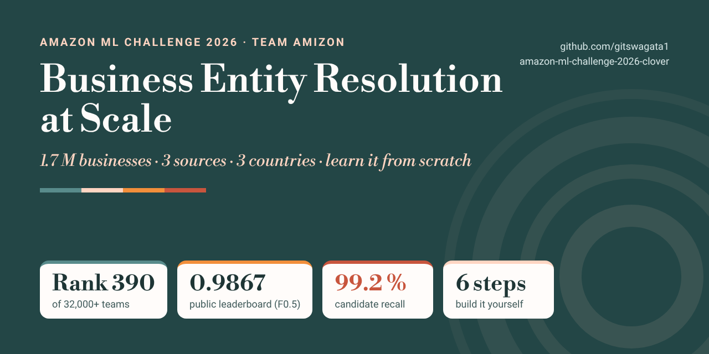
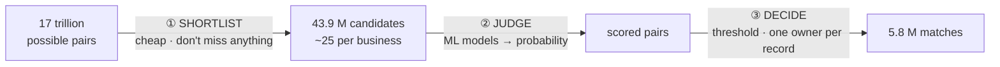
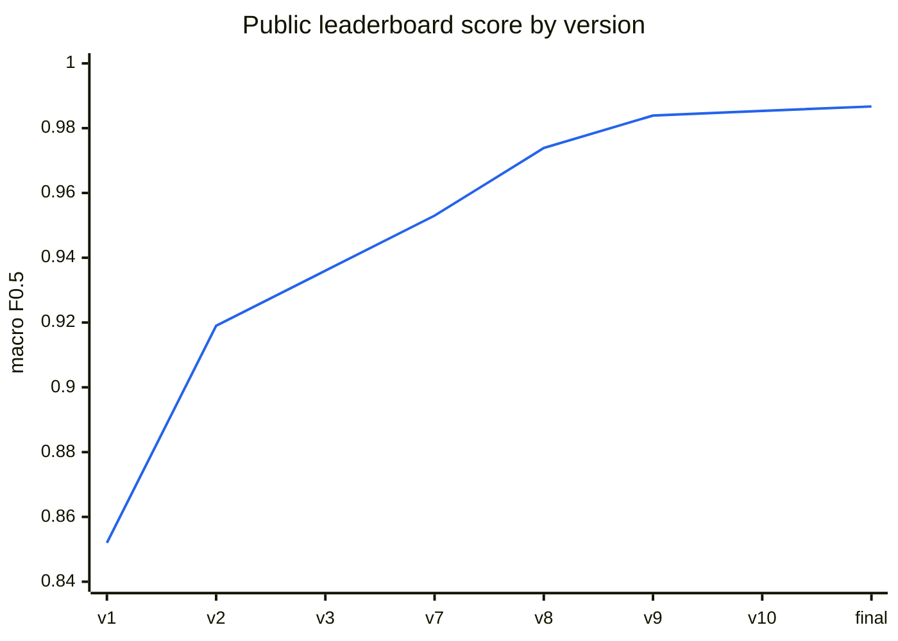
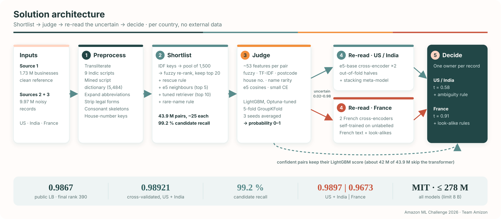

<p align="center">
  
</p>

<p align="center">
  
  
  
  
  
  
  <br>
  <a href="https://colab.research.google.com/github/gitswagata1/amazon-ml-challenge-2026-clover/blob/main/notebooks/build_from_scratch.ipynb"></a>
  <a href="https://github.com/gitswagata1/amazon-ml-challenge-2026-clover/actions/workflows/examples.yml"></a>
</p>

<p align="center"><b>Which of 10 million messy records belong to the same real business?</b><br>
We answered it for 1.7 million businesses across three countries, one of which had no training data,
and documented every step so you can rebuild it from scratch.</p>

<p align="center">
  <a href="docs/start-here.md"><b>New to ML</b></a> ·
  <a href="TECHNICAL.md"><b>Technical deep dive</b></a> ·
  <a href="#8-start-here"><b>Run it</b></a> ·
  <a href="#2-why-it-matters"><b>Business view</b></a> ·
  <a href="presentation/"><b>Pitch deck</b></a>
</p>

---

## Contents

1. [The problem](#1-the-problem)
2. [Why it matters](#2-why-it-matters)
3. [The gap: why this is still hard](#3-the-gap-why-this-is-still-hard)
4. [Our approach](#4-our-approach)
5. [The journey](#5-the-journey)
6. [The solution](#6-the-solution)
7. [Results and impact](#7-results-and-impact)
8. [Start here](#8-start-here)
9. [Repository](#9-repository)
10. [Reproduce the submission](#10-reproduce-the-submission)
11. [Credits and licence](#11-credits-and-licence)

---

## 1. The problem

Amazon gave us business records from **three independent sources** describing the same real businesses, with **no shared ID**:

| Source | Name | Address |
|---|---|---|
| 1 (clean reference) | Sharma Traders Private Limited | 12, MG Road, Indiranagar, Bengaluru 560038 |
| 2 | SHARMA TRADERS PVT LTD | 12 M.G. Rd, Bangalore |
| 3 | शर्मा ट्रेडर्स | Near SBI ATM, MG Road, 560038 |
| 3 | Sharma Trading Services | 14 MG Road, Bengaluru *(a different business next door)* |

**The competition.** Amazon ML Challenge 2026 drew **89,000+ registrations** and **32,000+ teams**, who had
**72 hours** (25–27 September 2026) to build a solution. Amazon describes it as a problem its own scientists work on.
Beyond the leaderboard, entries were checked for plagiarism and through manual review of approach notes and code, and
about 103 teams were disqualified.

**Task.** For each of the **1,732,544** Source 1 businesses in the test set, list every matching record among the
**9.97 M** records of Sources 2 and 3. A business can have zero, one or many matches.

**Data.** Only four columns: `entity_id`, `business_name`, `business_address`, `country`. Training covers US and India,
with answers. The test set adds **France, with no training examples at all**.

**Metric: macro F0.5.** Score every business, then average. Precision counts twice as much as recall.
*Example:* truth = {A, B}; we predict {A, B, X} → precision 2/3, recall 1 → **0.714**. Predicting only {A} scores **0.833**:
missing a copy is better than adding a wrong one. More in [docs/problem.md](docs/problem.md) and the [official problem statement (PDF)](problem-statement/Amazon-ML-Challenge-2026-Problem-Statement.pdf).

**Rules.** No external data or APIs · models MIT or Apache 2.0 and ≤ 8 B parameters · a 72-hour window · smaller
candidate sets ranked higher in the final evaluation.

---

## 2. Why it matters

Every large company holds the same customer, supplier or seller several times over, typed differently by different
systems. Deciding which records are the same entity is **entity resolution**. Both kinds of mistake cost money:

| Mistake | What it means | Typical consequences |
|---|---|---|
| **False merge** (two businesses treated as one) | precision error | payments, reviews or compliance flags land on the wrong business; one firm sees another's data |
| **Missed match** (one business split in two) | recall error | duplicate vendors, double payments, fragmented spend and risk views, onboarding repeated |

Where it shows up: **marketplaces** (seller identity and trust), **procurement** (vendor master data and spend
analytics), **banking** (know-your-customer and anti-money-laundering checks), **CRM** (one customer, one record), and
**government registries**. The competition's precision-heavy metric mirrors this: a false merge is usually the more
dangerous mistake.

---

## 3. The gap: why this is still hard

| Why entity resolution isn't solved | What it looked like here |
|---|---|
| **No shared identifier.** Records must be linked by content alone | names and addresses were the only evidence |
| **Noisy, multilingual text.** One name, many spellings | abbreviations, typos, `Freed0m`, legal suffixes, 9 Indian scripts, French accents and conventions |
| **Scale.** You can't compare everything with everything | 1.7 M × 10 M ≈ **17 trillion** pairs; real platforms hold billions of records |
| **Look-alikes.** Similar ≠ same | planted decoys: same name + one word, at a nearby house number |
| **Unseen domains.** New markets arrive without labels | France: 15 % of the test, zero training examples, 10–40× more look-alikes |
| **Asymmetric cost.** Wrong merges do real damage | F0.5 forces "match" only when very sure |
| **Missing information.** Sometimes the answer isn't in the data | 52 % of our hardest misses had an **empty address** and a common name |

**The real gap was doing all of this at once:** near-complete recall from a *small* candidate set, high precision against
deliberate traps, and transfer to a country with no labels.

---

## 4. Our approach



1. **Shortlist** ~25 plausible candidates per business, cheaply, without losing true matches.
2. **Judge** each pair with machine learning, which gives the probability that both records are the same business.
3. **Decide** cautiously: accept only confident pairs, and give each record to at most one business.
4. **France gets its own path**, because it has no labels.

**The key insight:** if the shortlist misses a match, nothing later can recover it. Our biggest jumps came from better
shortlists, not better models. See [TECHNICAL §1](TECHNICAL.md#1-how-to-think-about-the-problem)

---

## 5. The journey

72 hours · 29 leaderboard uploads · 10 pipeline versions · 30+ ideas measured and rejected.



| Step | What we tried | What went right | What went wrong | Lesson |
|---|---|---|---|---|
| **v1–v3** · day 1 | keyword blocking, fuzzy re-rank, address keys | recall 81 → 93 %, LB 0.852 → 0.936 | a learned re-ranker raised recall but *lowered* the score | more candidates can mean harder traps |
| **v7** · day 2 | tuning, embeddings, small cross-encoder | cross-encoder +0.0077; tuning +0.0028 | CatBoost, blends, extra features: no gain. Rank ~1,069 | models that read the *words* beat numbers about words |
| **v8** | bigger pool, address word-pair keys, all data | recall 96.6 %, **LB +0.021** | France ≈ 0.94 vs ~0.98 elsewhere | recall is the ceiling; find your unseen subgroup |
| **v9** · overnight | native-script dictionary, rescue rule, neighbours, rarity, re-ranker | CV 0.98693 | the build script deadlocked itself for 70 min | automate, but wait on the right signal |
| **France** · day 3 | look-alike rules, French self-training | **+0.0075** and **+0.011** on France | plain pseudo-labelling had failed; e5-large hurt France | synthetic hard negatives beat pseudo-labels |
| **v10** | fine-tuned retriever, 3 seeds | recall **99.2 %**, CV 0.98921 | hurt France; out-of-memory crash; power cut; stale Kaggle data; GPU quota | cache everything, verify inputs, budget compute |
| **final** | US/India from v10 + France from v9, French threshold 0.91 | **LB 0.986691** | France still 0.9673 | plan for the unseen part from day 1 |

Day-by-day timeline, every incident and all 29 uploads: **[docs/journey.md](docs/journey.md)**

---

## 6. The solution

<p align="center"></p>

- **Robust text cleaning:** 9 Indian scripts, a dictionary mined from training pairs, digit-for-letter typos and French
  conventions, using only the Python standard library.
- **Recall under a budget:** five candidate sources find 99.2 % of true matches with ~25 candidates per business.
- **A fast, strong judge:** LightGBM over ~53 features. *How rare a name is* proved the most valuable single signal.
- **Transformers only where they pay:** multilingual e5 cross-encoders re-read the ~1.5 M uncertain pairs, not all 43.9 M.
- **A country with no labels:** French models trained on 885,573 pairs built from unlabelled French text, with synthetic
  look-alikes that imitate the data generator.
- **Numbers you can trust:** grouped cross-validation and out-of-fold models. For US/India, CV (0.98921) matched the
  leaderboard (0.9897).

Every stage, model, setting and trade-off: **[TECHNICAL.md](TECHNICAL.md)**

---

## 7. Results and impact

| Measure | Result |
|---|---|
| Final rank | **390** of 32,000+ teams (Top 500) |
| Public leaderboard (macro F0.5) | **0.986691** |
| Field | 32,000+ teams from 89,000+ registrations, 72 hours |
| Cross-validated, US + India | 0.98921 |
| Leaderboard split (diagnostic upload) | **US/India 0.9897** · **France 0.9673** |
| Candidate recall · candidates per business | 99.2 % · ~25 (43.9 M test pairs) |
| Submission | 1,732,544 rows · 5,797,017 links · 5.81 % predicted singletons |

**What moved the score most** (measured gains, largest first):

| # | Lever | Measured gain |
|---|---|---|
| 1 | **Finding more true candidates** (v7 → v8: bigger pool, address keys, all training data) | **+0.020 CV**, +0.021 LB |
| 2 | Small multilingual cross-encoder as a feature | +0.0077 CV |
| 3 | Name-rarity features | +0.0038 CV |
| 4 | Hyperparameter tuning (Optuna) | +0.0028 CV |
| 5 | French self-trained cross-encoder | +0.0017 LB overall (≈ +0.011 on France) |

**What we'd do next:** almost the whole gap to the top 10 is France (≈ +0.003 if France matched US/India). The plan:
synthetic French training data from labelled US/India pairs, a France-aware retriever, and an open LLM judge for French
look-alikes. [TECHNICAL §8](TECHNICAL.md#8-gap-analysis-why-we-did-not-rank-higher)

---

## 8. Start here

**No install.** Open the 6-step notebook in Colab and run it top to bottom (about 15 seconds).
[](https://colab.research.google.com/github/gitswagata1/amazon-ml-challenge-2026-clover/blob/main/notebooks/build_from_scratch.ipynb)

**On your laptop**, the whole idea in miniature runs in about 5 seconds:

```bash
git clone https://github.com/gitswagata1/amazon-ml-challenge-2026-clover.git
cd amazon-ml-challenge-2026-clover
pip install -r examples/requirements.txt          # numpy, scikit-learn
python examples/toy_entity_resolution.py          # data → shortlist → features → model → decisions → score
```

```text
[blocking] 30000 candidate pairs (10.0 per S1) instead of 26,628,000 all-pairs; candidate recall 92.7%
[baseline] rule 'name similarity >= 0.8'            -> macro F0.5 0.3980   (many businesses share a name!)
[baseline] rule 'name >= 0.8 AND same house number' -> macro F0.5 0.8587   (misses copies with no address)
[model]    best threshold 0.80 (chosen on out-of-fold predictions) -> macro F0.5 0.9361
```

**Reading paths**

| If you are | Read |
|---|---|
| **New to ML** | [Start here](docs/start-here.md) → [The problem](docs/problem.md) → [Build it in 6 steps](docs/build-guide.md) → [TECHNICAL §0–3](TECHNICAL.md) → [Exercises](docs/learning-track.md) |
| **Presenting it** (faculty, guide, class) | [Pitch deck](presentation/) → [10-minute debrief script](docs/debrief-script.md) → [The journey](docs/journey.md) |
| **An ML engineer or recruiter** | This README → [TECHNICAL.md](TECHNICAL.md) → [Code walkthrough](docs/code-walkthrough.md) → [`code/`](code/business_entity_resolution/) |
| **Business or product** | [Why it matters](#2-why-it-matters) → [Results](#7-results-and-impact) → [TECHNICAL §9: adapting it to your data](TECHNICAL.md#9-scaling-production-and-adapting-it-to-your-data) |

---

## 9. Repository

```text
.
├── README.md                     you are here
├── TECHNICAL.md                  the deep dive: architecture, stages, models, validation, errors, decisions, glossary
├── code/business_entity_resolution/
│   ├── reproduce.py              one command runs the whole competition pipeline
│   ├── src/                      preprocessing, blocking, features, embeddings, cross-encoders, driver, tuning
│   └── src/pipeline/             candidates, extra features, classifier, re-ranking, France, decisions
├── experiments/                  60+ A/B tests, simulations and Kaggle kernels from the 72 hours
├── logs/
│   ├── submissions.md            all 29 leaderboard uploads and every rejected idea, with scores
│   ├── work-log.md               the live plan: tracks, machines, incidents, decisions
│   └── methodology-submitted.md  the methodology document submitted with the final package
├── docs/                         start here, problem, data, build guide, journey, lessons, exercises,
│                                 code walkthrough, debrief script, open questions
├── examples/                     laptop-runnable: metric · mini pipeline · 6-step solution
├── tests/                        unit tests for the pipeline's normalisation, blocking keys and features
├── notebooks/                    the 6-step build guide as a Colab notebook
├── presentation/                 21-slide pitch deck (PDF + PowerPoint with speaker notes)
├── problem-statement/            the official problem statement (PDF)
└── .github/workflows/            CI: runs every example and the notebook on each push
```

---

## 10. Reproduce the submission

<details>
<summary><b>Full reproduction</b> (needs the competition data, a 16 GB CUDA GPU, ~40 GB RAM, Python 3.12)</summary>

<br>

```bash
git clone https://github.com/gitswagata1/amazon-ml-challenge-2026-clover.git
cd amazon-ml-challenge-2026-clover
pip install -r code/business_entity_resolution/requirements.txt -r code/business_entity_resolution/requirements-gpu.txt
python code/business_entity_resolution/reproduce.py --data /path/to/student_resource
```

`--data` is the organisers' `student_resource/` folder (with `dataset/` and `utils/`). Each stage caches its output,
so an interrupted run resumes where it stopped. The dataset belongs to Amazon and is not included.

</details>

**Tech stack:** Python 3.12 · Polars · NumPy · RapidFuzz · scikit-learn · LightGBM · Optuna · PyTorch · Hugging Face
`transformers` 4.57.6 · `intfloat/multilingual-e5-small` (118 M) and `-base` (278 M), MIT licensed.

---

## 11. Credits and licence

Competition pipeline co-developed with [**Martial-Gautam**](https://github.com/Martial-Gautam). Analysis, documentation, teaching material, notebook,
diagrams and pitch deck by [**gitswagata1**](https://github.com/gitswagata1).

Every number in this repository comes from the team's logs ([`logs/`](logs/)). Anything we could not verify is
listed in [docs/open-questions.md](docs/open-questions.md). The official problem statement is included for reference.
The competition dataset is not included. Changes are tracked in [CHANGELOG.md](CHANGELOG.md).

Licensed under the [MIT Licence](LICENSE).
