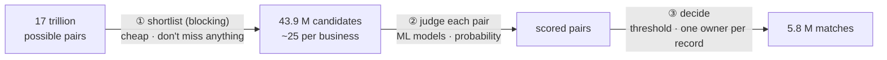
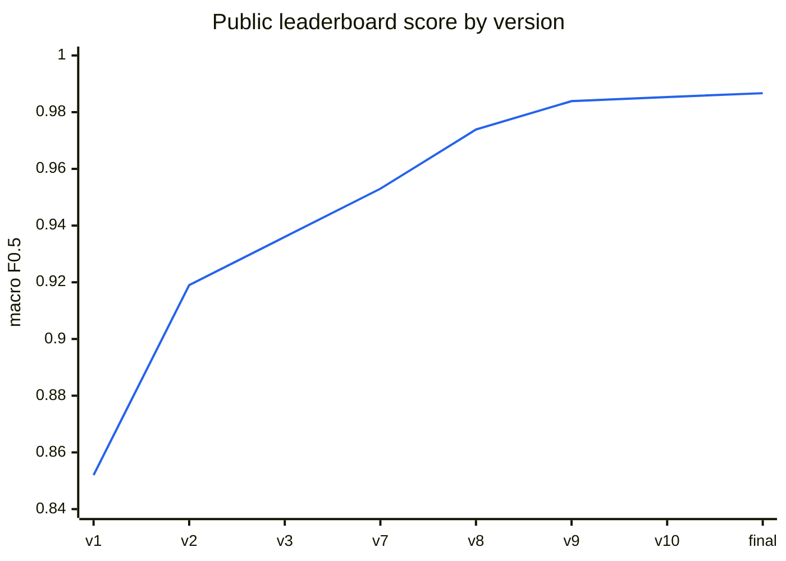
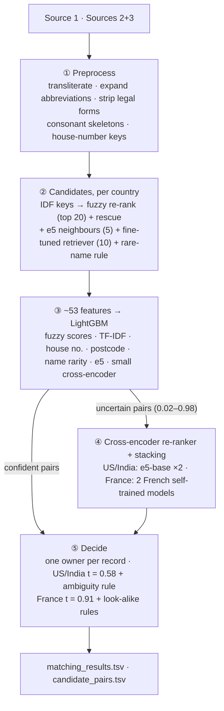

<div align="center">

# Business Entity Resolution at Scale
### Amazon ML Challenge 2026 · Team Amizon · Top 500 nationally

**Find every noisy copy of 1.7 million businesses across three data sources and three countries,<br>
one of which (France) never appears in the training data.**

-0.986691-2563eb)


[Problem](#1-the-amazon-problem-statement) · [The gap](#2-the-gap-why-this-is-still-hard) · [Our framing](#3-our-problem-in-short) · [Journey](#4-the-journey) · [Solution](#5-the-solution) · [Start learning](#6-start-learning-here) · [**Technical deep dive →**](TECHNICAL.md)

</div>

---

## 1. The Amazon problem statement

Amazon gave us business records from **three independent sources** that describe the same real businesses, with **no
shared ID**:

| Source | Name | Address |
|---|---|---|
| 1 (clean reference) | Sharma Traders Private Limited | 12, MG Road, Indiranagar, Bengaluru 560038 |
| 2 | SHARMA TRADERS PVT LTD | 12 M.G. Rd, Bangalore |
| 3 | शर्मा ट्रेडर्स | Near SBI ATM, MG Road, 560038 |
| 3 | Sharma Trading Services | 14 MG Road, Bengaluru *(a different business next door!)* |

**The task:** for each of the **1,732,544** Source 1 businesses in the test set, list every matching record among the
**9.97 M** records of Sources 2 and 3. A business can have zero, one or many matches.

- **Data:** only four columns (`entity_id`, `business_name`, `business_address`, `country`). Training covers US and India,
  with answers. The test set adds **France, with no training examples**.
- **Metric: macro F0.5.** Score each business, then average. F0.5 weights **precision twice as much as recall**, so a
  wrong merge hurts more than a missed match. A business with no matches scores 1 only if we predict nothing.
- **Rules:** no external data or APIs; models must be MIT or Apache 2.0 licensed with ≤ 8 B parameters; a 72-hour window;
  and smaller candidate sets ranked higher in the final evaluation.

→ Full explanation with worked examples: [docs/problem.md](docs/problem.md) · the data: [docs/data.md](docs/data.md)

---

## 2. The gap: why this is still hard

Entity resolution (deciding which records refer to the same real-world thing) has been studied for decades, yet every
large platform still struggles with it:

| Why it isn't solved | What it looked like here |
|---|---|
| **No shared identifier.** Records must be linked by their content alone | names and addresses were the only evidence |
| **Noisy, multilingual text.** The same name is written many ways | abbreviations, typos, `Freed0m`, legal suffixes, 9 Indian scripts, French accents and conventions |
| **Scale.** Comparing everything with everything is impossible | 1.7 M × 10 M ≈ **17 trillion** pairs; real platforms have billions of records |
| **Look-alike businesses.** Similar is not the same | the data planted decoys: same name + one word, at a nearby house number |
| **Unseen domains.** New countries arrive without labels | France: 15 % of the test, zero training examples, 10–40× more look-alikes |
| **Asymmetric cost.** A wrong merge does real damage | F0.5 forces the system to say "match" only when very sure |
| **Missing information.** Sometimes the answer isn't in the data | 52 % of our hardest misses had an **empty address** and a common name |

The exact gap for this challenge was **doing all of this at once**: high recall from a tiny candidate set, high precision
against deliberate look-alikes, and transfer to a country with no labels.

---

## 3. Our problem, in short

We framed it as **"shortlist, judge, decide"**:



1. **Shortlist** ~25 plausible candidates per business, cheaply, without losing true matches.
2. **Judge** each candidate pair with machine learning, which outputs the probability it's the same business.
3. **Decide** cautiously: accept only confident pairs, and give each record to at most one business.
4. **France gets its own path**, because it has no labels.

Key insight: **if the shortlist misses a match, nothing later can recover it.** Our biggest jumps came from better
shortlists, not better models. → [TECHNICAL §1](TECHNICAL.md#1-how-to-think-about-the-problem)

---

## 4. The journey

72 hours, 29 leaderboard uploads, 10 pipeline versions, 30+ ideas measured and rejected.



| Step | What we tried | ✅ Went right | ❌ Went wrong | Lesson |
|---|---|---|---|---|
| **v1–v3** · day 1 | keyword blocking, fuzzy re-rank, address keys | recall 81 → 93 %, LB 0.852 → 0.936 | a learned re-ranker raised recall but lowered the score | more candidates can mean harder traps |
| **v7** · day 2 | tuning, embeddings, small cross-encoder | cross-encoder +0.0077; tuning +0.0028 | CatBoost, blends, extra features: no gain. Rank ~1,069 | models that *read words* beat numbers about words |
| **v8** | bigger pool, address word-pair keys, all data | recall 96.6 %, **LB +0.021** | France ≈ 0.94 vs ~0.98 elsewhere | recall is the ceiling; find your unseen subgroup |
| **v9** · overnight | dictionary, rescue rule, neighbours, rarity, re-ranker | CV 0.98693 | a build script deadlocked itself for 70 min | automate, but wait on the right signal |
| **France** · day 3 | look-alike rules, French self-training | **+0.0075** and **+0.011** on France | plain pseudo-labelling had failed; e5-large hurt France | synthetic hard negatives beat pseudo-labels |
| **v10** | fine-tuned retriever, 3 seeds | recall **99.2 %**, CV 0.98921 | hurt France; out-of-memory crash; power cut; stale Kaggle data; GPU quota | cache everything, verify inputs, budget compute |
| **final** | US/India from v10 + France from v9, French threshold 0.91 | **LB 0.986691**; US/India 0.9897 | France still 0.9673, roughly the gap to the top 10 | plan for the unseen part from day 1 |

→ Full story, every failure and all 29 uploads: [docs/journey.md](docs/journey.md)

---

## 5. The solution



- **Text cleaning** that handles 9 Indian scripts, a dictionary mined from training pairs, digit-for-letter typos and
  French address conventions, using only the Python standard library.
- **Five candidate sources** under a size budget: 99.2 % of true matches found with ~25 candidates per business.
- **LightGBM** (gradient-boosted trees) over ~53 features. Name *rarity* was the strongest single feature (+0.0038).
- **Multilingual transformers** (`intfloat/multilingual-e5`, MIT) re-read only the ~1.5 M uncertain pairs, and a small
  model stacks both opinions.
- **France without labels:** fine-tuned on 885,573 pairs built from unlabelled French text, with synthetic look-alikes
  that copy the data generator (≈ +0.011 on France).
- **Strict validation:** grouped cross-validation and out-of-fold neural models. CV matched the leaderboard for US/India.

→ Every stage, model, setting and trade-off: **[TECHNICAL.md](TECHNICAL.md)**

---

## 6. Start learning here

New to machine learning? This repo is designed to be your first complete ML project.

**Run the whole pipeline in miniature, in about 5 seconds:**

```bash
git clone https://github.com/gitswagata1/amazon-ml-challenge-2026-entity-resolution.git
cd amazon-ml-challenge-2026-entity-resolution
pip install -r examples/requirements.txt          # numpy, scikit-learn
python examples/f05_metric.py                     # the scoring rule, with worked examples
python examples/toy_entity_resolution.py          # data → blocking → features → model → decisions → score
```

```text
[blocking] 30000 candidate pairs (10.0 per S1) instead of 26,628,000 all-pairs; candidate recall 92.7%
[baseline] rule 'name similarity >= 0.8'            -> macro F0.5 0.3980   (many businesses share a name!)
[baseline] rule 'name >= 0.8 AND same house number' -> macro F0.5 0.8587   (misses copies with no address)
[model]    best threshold 0.80 (chosen on out-of-fold predictions) -> macro F0.5 0.9361
```

**Reading path:**

| Step | Read | You will learn |
|---|---|---|
| 1 | [docs/start-here.md](docs/start-here.md) | the four ideas that carry the whole project |
| 2 | [docs/problem.md](docs/problem.md) | entity resolution and the F0.5 metric |
| 3 | `examples/` (run and change them) | blocking, features, models, thresholds, by doing |
| 4 | [TECHNICAL.md §0–3](TECHNICAL.md) | the real architecture, pipeline and models |
| 5 | [docs/learning-track.md](docs/learning-track.md) | exercises from beginner to advanced, with answers |
| 6 | [docs/journey.md](docs/journey.md) + [docs/lessons.md](docs/lessons.md) | how real ML projects go wrong and recover |

---

## 7. Repository, reproduction, credits

```text
.
├── README.md                    ← you are here
├── TECHNICAL.md                 ← the deep dive: architecture, every stage and model, validation, errors, glossary
├── docs/
│   ├── start-here.md            ← how to use this repo to learn ML
│   ├── problem.md · data.md     ← the problem, metric, rules and data in plain words
│   ├── journey.md               ← timeline, every failure, all 29 leaderboard uploads
│   ├── lessons.md               ← checklist for the next ML hackathon
│   ├── learning-track.md        ← exercises with answers
│   ├── code-walkthrough.md      ← file-by-file, function-by-function map of the code
│   ├── debrief-script.md        ← a 10-minute spoken walkthrough for a group
│   └── open-questions.md        ← what isn't in the files yet
├── examples/                    ← runnable on any laptop: metric + mini pipeline
├── code/      → submodule: Martial-Gautam/Amazon-ML-Challenge-2026 (final submission package)
└── research/  → submodule: Martial-Gautam/Amizon (72-hour working repo: experiments, logs)
```

**Reproduce the real submission** (needs the competition data, a CUDA GPU with 16 GB, ~40 GB RAM, Python 3.12):

```bash
git clone --recurse-submodules https://github.com/gitswagata1/amazon-ml-challenge-2026-entity-resolution.git
cd amazon-ml-challenge-2026-entity-resolution/code
pip install -r code/business_entity_resolution/requirements.txt -r code/business_entity_resolution/requirements-gpu.txt
python code/business_entity_resolution/reproduce.py --data /path/to/student_resource
```

**Tech stack:** Python 3.12 · Polars · NumPy · RapidFuzz · scikit-learn · LightGBM · Optuna · PyTorch · Hugging Face
`transformers` 4.57.6 · `multilingual-e5-small` (118 M) and `-base` (278 M), MIT · Kaggle T4/P100 GPUs and a 32-core
workstation.

**Credits.** Team Amizon. The competition code and methodology are by Ranveer Gautam
([`Martial-Gautam`](https://github.com/Martial-Gautam)), Satyam Kumar Pandey and Shreepal, as listed in the team's
[methodology document](https://github.com/Martial-Gautam/Amazon-ML-Challenge-2026/blob/95b58b6f460fe362b6a4d2d362d3fb9845a1017c/Documentation_template.md).
Their code is linked as submodules, not copied: see
[Amazon-ML-Challenge-2026](https://github.com/Martial-Gautam/Amazon-ML-Challenge-2026) and
[Amizon](https://github.com/Martial-Gautam/Amizon). This documentation, the learning track and the examples are by
Swagata Banerjee ([`gitswagata1`](https://github.com/gitswagata1)). Every score and setting is taken from the team's
files. Anything we could not verify is marked `[not in the files]` and listed in
[docs/open-questions.md](docs/open-questions.md). The competition dataset is Amazon's and is not included.

**Licence:** [MIT](LICENSE), covering the docs and examples in this repository only.
