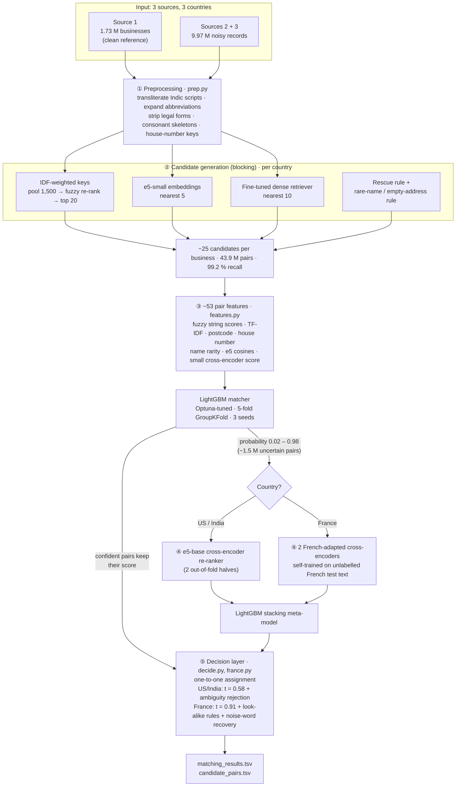
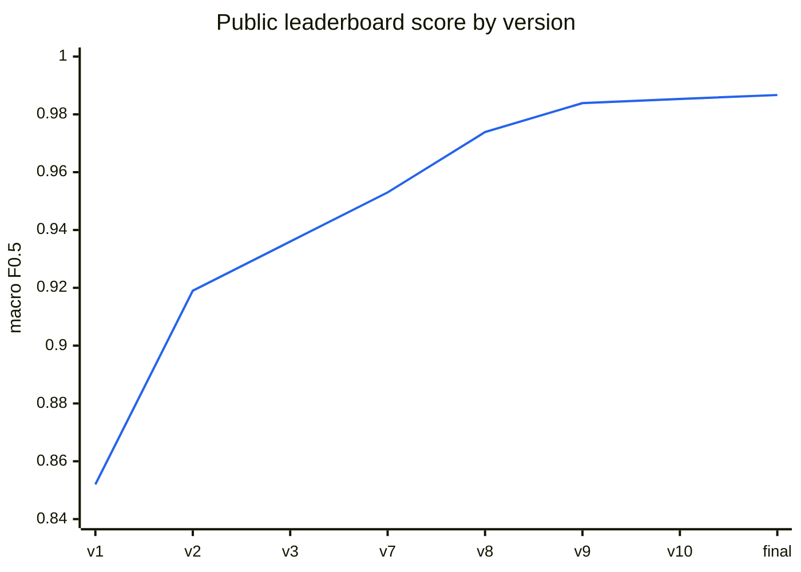

<div align="center">

# Business Entity Resolution at Scale
### Amazon ML Challenge 2026 · Team Amizon · Full post-mortem and learning guide

**Find every noisy copy of 1.7 million businesses across three data sources and three countries,<br>
one of which (France) never appears in the training data.**

| Public leaderboard (macro F0.5) | Cross-validated (US + India) | Candidate recall | Candidates per business | External data |
|:---:|:---:|:---:|:---:|:---:|
| **0.986691** | **0.98921** | **99.2 %** | **~25** | **none** |

*Team result: Top 500 nationally.*

[Start learning](docs/00-start-here.md) · [The problem](docs/01-problem.md) · [Architecture](#architecture) · [Pipeline deep dive](docs/04-pipeline.md) · [What went wrong](docs/07-bottlenecks.md) · [Team debrief script](docs/12-debrief-script.md)

</div>

---

## What this repository is

This is the **teaching and documentation companion** to our competition code. It explains, from zero, what Amazon
asked, how we thought about it, every model we built, every bug and dead end, and what we would do differently.

It is written for two readers:

1. **Someone new to machine learning** who wants to learn real-world ML by following one complete, top-500 solution
   from raw data to final submission. Every technical term is explained the first time it appears, and there is a
   [glossary](docs/11-glossary.md).
2. **Teammates and reviewers** who want the full technical picture, with links to the exact file and function in the
   code.

Two team repositories are linked here as Git submodules:

| Folder | Repository | What it is |
|---|---|---|
| [`code/`](code) | [`Martial-Gautam/Amazon-ML-Challenge-2026`](https://github.com/Martial-Gautam/Amazon-ML-Challenge-2026) | The clean, final submission package: `reproduce.py` plus source |
| [`research/`](research) | [`Martial-Gautam/Amizon`](https://github.com/Martial-Gautam/Amizon) | The working repo from the 72 hours: 209 commits, 60+ experiment scripts, the submission log (`SUBMISSIONS.md`) and the live plan (`WORKBOARD.md`) |

Everything in `docs/` and `examples/` is new and draws on both.

> **New to ML?** Run the toy pipeline first. It is the whole competition in 300 lines and runs on a laptop in 5 seconds:
> ```bash
> pip install numpy scikit-learn
> python examples/toy_entity_resolution.py
> ```

---

## The story in 60 seconds

Amazon gave us business records from **three sources** that describe the same real businesses in messy, different ways.
For example, *"Sharma Traders Pvt Ltd, 12 MG Rd"* in one source might be *"शर्मा ट्रेडर्स, 12 M.G. Road, Pune"* in another.
Source 1 is a clean reference list. For each of its 1.7 million businesses, we had to find every matching record in Sources 2 and 3.

Scoring punishes **wrong merges twice as hard as missed matches** (the F0.5 score). The test set also included
**France**, a country with zero training examples.

We built a five-stage pipeline:

1. **Clean** the text: transliterate Indian scripts, expand abbreviations, strip *Pvt Ltd / LLC / SARL*.
2. **Shortlist** about 25 plausible candidates per business out of 10 million, keeping 99.2 % of the true matches.
3. **Score** every candidate pair with a gradient-boosted tree model (LightGBM) over ~53 similarity features.
4. **Re-read** the uncertain pairs with a multilingual transformer (cross-encoder) that reads both records side by side.
5. **Decide** with a precision-tuned threshold, assigning each record to at most one business.

For France, we **taught the transformer French without any labels**, using its own confident predictions on the French
test data plus fake look-alike examples (self-training).

Final result: **0.9867** on the public leaderboard. US/India scored ~0.990 and France ~0.967, so France is where the
remaining points were lost.

---

## Architecture



The full stage-by-stage explanation, with what each stage added to the score, is in [docs/04-pipeline.md](docs/04-pipeline.md).

---

## Results

**How the score climbed** (CV = our own cross-validated macro F0.5 on 2.1 M training businesses):

| Version | Main change | Candidate recall | CV | Public LB |
|---|---|:---:|:---:|:---:|
| v1 | transliteration, composite-key blocking, LightGBM on 200k businesses | 81 % | 0.882 | 0.852 |
| v2 | pool of 300 + fuzzy re-rank to top 20, 400k businesses | 90 % | 0.937 | 0.919 |
| v3 | street-name / digit-drop address keys, pool 600 | 93.0 % | 0.9487 | 0.936 |
| v7 | TF-IDF, embeddings, tuned LightGBM, small cross-encoder | 92.6 % | 0.9603 | 0.953 |
| v8 | bigger candidate pool, address keys, all training data | 96.6 % | 0.9804 | 0.973867 |
| v9 | native-script dictionary, e5 neighbours, rarity features, re-ranker, French rules | 97.8 % | 0.98693 | 0.983893 |
| v10 | fine-tuned dense retriever, 3 seeds, threshold 0.58 | 99.2 % | 0.98921 | 0.985330 |
| **final** | US/India from v10, France from v9 + two French cross-encoders + French rules | 99.2 % | 0.98921 | **0.986691** |



Every big jump (v1 → v2 → v3, then v7 → v8 at +0.021 LB) came from **finding more true candidates**, not from a better
model. That is the most important lesson in this repository. [Why?](docs/03-thinking.md#the-recall-ceiling)

Mid-challenge, after v7 (LB 0.953), the team was ranked about **1,069th**. The candidate and France work from v8 onwards
moved it into the Top 500. The 29 leaderboard uploads are listed in [docs/07-bottlenecks.md](docs/07-bottlenecks.md#the-leaderboard-log).

---

## The good, the bad, the honest

| ✅ What worked | ❌ What did not / what hurt |
|---|---|
| Treating **candidate recall** as the ceiling and raising it step by step (81 % → 99.2 %) | France: **0.967 vs 0.990** for US/India. No labels, 10–40× more look-alike businesses |
| **Name rarity** features: "same name" means much more when the name is rare (+0.0038 CV, the biggest single feature) | French **recall ≈ 0.90**: French noise patterns never seen in training |
| **Out-of-fold everything**: no model ever scored data it trained on, so CV matched the leaderboard for US/India | The dense retriever **hurt France** (−0.004): its extra French candidates were mostly look-alikes |
| A **native-script dictionary** mined from training pairs (குளோபல் → *global*) | **56 % of the error** (v8) came from true matches blocking never found, and half of those had an empty address |
| **Self-training** a cross-encoder on unlabelled French text plus synthetic look-alikes (≈ +0.011 on France) | 30+ ideas measured and **rejected**: CatBoost, LambdaRank, pair chaining, e5-large, plain pseudo-labelling, a 2nd self-training round… |
| A one-command, resumable, cached pipeline (`reproduce.py`) and a written log of every experiment | Needs a 16 GB GPU, ~40 GB RAM, and many GPU hours. Survived a power cut, an out-of-memory crash and a stale Kaggle dataset |
| A strict noise bar: keep a change only if CV gains > +0.0005 | France threshold (0.91) had to be tuned **against the public leaderboard** (7 uploads), which risks overfitting the public split |

The full list, with diagnoses, is in [docs/07-bottlenecks.md](docs/07-bottlenecks.md). An honest comparison with what
top teams likely did is in [docs/09-gap-analysis.md](docs/09-gap-analysis.md).

---

## Documentation map

Read in order if you are learning. Jump around if you are reviewing.

| # | Chapter | What you will learn |
|---|---|---|
| 00 | [Start here](docs/00-start-here.md) | How to use this repo to learn ML, reading paths, prerequisites |
| 01 | [The problem in plain English](docs/01-problem.md) | Entity resolution, the F0.5 metric with worked examples, the rules |
| 02 | [The data](docs/02-data.md) | What we were given, the noise, EDA findings, a profile of our submission |
| 03 | [How to think about it](docs/03-thinking.md) | The mental model *before* writing code: blocking vs matching, the recall ceiling |
| 04 | [The pipeline, step by step](docs/04-pipeline.md) | Every stage, what it does, why, and what it changed in the score |
| 05 | [The models](docs/05-models.md) | LightGBM, e5 embeddings, dense retriever, cross-encoders, stacking. What and why |
| 06 | [France: learning a country with no labels](docs/06-france.md) | Domain adaptation, self-training, synthetic hard negatives, look-alike rules |
| 07 | [Bottlenecks and failures](docs/07-bottlenecks.md) | What broke, how we found out, what fixed it |
| 08 | [Key decisions and trade-offs](docs/08-decisions.md) | The 8 decisions that mattered most |
| 09 | [Why we did not rank higher](docs/09-gap-analysis.md) | Gap analysis (informed opinion, clearly labelled) |
| 10 | [Lessons for the next hackathon](docs/10-lessons.md) | A practical checklist |
| 11 | [Glossary](docs/11-glossary.md) | Every term, one line each |
| 12 | [10-minute team debrief script](docs/12-debrief-script.md) | A spoken walkthrough to present to the group |
| 13 | [Code walkthrough](docs/13-code-walkthrough.md) | File-by-file and function-by-function map, how to run it |
| 14 | [Learning track and exercises](docs/14-learning-track.md) | Hands-on exercises from beginner to advanced |
| 15 | [Open questions](docs/15-open-questions.md) | What is not in the files yet |

---

## Repository layout

```text
.
├── README.md                     ← you are here
├── docs/                         ← 16 chapters (00–15), plain-language with technical depth
├── examples/
│   ├── f05_metric.py             ← the competition metric with worked examples (stdlib only)
│   └── toy_entity_resolution.py  ← the full pipeline in miniature, runs in ~5 s
├── code/                         ← submodule → Martial-Gautam/Amazon-ML-Challenge-2026 (final submission package)
│   └── code/business_entity_resolution/
│       ├── reproduce.py          ← one command runs every stage
│       ├── src/                  ← prep, blocking, features, embeddings, cross-encoders, driver, tuning
│       └── src/pipeline/         ← candidates, extra features, classifier, re-rank, France, decide
└── research/                     ← submodule → Martial-Gautam/Amizon (the 72-hour working repo)
    ├── SUBMISSIONS.md            ← every leaderboard upload and every rejected experiment, with scores
    ├── WORKBOARD.md              ← the live plan: owners, machines, decisions, incidents
    └── experiments/              ← 60+ A/B tests, simulations and Kaggle kernels
```

Clone with the code included:

```bash
git clone --recurse-submodules https://github.com/gitswagata1/amazon-ml-challenge-2026-entity-resolution.git
```

Reproducing the actual submission (needs the competition data, a CUDA GPU with 16 GB, ~40 GB RAM, Python 3.12):

```bash
cd amazon-ml-challenge-2026-entity-resolution/code
pip install -r code/business_entity_resolution/requirements.txt -r code/business_entity_resolution/requirements-gpu.txt
python code/business_entity_resolution/reproduce.py --data /path/to/student_resource
```

---

## Tech stack

Python 3.12 · Polars · NumPy · RapidFuzz · scikit-learn · SciPy · LightGBM · Optuna · PyTorch · Hugging Face
`transformers` (pinned to 4.57.6) · `intfloat/multilingual-e5-small` (118 M) and `-base` (278 M), both MIT licensed and far
below the 8 B parameter limit. Compute: a 32-core, 54 GB Linux machine plus Kaggle T4/P100 GPUs. No external data,
APIs or geocoding.

---

## Credits

**Team Amizon.** Competition code and original methodology: Ranveer Gautam (`Martial-Gautam`), Satyam Kumar Pandey,
Shreepal, as listed in the [team's methodology document](https://github.com/Martial-Gautam/Amazon-ML-Challenge-2026/blob/95b58b6f460fe362b6a4d2d362d3fb9845a1017c/Documentation_template.md).
This learning guide and the examples: Swagata Banerjee (`gitswagata1`).

All scores, versions and settings quoted here come from the team's code and documentation at commit
[`95b58b6`](https://github.com/Martial-Gautam/Amazon-ML-Challenge-2026/tree/95b58b6f460fe362b6a4d2d362d3fb9845a1017c).
The competition dataset is Amazon's and is not included.
