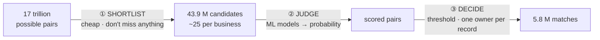
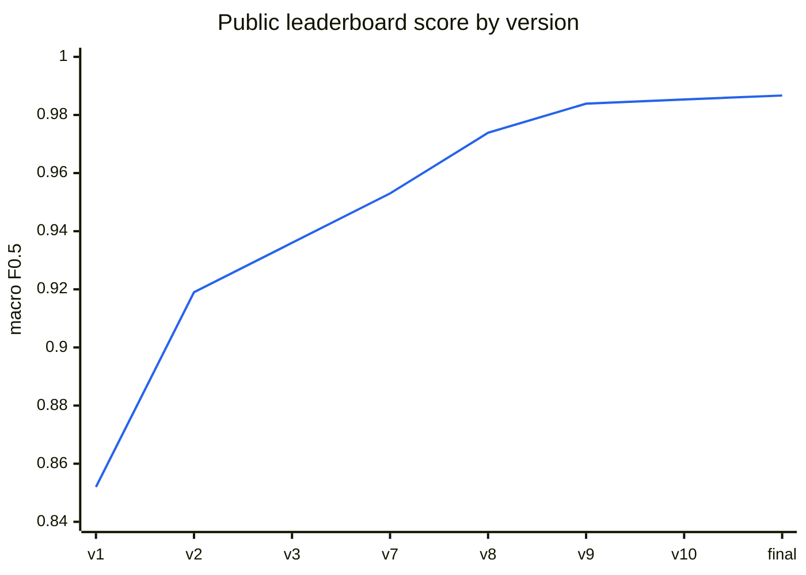

<div align="center">

# Business Entity Resolution at Scale
### Amazon ML Challenge 2026 · Team Amizon · Top 500 nationally

**Which of 10 million messy records belong to the same real business?**<br>
**We answered it for 1.7 million businesses across three countries, one of which had no training data.**

-0.986691-2563eb)


| 🌱 I'm new to ML | 🔬 I want the technical detail | ▶️ I want to run it | 💼 I want the business view | 🎤 I want to present it |
|:---:|:---:|:---:|:---:|:---:|
| [Start here](docs/start-here.md) → [build it in 6 steps](docs/build-guide.md) | [TECHNICAL.md](TECHNICAL.md) | [5-second demo](#8-start-here) | [Why it matters](#2-why-it-matters) · [adapting it](TECHNICAL.md#9-scaling-production-and-adapting-it-to-your-data) | [Pitch deck](presentation/) (PDF · PowerPoint) |

</div>

---

## 1. The problem

Amazon gave us business records from **three independent sources** describing the same real businesses, with **no shared ID**:

| Source | Name | Address |
|---|---|---|
| 1 (clean reference) | Sharma Traders Private Limited | 12, MG Road, Indiranagar, Bengaluru 560038 |
| 2 | SHARMA TRADERS PVT LTD | 12 M.G. Rd, Bangalore |
| 3 | शर्मा ट्रेडर्स | Near SBI ATM, MG Road, 560038 |
| 3 | Sharma Trading Services | 14 MG Road, Bengaluru ← *a different business next door* |

**Task.** For each of the **1,732,544** Source 1 businesses in the test set, list every matching record among the
**9.97 M** records of Sources 2 and 3. A business can have zero, one or many matches.

**Data.** Only four columns: `entity_id`, `business_name`, `business_address`, `country`. Training covers US and India,
with answers. The test set adds **France, with no training examples at all**.

**Metric: macro F0.5.** Score every business, then average. Precision counts twice as much as recall.
*Example:* truth = {A, B}; we predict {A, B, X} → precision 2/3, recall 1 → **0.714**. Predicting only {A} scores **0.833**:
missing a copy is better than adding a wrong one. → [worked examples](docs/problem.md)

**Rules.** No external data or APIs · models MIT or Apache 2.0 and ≤ 8 B parameters · a 72-hour window · smaller
candidate sets ranked higher in the final evaluation.

---

## 2. Why it matters

Every large company holds the same customer, supplier or seller several times over, typed differently by different
systems. Deciding which records are the same entity is **entity resolution**. Both kinds of mistake cost money:

| Mistake | What it means | Typical consequences |
|---|---|---|
| **False merge** (two businesses treated as one) | precision error | payments, reviews or compliance flags land on the wrong business; one firm sees another's data |
| **Missed match** (one business split in two) | recall error | duplicate vendors, double payments, fragmented spend and risk views, onboarding repeated |

Where it shows up: **marketplaces** (seller identity and trust), **procurement** (vendor master data and spend
analytics), **banking** (know-your-customer and anti-money-laundering checks), **CRM** (one customer, one record), and
**government registries**. The competition's precision-heavy metric mirrors this: a false merge is usually the more
dangerous mistake.

---

## 3. The gap: why this is still hard

| Why entity resolution isn't solved | What it looked like here |
|---|---|
| **No shared identifier.** Records must be linked by content alone | names and addresses were the only evidence |
| **Noisy, multilingual text.** One name, many spellings | abbreviations, typos, `Freed0m`, legal suffixes, 9 Indian scripts, French accents and conventions |
| **Scale.** You can't compare everything with everything | 1.7 M × 10 M ≈ **17 trillion** pairs; real platforms hold billions of records |
| **Look-alikes.** Similar ≠ same | planted decoys: same name + one word, at a nearby house number |
| **Unseen domains.** New markets arrive without labels | France: 15 % of the test, zero training examples, 10–40× more look-alikes |
| **Asymmetric cost.** Wrong merges do real damage | F0.5 forces "match" only when very sure |
| **Missing information.** Sometimes the answer isn't in the data | 52 % of our hardest misses had an **empty address** and a common name |

**The real gap was doing all of this at once:** near-complete recall from a *small* candidate set, high precision against
deliberate traps, and transfer to a country with no labels.

---

## 4. Our approach in one picture



1. **Shortlist** ~25 plausible candidates per business, cheaply, without losing true matches.
2. **Judge** each pair with machine learning, which gives the probability that both records are the same business.
3. **Decide** cautiously: accept only confident pairs, and give each record to at most one business.
4. **France gets its own path**, because it has no labels.

**The key insight:** if the shortlist misses a match, nothing later can recover it. Our biggest jumps came from better
shortlists, not better models. → [TECHNICAL §1](TECHNICAL.md#1-how-to-think-about-the-problem)

---

## 5. The journey

72 hours · 29 leaderboard uploads · 10 pipeline versions · 30+ ideas measured and rejected.



| Step | What we tried | ✅ Went right | ❌ Went wrong | Lesson |
|---|---|---|---|---|
| **v1–v3** · day 1 | keyword blocking, fuzzy re-rank, address keys | recall 81 → 93 %, LB 0.852 → 0.936 | a learned re-ranker raised recall but *lowered* the score | more candidates can mean harder traps |
| **v7** · day 2 | tuning, embeddings, small cross-encoder | cross-encoder +0.0077; tuning +0.0028 | CatBoost, blends, extra features: no gain. Rank ~1,069 | models that read the *words* beat numbers about words |
| **v8** | bigger pool, address word-pair keys, all data | recall 96.6 %, **LB +0.021** | France ≈ 0.94 vs ~0.98 elsewhere | recall is the ceiling; find your unseen subgroup |
| **v9** · overnight | native-script dictionary, rescue rule, neighbours, rarity, re-ranker | CV 0.98693 | the build script deadlocked itself for 70 min | automate, but wait on the right signal |
| **France** · day 3 | look-alike rules, French self-training | **+0.0075** and **+0.011** on France | plain pseudo-labelling had failed; e5-large hurt France | synthetic hard negatives beat pseudo-labels |
| **v10** | fine-tuned retriever, 3 seeds | recall **99.2 %**, CV 0.98921 | hurt France; out-of-memory crash; power cut; stale Kaggle data; GPU quota | cache everything, verify inputs, budget compute |
| **final** | US/India from v10 + France from v9, French threshold 0.91 | **LB 0.986691** | France still 0.9673 | plan for the unseen part from day 1 |

→ Day-by-day timeline, every incident and all 29 uploads: [docs/journey.md](docs/journey.md)

---

## 6. The solution

<p align="center"></p>

- **Robust text cleaning:** 9 Indian scripts, a dictionary mined from training pairs, digit-for-letter typos and French
  conventions, using only the Python standard library.
- **Recall under a budget:** five candidate sources find 99.2 % of true matches with ~25 candidates per business.
- **A fast, strong judge:** LightGBM over ~53 features. *How rare a name is* proved the most valuable single signal.
- **Transformers only where they pay:** multilingual e5 cross-encoders re-read the ~1.5 M uncertain pairs, not all 43.9 M.
- **A country with no labels:** French models trained on 885,573 pairs built from unlabelled French text, with synthetic
  look-alikes that imitate the data generator.
- **Numbers you can trust:** grouped cross-validation and out-of-fold models. For US/India, CV (0.98921) matched the
  leaderboard (0.9897).

→ Every stage, model, setting and trade-off: **[TECHNICAL.md](TECHNICAL.md)**

---

## 7. Results and impact

| Measure | Result |
|---|---|
| Public leaderboard (macro F0.5) | **0.986691** · Top 500 nationally |
| Cross-validated, US + India | 0.98921 |
| Leaderboard split (diagnostic upload) | **US/India 0.9897** · **France 0.9673** |
| Candidate recall · candidates per business | 99.2 % · ~25 (43.9 M test pairs) |
| Submission | 1,732,544 rows · 5,797,017 links · 5.81 % predicted singletons |

**What moved the score most** (measured gains, largest first):

| # | Lever | Measured gain |
|---|---|---|
| 1 | **Finding more true candidates** (v7 → v8: bigger pool, address keys, all training data) | **+0.020 CV**, +0.021 LB |
| 2 | Small multilingual cross-encoder as a feature | +0.0077 CV |
| 3 | Name-rarity features | +0.0038 CV |
| 4 | Hyperparameter tuning (Optuna) | +0.0028 CV |
| 5 | French self-trained cross-encoder | +0.0017 LB overall (≈ +0.011 on France) |

**What we'd do next:** almost the whole gap to the top 10 is France (≈ +0.003 if France matched US/India). The plan:
synthetic French training data from labelled US/India pairs, a France-aware retriever, and an open LLM judge for French
look-alikes. → [TECHNICAL §8](TECHNICAL.md#8-gap-analysis-why-we-did-not-rank-higher)

---

## 8. Start here

**Run the whole idea in miniature, on any laptop, in about 5 seconds:**

```bash
git clone https://github.com/gitswagata1/amazon-ml-challenge-2026-clover.git
cd amazon-ml-challenge-2026-clover
pip install -r examples/requirements.txt          # numpy, scikit-learn
python examples/toy_entity_resolution.py          # data → shortlist → features → model → decisions → score
```

```text
[blocking] 30000 candidate pairs (10.0 per S1) instead of 26,628,000 all-pairs; candidate recall 92.7%
[baseline] rule 'name similarity >= 0.8'            -> macro F0.5 0.3980   (many businesses share a name!)
[baseline] rule 'name >= 0.8 AND same house number' -> macro F0.5 0.8587   (misses copies with no address)
[model]    best threshold 0.80 (chosen on out-of-fold predictions) -> macro F0.5 0.9361
```

**Reading paths:**

| You are… | Path |
|---|---|
| 🌱 **New to ML** | [start here](docs/start-here.md) → [the problem](docs/problem.md) → [build it in 6 steps](docs/build-guide.md) → [TECHNICAL §0–3](TECHNICAL.md) → [exercises](docs/learning-track.md) |
| 👥 **A teammate presenting it** | [the problem](docs/problem.md) → [journey](docs/journey.md) → [TECHNICAL §0–2, §7](TECHNICAL.md) → [10-minute debrief script](docs/debrief-script.md) |
| 🔬 **ML engineer or recruiter** | this README → [TECHNICAL.md](TECHNICAL.md) → [code walkthrough](docs/code-walkthrough.md) |
| 🎤 **Pitching it** (faculty, guide, class) | [the 21-slide deck](presentation/) with speaker notes → [debrief script](docs/debrief-script.md) |
| 💼 **Business or product** | [§2 why it matters](#2-why-it-matters) → [§7 results](#7-results-and-impact) → [TECHNICAL §9: adapting it to your data](TECHNICAL.md#9-scaling-production-and-adapting-it-to-your-data) |

---

## 9. Repository, reproduction, credits

```text
.
├── README.md                    ← you are here
├── TECHNICAL.md                 ← the deep dive: architecture, every stage and model, validation, errors,
│                                  decisions, gap analysis, scaling and adaptation, glossary
├── docs/
│   ├── start-here.md            ← how to use this repo to learn ML
│   ├── problem.md · data.md     ← problem, metric, rules and data in plain words
│   ├── build-guide.md           ← rebuild the solution from scratch in 6 runnable steps
│   ├── learning-track.md        ← exercises from beginner to advanced, with answers
│   ├── journey.md               ← timeline, every incident, all 29 leaderboard uploads
│   ├── lessons.md               ← checklist for the next ML hackathon
│   ├── code-walkthrough.md      ← file-by-file, function-by-function map of the real code
│   ├── debrief-script.md        ← 10-minute talk + likely questions
│   └── open-questions.md        ← what isn't in the files yet
├── presentation/                ← 21-slide pitch deck: PDF + PowerPoint with speaker notes
├── examples/                    ← laptop-runnable: metric · mini pipeline · 6-step solution
├── code/      → submodule: Martial-Gautam/Amazon-ML-Challenge-2026 (final submission package)
└── research/  → submodule: Martial-Gautam/Amizon (72-hour working repo: experiments, logs)
```

**Reproduce the real submission** (needs the competition data, a CUDA GPU with 16 GB, ~40 GB RAM, Python 3.12):

```bash
git clone --recurse-submodules https://github.com/gitswagata1/amazon-ml-challenge-2026-clover.git
cd amazon-ml-challenge-2026-clover/code
pip install -r code/business_entity_resolution/requirements.txt -r code/business_entity_resolution/requirements-gpu.txt
python code/business_entity_resolution/reproduce.py --data /path/to/student_resource
```

**Tech stack:** Python 3.12 · Polars · NumPy · RapidFuzz · scikit-learn · LightGBM · Optuna · PyTorch · Hugging Face
`transformers` 4.57.6 · `multilingual-e5-small` (118 M) and `-base` (278 M), MIT licensed · Kaggle T4/P100 GPUs and a
32-core workstation.

**Credits.** Team Amizon. The competition code and methodology are by Ranveer Gautam
([`Martial-Gautam`](https://github.com/Martial-Gautam)), Satyam Kumar Pandey and Shreepal, as listed in the team's
[methodology document](https://github.com/Martial-Gautam/Amazon-ML-Challenge-2026/blob/95b58b6f460fe362b6a4d2d362d3fb9845a1017c/Documentation_template.md).
Their code is **linked, not copied**:
[Amazon-ML-Challenge-2026](https://github.com/Martial-Gautam/Amazon-ML-Challenge-2026) ·
[Amizon](https://github.com/Martial-Gautam/Amizon). This documentation, the build guide, the learning track and the
examples are by Swagata Banerjee ([`gitswagata1`](https://github.com/gitswagata1)). Every number comes from the team's
files. Anything unverified is marked `[not in the files]` and listed in [open questions](docs/open-questions.md). The
competition dataset belongs to Amazon and is not included.

**Changes:** see [CHANGELOG.md](CHANGELOG.md).

**Licence:** [MIT](LICENSE), covering the docs and examples in this repository only.
