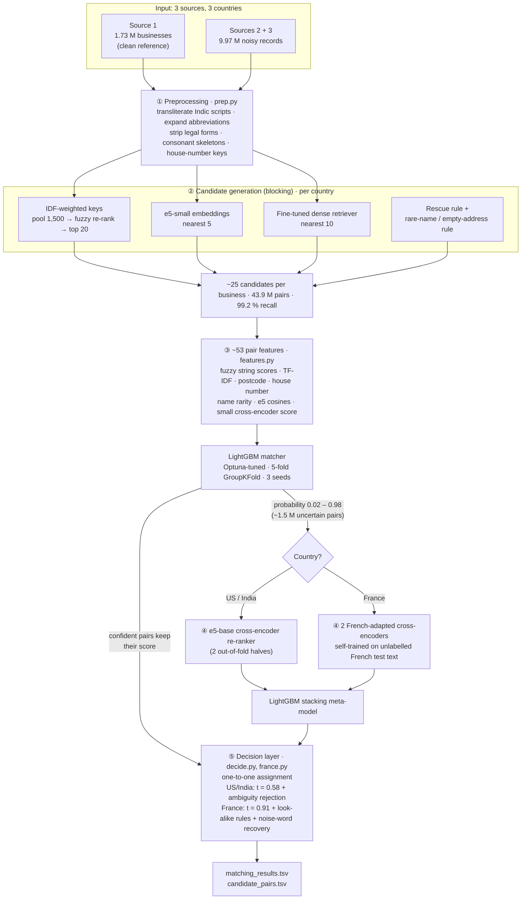
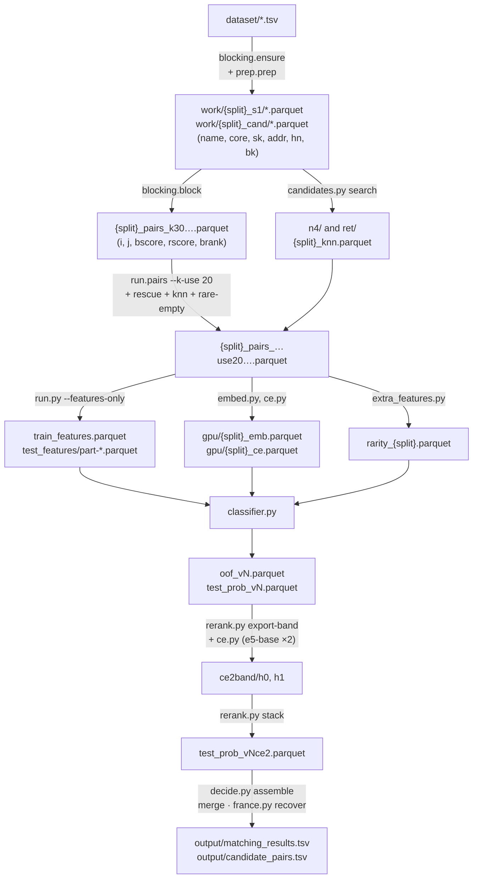
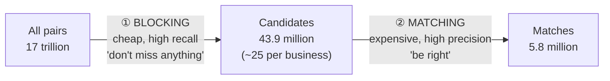
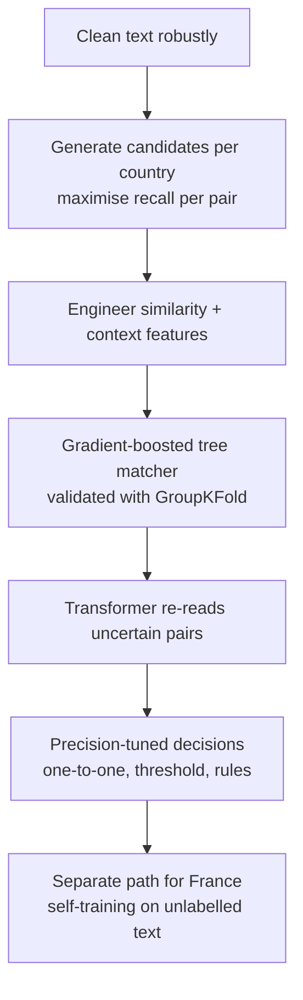
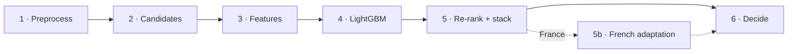
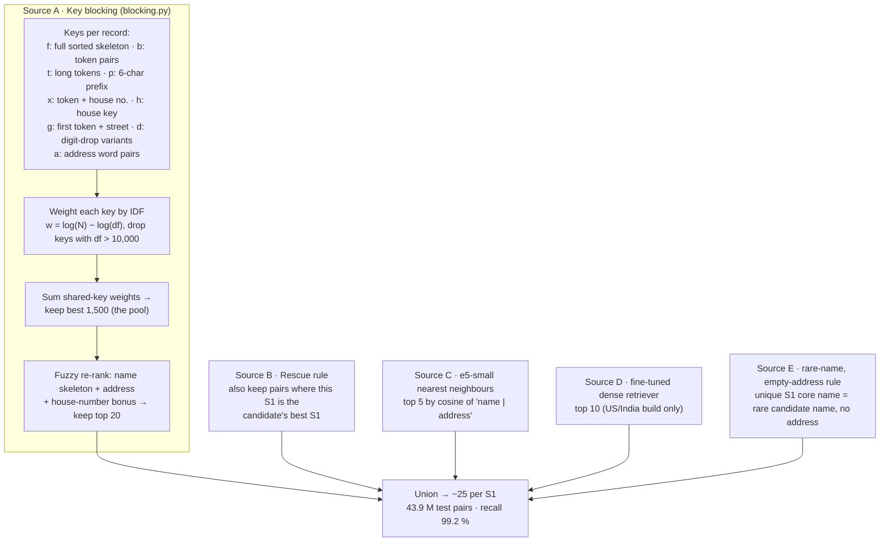
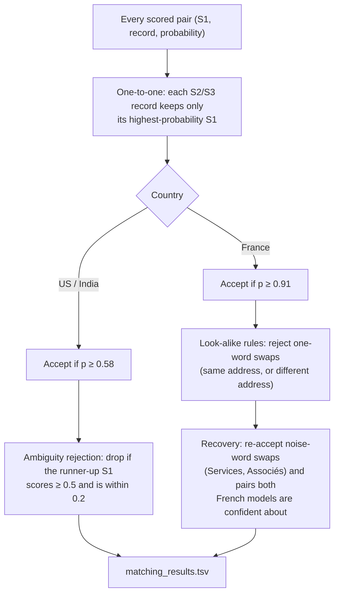
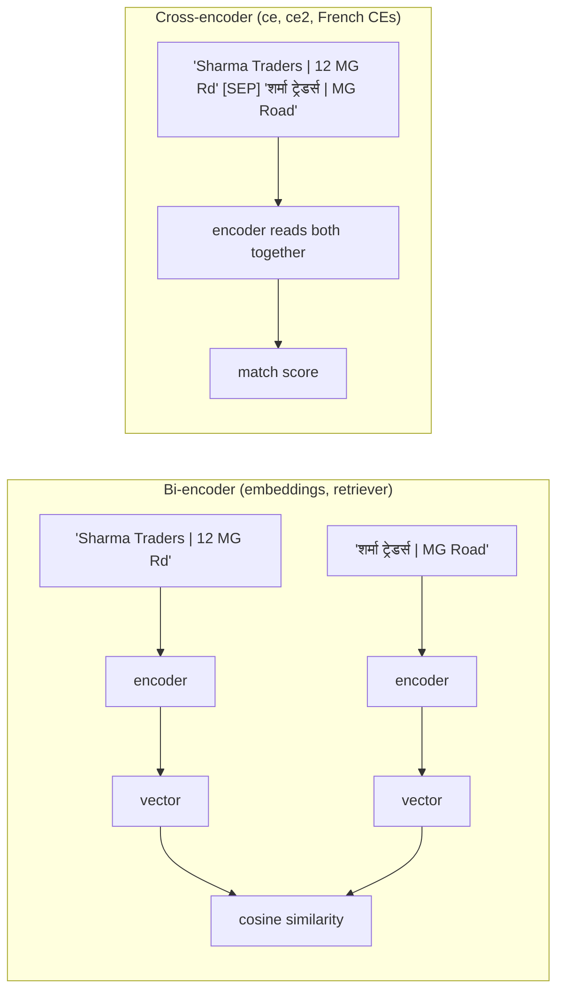
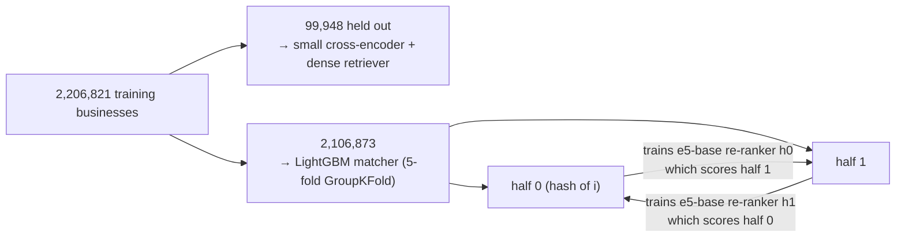
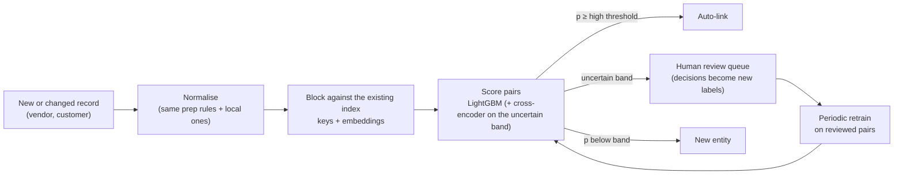

# Technical deep dive

**Amazon ML Challenge 2026 · Business Entity Resolution · Team Amizon**

This is the one document that explains the whole solution in depth: every stage, every model, the exact settings,
what each choice did to the score, how we validated it, and where it still fails. It is written so that you can follow
it **without an ML background**. Each idea is explained in plain words first, then given precisely. Every technical
term is defined the first time it appears and again in the [glossary](#10-glossary).

Code links point to the final package at commit
[`95b58b6`](https://github.com/Martial-Gautam/Amazon-ML-Challenge-2026/tree/95b58b6f460fe362b6a4d2d362d3fb9845a1017c)
(the `code/` submodule). Experiment evidence comes from the 72-hour working repo
[`Martial-Gautam/Amizon`](https://github.com/Martial-Gautam/Amizon) (the `research/` submodule), mainly `SUBMISSIONS.md`
and `WORKBOARD.md`.

| § | Section | One-line summary |
|---|---|---|
| 0 | [Architecture at a glance](#0-architecture-at-a-glance) | the five-stage funnel and the file-level data flow |
| 1 | [How to think about the problem](#1-how-to-think-about-the-problem) | pairwise classification, blocking vs matching, the recall ceiling |
| 2 | [The pipeline, stage by stage](#2-the-pipeline-stage-by-stage) | what, why, exact settings and score effect of each stage |
| 3 | [The models](#3-the-models) | LightGBM, embeddings, retriever, cross-encoders, stacking |
| 4 | [France: domain adaptation without labels](#4-france-domain-adaptation-without-labels) | self-training, synthetic look-alikes, rules, thresholds |
| 5 | [Validation and leakage prevention](#5-validation-and-leakage-prevention) | why our numbers can be trusted |
| 6 | [Error analysis](#6-error-analysis) | where the points were lost |
| 7 | [Key decisions and trade-offs](#7-key-decisions-and-trade-offs) | the eight choices that mattered |
| 8 | [Gap analysis](#8-gap-analysis-why-we-did-not-rank-higher) | why not top 10 (opinion, clearly labelled) |
| 9 | [Scaling, production and adapting it](#9-scaling-production-and-adapting-it-to-your-data) | the forward-deployed view: limits, reliability, new countries, company data |
| 10 | [Glossary](#10-glossary) | every term, one line each |

---

## 0. Architecture at a glance

The system has five stages. Each stage turns its input into something smaller and more certain, like a funnel.



### Data flow: which file feeds which

The architecture shows *ideas*. The data flow shows *files*. Every arrow is a file written to disk, which is why
an interrupted run can resume where it stopped.



`{split}` is `train` or `test`. `i` is a Source 1 row number and `j` a Source 2/3 row number. Using integer row numbers
instead of string IDs keeps joins over tens of millions of pairs fast. The real IDs are restored only when the
submission is written (`run.write`).

---

## 1. How to think about the problem

This section is about the *thinking*, not the code. If you were handed this problem tomorrow, this is the order of
questions an experienced person would ask.

### Question 1: What kind of ML problem is this?

It looks like "find groups", which suggests *clustering*. But Source 1 is already clean, so we only need to attach
Source 2/3 records to Source 1 businesses. That turns it into a much easier, better-studied shape:

> **Pairwise classification + constrained assignment.**
> For a pair (Source 1 business, candidate record), predict the probability they are the same business. Then accept the
> pairs above a threshold, with the constraint that each candidate record goes to at most one business.

Why this framing is good:
- Training data is plentiful. Every labelled business gives several positive pairs and many negative pairs.
- Any classifier works: trees, neural networks, or both stacked.
- The constraint ("at most one owner") comes straight from the problem, since Source 1 is deduplicated.

### Question 2: Can we just compare every pair?

1.73 M × 9.97 M ≈ **17 trillion** pairs. At a million comparisons per second, that is about 200 days. No.

So every entity-resolution system has two stages:



- **Blocking (candidate generation)** asks: which records *could possibly* be this business? It must be cheap and must
  not miss true matches.
- **Matching** asks: of these candidates, which really *are* this business? It can afford expensive comparisons because
  there are few candidates.

An analogy: a recruiter first filters 10,000 CVs down to 25 by keywords (blocking), then interviews those 25 carefully
(matching).

### The recall ceiling

This is the most important idea in the project:

> **If blocking misses a true match, no model can ever recover it.**
> The matcher only judges the candidates it is shown. Candidate recall is a hard ceiling on the final score.

Look at the team's history:

| Version | Candidate recall | CV F0.5 |
|---|:---:|:---:|
| v7 | 92.6 % | 0.9603 |
| v8 | **96.6 %** | **0.9804** |

v8 did not have a smarter model. It mostly had a bigger candidate pool and address-based keys. **+4 points of recall
gave +0.02 F0.5**, a bigger jump than any model change in the whole project. Once you see this, the strategy is clear:
first push recall as high as you can with a small candidate set, and only then polish the matcher.

But there is tension: the challenge also **rewarded smaller candidate sets**. So the question is not "how many candidates
can we add?" but "which candidate sources find the most true matches **per pair added**?" The team tested each source on
training data and kept only those that paid for themselves ([§2](#2-the-pipeline-stage-by-stage), stage 2).

### Question 3: What would a match-judge need to know?

Think like a careful human checking two records. You'd ask:

| Human question | Becomes feature(s) |
|---|---|
| Do the names look alike, even with typos? | fuzzy string ratios, Jaro-Winkler, consonant-skeleton similarity |
| Do they share the important words? | token Jaccard, TF-IDF cosine |
| Same house number? Same postcode? | `hn_jacc`, `post_match` |
| Is this name common? ("Sai Traders" is everywhere, "Zephyrion Analytics" is not) | **name rarity** `name_df_s1`, `name_df_cand` |
| Is the address missing, so I can't check it? | empty-address flags |
| Was this candidate a top pick from the shortlist? | blocking score and rank |
| Does it *mean* the same, across scripts? | multilingual embedding cosine, cross-encoder score |

Name rarity turned out to be the single biggest feature gain (+0.0038 CV). The intuition: "same name, no address" is
strong evidence for a rare name and almost no evidence for a common one.

### Question 4: How will I know if I'm improving?

Before writing a model, set up **validation that mirrors the leaderboard**:

1. **Use the exact competition metric**: macro F0.5, singletons included, after the one-to-one rule and the threshold.
   Not accuracy, not AUC.
2. **Split by business.** All candidates of one Source 1 business go in the same fold (GroupKFold).
3. **Count the misses.** Businesses whose true matches were never found by blocking still count in the score.
4. **Set a noise floor.** Only keep a change if CV improves by more than about +0.0005. Smaller "gains" are often noise.
5. **Check against the leaderboard** occasionally, but don't optimise *for* it.

The team also simulated "unseen country" by training on US and testing on India (and the reverse). An early model scored
0.822 / 0.946 in that setup, and the later model with the cross-encoder 0.937 / 0.969. This told them France would be
hard, and roughly how hard.

### Question 5: What is special about this dataset?

The EDA answers ([the data guide](docs/data.md)) that shaped the plan:
- **Country never crosses**, so do everything per country.
- **The generator is the same in every country**, so US/India knowledge transfers to France.
- **The generator plants look-alikes**, so precision needs explicit defences.
- **France is unlabelled**, so we need a domain-adaptation strategy.

### The plan that falls out



Each box is a section of [§2](#2-the-pipeline-stage-by-stage).

Next: [04 · The pipeline, step by step →](#2-the-pipeline-stage-by-stage)

---

## 2. The pipeline, stage by stage

Each stage below follows the same pattern:

- **In plain words:** what it does, in everyday language.
- **What we did:** the exact implementation, with links to the code.
- **Why:** the reasoning.
- **What it changed:** the measured effect on the score.

Code links point to the final package at commit
[`95b58b6`](https://github.com/Martial-Gautam/Amazon-ML-Challenge-2026/tree/95b58b6f460fe362b6a4d2d362d3fb9845a1017c/code/business_entity_resolution).
Experiment evidence comes from the working repo's
[`SUBMISSIONS.md`](https://github.com/Martial-Gautam/Amizon/blob/main/SUBMISSIONS.md) and
[`WORKBOARD.md`](https://github.com/Martial-Gautam/Amizon/blob/main/WORKBOARD.md).



---

### Stage 1 · Preprocessing (text normalisation)

**In plain words.** Before comparing names, make them comparable. "M/s. Sharma Traders Pvt. Ltd." and "SHARMA TRADERS
PRIVATE LIMITED" should both become `sharma traders`. Think of it as translating every record into one house style.

**What we did** ([`prep.py`](https://github.com/Martial-Gautam/Amazon-ML-Challenge-2026/blob/95b58b6f460fe362b6a4d2d362d3fb9845a1017c/code/business_entity_resolution/src/prep.py)).
For every record we compute six derived fields:

| Field | Example input → output | Function |
|---|---|---|
| `name` (normalised) | `M/S Sharma Traders Pvt. Ltd.` → `sharma traders private limited` | `norm` |
| `core` (no legal words) | → `sharma traders` | `name_fields` |
| `sk` (consonant skeleton of core) | → `srm trdrs` | `skel` |
| `addr` (normalised address) | `12 Main St, Ste 100` → `12 main street suite 100` | `addr_fields` |
| `hn` (house-number keys) | `19 Rue de la Douve, Pornic` → `19 dv` | `addr_fields` |
| `bk` (blocking keys) | → `f:srm trdrs`, `b:srm trdrs`, `t:trdrs`, `p:srmtrd`, `x:srm 12`, `h:12` (with address "12, MG Road") | `block_keys` |

The main tricks:

1. **Indic transliteration with only the standard library.** `latin()` reads each character's Unicode name ("DEVANAGARI
   LETTER KA") to turn 9 Indian scripts into rough Latin. No external transliteration library was needed.
2. **Mined dictionary.** `translate()` first swaps whole native-script words for English ones using `native_dict.tsv`
   ([the data guide](docs/data.md)). This is better than letter-by-letter conversion, because the data translated English words *into* Indian
   scripts.
3. **Consonant skeleton.** `skel()` drops vowels, `y` and `h`, merges look-alike consonants (w/b→v, c/q→k, z→j, ph→f)
   and collapses repeats. `marketing` and `मार्केटिंग` both become `mrktng`, and `enterpires` and `enterprises` both become
   `ntrprs`. Typos mostly hit vowels and letter order, so this simple trick absorbs a lot of noise.
4. **Digit-for-letter repair.** Inside mostly-letter words: 0→o, 1→l, 3→e, 5→s, 6→g, 8→b (`Bui1ders` → `builders`).
   Ordinals like `1st` and `3rd` are kept.
5. **French rules.** `St-Nazaire` and `Ste-Foy` mean Saint/Sainte, but `Main St, Ste 100` means Street/Suite. Elisions
   (`L'Atelier`) are removed, `N° 6` is not "north 6", `59bis` is house 59, and Cedex/BP numbers are not house numbers.
6. **Legal-word removal with a safety catch.** Stripping legal words by skeleton broke real words: `smith` ~ `smt`,
   `israel` ~ `srl`, `place` ~ `plc`. This affected about 1 % of names. The fix applies skeleton matching **only to
   transliterated Indic text**. The self-test at the bottom of `prep.py` (`python prep.py` prints `ok`) has 40+
   assertions guarding exactly these cases.

**Why.** Every later stage compares strings. Noise that isn't removed here becomes noise in every feature. It is also
cheap: it runs once per record, in parallel (`multiprocessing.Pool`).

**What it changed.** It is hard to isolate, because v1 already had transliteration. The measurable pieces are the
dictionary (+0.0010 CV, and native-script word matches 0 % → 79 %) and the legal-word fix (about 1 % of names repaired).

---

### Stage 2 · Candidate generation (blocking)

**In plain words.** For each Source 1 business, quickly find around 25 records that *might* be the same business, out of
millions. Like a library index: you don't read every book, you look up keywords.

**What we did.** There are four candidate sources, combined. All are **scoped to one country**: the country is folded
into every key's hash, and the neighbour searches loop over countries. This way France works without any special code.



**Source A, key blocking** ([`blocking.py`](https://github.com/Martial-Gautam/Amazon-ML-Challenge-2026/blob/95b58b6f460fe362b6a4d2d362d3fb9845a1017c/code/business_entity_resolution/src/blocking.py)):
- Each record emits many short *keys* (`block_keys` in `prep.py` and `_keys` in `blocking.py`). Two records "meet" if
  they share a key.
- **IDF weighting** (inverse document frequency) means rare keys count more. Sharing the key `t:zphyrn` (a rare word)
  is strong evidence, while sharing `t:trdrs` ("traders") is weak. Precisely: a key's weight is
  `w = log(N) − log(df)`, where `df` is how many candidate records carry the key and `N` is the total number of
  (record, key) occurrences in that country (`blocking.block`). Keys used by more than 10,000 records are dropped
  entirely.
- For each S1, sum the weights of shared keys, keep the best **1,500** (`--pool 1500`), then re-score those with cheap
  fuzzy similarity (`_rescore`: skeleton token-set ratio + address token-set + partial ratio + a +40 bonus for a shared
  house number) and keep the **top 20** (`--k-use 20`).
- Everything streams through Parquet files in chunks of 5,000 S1 records, so memory stays bounded. The peak was about
  36 GB, on the biggest country.

**Source B, rescue** (`--rescue` in `run.py pairs`): look in reverse. If this S1 is the *candidate's* best-scoring S1
(reverse rank 1 among its top 30), keep the pair even if it fell outside this S1's top 20. **+0.0010 CV** for only
+0.53 % more pairs.

**Source C, off-the-shelf embedding neighbours** (`candidates.py search`, model `intfloat/multilingual-e5-small`): turn
each record's `"name | address"` into a 384-number vector, then find the 5 closest records in the same country by
cosine similarity. This catches matches that share no keyword, such as native-script names or domain-style names. It
recovered 17.5 % of the previous version's misses for +4.5 % pairs.

**Source D, fine-tuned dense retriever** (`candidates.py train-retriever`): the same e5-small model, *trained* to put a
business and its copies close together (contrastive learning, [§3](#3-the-models)). Its top 10 found **65.4 %** of v9's remaining
misses for +24.4 % pairs, which lifted recall from 97.8 % to **99.2 %**. The team chose top 10 over top 5 (34.7 %) and
top 20 (78.1 % but +69 % pairs). Used for US/India only, because it hurt France ([§4](#4-france-domain-adaptation-without-labels)).

**Source E, rare-name empty-address rule** (`rare_empty_pairs` in `run.py`): when a candidate has **no address**, key
blocking can only use the name. If the S1's core name is unique in its country and at most 10 candidates share it, pair
them directly. These pairs were **97.6 % true** on training data and recovered 4.9 % of the misses.

**Why each source had to earn its place.** The organisers ranked smaller candidate sets higher. So the test was always
"true matches recovered per pair added", measured on training data:

| Decision | Measurement | Verdict |
|---|---|---|
| Keep top 20, not 30 | CV 0.9487 vs 0.9489, with 33 % fewer pairs | **top 20** |
| Keep top 10? | CV 0.9468 | too costly |
| Higher key caps (30k / 50k) | no recall gain | rejected |
| Learned LambdaRank re-ranker in blocking | recall 94.5 % but CV 0.944 | rejected: the extra candidates were hard look-alikes |
| Empty-address same-name block (broad) | 13–16 % of misses at 1.6–2.6 % precision | rejected: floods candidates |

**What it changed.** This stage drove the score more than any other:

| Version | Blocking change | Recall | CV |
|---|---|:---:|:---:|
| v1 | composite keys | 81 % | 0.882 |
| v2 | pool 300 + fuzzy re-rank | 90 % | 0.937 |
| v3 | address keys, pool 600 | 93.0 % | 0.9487 |
| v8 | pool 1,500, partial-address re-rank, address word-pair keys | 96.6 % | 0.9804 |
| v9 | dictionary, rescue, e5 top 5, rare-empty | 97.8 % | 0.98693 |
| v10 | + fine-tuned retriever top 10 | **99.2 %** | **0.98921** |

> **Where the remaining misses are.** In v8, 52 % of missed true pairs had an **empty candidate address** (66 % in the
> US), and 27 % of India's misses were native-script names. "Same name, no address" for a common name is genuinely
> unresolvable: the information isn't in the data.

---

### Stage 3 · Feature engineering

**In plain words.** For each candidate pair, compute a row of numbers that describe how alike the two records are and
how much that likeness means. The model learns from these numbers, not from the raw text.

**What we did** ([`features.py`](https://github.com/Martial-Gautam/Amazon-ML-Challenge-2026/blob/95b58b6f460fe362b6a4d2d362d3fb9845a1017c/code/business_entity_resolution/src/features.py),
[`extra_features.py`](https://github.com/Martial-Gautam/Amazon-ML-Challenge-2026/blob/95b58b6f460fe362b6a4d2d362d3fb9845a1017c/code/business_entity_resolution/src/pipeline/extra_features.py),
[`embed.py`](https://github.com/Martial-Gautam/Amazon-ML-Challenge-2026/blob/95b58b6f460fe362b6a4d2d362d3fb9845a1017c/code/business_entity_resolution/src/embed.py)).
About 53 features, in families:

| Family | Features | What they capture |
|---|---|---|
| **Blocking context** (9) | `bscore`, `bshared`, `rscore`, `brank`, `b_rel_s1`, `r_rel_s1`, `b_n_s1`, `b_n_c`, `b_rel_c` | how strongly blocking linked the pair, relative to this S1's other candidates and to the candidate's other S1s |
| **Name strings** (14) | `name_ratio/partial/tsort/tset`, `core_ratio/tset/jw`, `compact_ratio/partial`, `sk_ratio/tset/tsort/jacc`, `sk_first_eq` | RapidFuzz similarities on full, core, compacted and skeleton names; Jaro-Winkler; shared-word Jaccard |
| **Address strings** (4) | `addr_ratio/tset/tsort/partial` | the same for addresses |
| **Structured address** (3) | `post_match`, `hn_jacc`, `hn_num_jacc` | postcode agreement (last 5–6 digit number), house-number overlap |
| **Shape** (7) | `sk_ntok_a/b`, `addr_len_a/b`, `name_len_a/b`, `src3` | lengths, token counts, whether the candidate came from Source 3 |
| **TF-IDF** (2) | `tfidf_core`, `tfidf_addr` | cosine of character-trigram TF-IDF vectors (fitted on train + test text) |
| **Neural** (3) | `emb_name`, `emb_addr`, `ce` | e5-small cosine of names and of addresses; small cross-encoder logit |
| **Neighbour search** (2–4) | `knn_rank`, `knn_cos` (+ `knn_r_rank`, `knn_r_cos` in v10) | where the pair sits in the embedding searches |
| **Rarity** (6 + 1) | `name_df_s1`, `name_df_cand`, `cand_addr_empty`, `name_df_s1_x_empty`, `name_df_s1_eq1`, `name_df_cand_le1`, `rare_empty` | how many S1s and candidates share this exact core name; empty-address interactions |

Missing values are kept as `NaN` or `-1` (for example, `post_match = -1` when either side has no postcode). LightGBM
handles missing values natively, so "unknown" stays different from "disagrees".

**Why these.** Each family answers a question a human checker would ask ([§1](#1-how-to-think-about-the-problem)). Two design points are worth
stealing:
- **Rarity is context, not similarity.** Two records named "Sai Traders" are equally similar wherever they appear. What
  differs is how *surprising* the match is. That is why rarity was the single largest feature gain: **+0.0038 CV**.
- **Raw text for neural features.** `embed.py` and `ce.py` read the *original* text, not the normalised text. The
  multilingual model reads Indian scripts itself, which gives a signal independent of our own transliteration.

**What it changed.** TF-IDF + e5 cosines: +0.0014 together. Small cross-encoder feature: **+0.0077** (v6 0.9526 → v7
0.9603). Rarity: +0.0038. Native dictionary on name features: +0.0010. Word-level TF-IDF: +0.0012 on the A/B table but
−0.0017 on France on the leaderboard, so it was dropped from v10.

Six further feature families (per-country word IDF, cross-encoder rank/gap, decoration, typo shape, script flags,
address parts) each gained ≤ +0.001 and were all **rejected** under the noise bar.

---

### Stage 4 · The main matcher: LightGBM

**In plain words.** A model that looks at a pair's ~53 numbers and outputs the probability it's the same business.
LightGBM builds hundreds of small decision trees ("if name similarity > 92 and house numbers match, then…"). Each new
tree corrects the mistakes of the trees before it.

**What we did** ([`classifier.py`](https://github.com/Martial-Gautam/Amazon-ML-Challenge-2026/blob/95b58b6f460fe362b6a4d2d362d3fb9845a1017c/code/business_entity_resolution/src/pipeline/classifier.py),
[`run.py`](https://github.com/Martial-Gautam/Amazon-ML-Challenge-2026/blob/95b58b6f460fe362b6a4d2d362d3fb9845a1017c/code/business_entity_resolution/src/run.py),
[`tune.py`](https://github.com/Martial-Gautam/Amazon-ML-Challenge-2026/blob/95b58b6f460fe362b6a4d2d362d3fb9845a1017c/code/business_entity_resolution/src/tune.py)):

- **Training set:** all 2,206,821 training businesses **minus** the 99,948 used to train the small cross-encoder (to
  avoid leakage). That leaves 2,106,873 businesses and about 42–55 M candidate pairs.
- **Label:** 1 if the pair is in the ground truth, else 0.
- **Validation:** 5-fold **GroupKFold** grouped by Source 1 business. This gives an *out-of-fold* (OOF) probability for
  every training pair, predicted by a model that never saw that business.
- **Hyperparameters** (`best_params.json`, found by Optuna): learning rate 0.041, 286 leaves, min child samples 175,
  feature fraction 0.50, bagging 0.95, L1 0.096, L2 3.16, positive weight 1.21, **1,202 trees**.
- **Tuning objective:** the competition metric itself, macro F0.5 after the one-to-one rule at the best threshold
  (`tune.macro_f05`), with early stopping and median pruning.
- **Final model:** trained on all training pairs, averaged over **3 random seeds** (v10).

**Why LightGBM.** The data is tabular (rows of numbers), large (tens of millions of rows) and has missing values. Gradient-
boosted trees are the standard best choice for this: fast on CPU, no feature scaling needed, native missing-value
handling, strong out of the box. It was compared head-to-head with alternatives and won ([§3](#3-the-models)).

**What it changed, and what didn't:**

| Change | Result |
|---|---|
| Optuna-tuned vs default parameters (full 400k, 5-fold check) | **+0.0028** (0.95008 → 0.95287) |
| …but Optuna's own quick estimate (150k, 3-fold) | +0.0002. Too noisy to trust; the full re-check was needed |
| Second Optuna round on the newer feature set | +0.00003 to +0.00007 = noise, kept old params |
| 2× / 3× more trees, even at 2× data | flat (0.98581 / 0.98581 / 0.98579) |
| CatBoost; LightGBM + CatBoost blends | 0.95048; best blend 0.95268 < LightGBM alone 0.95287 |
| Training on all 2.2M vs 400k businesses | ~+0.002 |
| 3-seed averaging | part of v10's gain |

v8's LightGBM alone reached **CV 0.9804**. v10's reached 0.98802.

---

### Stage 5 · Cross-encoder re-ranking and stacking

**In plain words.** LightGBM sees only numbers *about* the text. For the pairs it is unsure about, we ask a model that
reads both records word by word, side by side, like a careful human proofreader. Then a small second model combines both
opinions.

**What we did** ([`rerank.py`](https://github.com/Martial-Gautam/Amazon-ML-Challenge-2026/blob/95b58b6f460fe362b6a4d2d362d3fb9845a1017c/code/business_entity_resolution/src/pipeline/rerank.py),
[`ce.py`](https://github.com/Martial-Gautam/Amazon-ML-Challenge-2026/blob/95b58b6f460fe362b6a4d2d362d3fb9845a1017c/code/business_entity_resolution/src/ce.py),
[`ce_data.py`](https://github.com/Martial-Gautam/Amazon-ML-Challenge-2026/blob/95b58b6f460fe362b6a4d2d362d3fb9845a1017c/code/business_entity_resolution/src/ce_data.py)):

1. **The uncertainty band.** Only pairs with LightGBM probability between **0.02 and 0.98** are re-read: ~1.5 M of the
   43.9 M test pairs. The rest are already clear.
2. **The re-ranker.** `multilingual-e5-base` (278 M parameters) fine-tuned as a binary classifier on input
   `"name | address" [SEP] "name | address"`, max 96 tokens, 1 epoch, learning rate 3e-5, batch 64, mixed precision.
3. **Two out-of-fold halves.** Training businesses are split into two halves by a fixed hash
   (`ce_half: (i × 2654435761 mod 2³²) mod 2`). Model h0 trains on 200k businesses from half 0 and scores half 1, and
   model h1 does the reverse. Every training pair therefore gets a score from a model that never saw it. `rerank.py`
   **asserts** this, and stops if any half scored its own training data. Test scores are the average of both models.
4. **Stacking.** A small LightGBM meta-model (200 trees, 15 leaves) takes `[logit(LightGBM probability), cross-encoder
   logit]` and outputs a new probability for band pairs. It is cross-validated by business and compared against a
   *control* meta-model that sees only the LightGBM probability. Output is written only if the cross-encoder version beats
   the control.

**Why.** Character-level fuzzy features can't tell "Chti Parents" from "Chti Centre" at the same address. A transformer
that has read the whole internet knows that "Parents" and "Centre" are different kinds of organisation. On uncertain
pairs, the small cross-encoder had AUC **0.887** vs LightGBM's **0.771**.

**What it changed.** v10 stage-1 CV 0.98802 → stacked **0.98876** (+0.00074). An earlier test on v7 gave only +0.0005,
and the team initially *didn't* adopt it, because scoring all test pairs with two e5-base models was expensive. Limiting
it to the uncertainty band made it cheap enough. On the leaderboard, ~40 % of its changes were French, and it helped
France more than CV could show.

---

### Stage 5b · France (domain adaptation)

France has its own section: [§4 · France: domain adaptation without labels](#4-france-domain-adaptation-without-labels). In short: two copies of the
e5-base re-ranker were fine-tuned on 885,573 French pairs **built from the unlabelled French test records**. Positives
were pairs the model was ≥ 99.5 % sure of. Negatives were synthetic look-alikes that imitate how the data generator
plants decoys. Their averaged score replaces the re-ranker score for French pairs. Result: about **+0.011 on France**.

---

### Stage 6 · The decision layer

**In plain words.** Probabilities aren't answers. This stage turns them into the final lists, cautiously, because wrong
merges are expensive.

**What we did** ([`decide.py`](https://github.com/Martial-Gautam/Amazon-ML-Challenge-2026/blob/95b58b6f460fe362b6a4d2d362d3fb9845a1017c/code/business_entity_resolution/src/pipeline/decide.py),
[`france.py`](https://github.com/Martial-Gautam/Amazon-ML-Challenge-2026/blob/95b58b6f460fe362b6a4d2d362d3fb9845a1017c/code/business_entity_resolution/src/pipeline/france.py)):



1. **One-to-one assignment** (`run.decide`, `exclusive=True`). Source 1 is deduplicated, so a record can belong to at
   most one S1. Keep each record only with its best-scoring S1. The threshold search tries it both on and off, and it
   always won.
2. **Threshold.** Chosen on out-of-fold predictions over a grid from 0.20 to 0.94 in steps of 0.02. For US/India the
   optimum (with step 3 below) is **0.58**, and it is flat between 0.56 and 0.62, which is a sign of a robust choice.
3. **Ambiguity rejection** (US/India only). If a record's second-best S1 also scores ≥ 0.5 and is within 0.2 of the
   best, the record sits between two look-alike businesses, so it is dropped. **+0.00018 CV**.
4. **France threshold 0.91.** There are no labels, so it could not be chosen on CV. It was found by sweeping on the
   public leaderboard (0.76 → 0.80 → 0.88 → 0.91 → 0.92 → 0.93 → 0.96) and fitting a calibration curve to those
   results. See [§4](#4-france-domain-adaptation-without-labels) and the risks in [the journey](docs/journey.md).
5. **French look-alike rules and recovery.** See [§4](#4-france-domain-adaptation-without-labels).

**What else was tried here and rejected.** 70 variants of per-business decision rules, including choosing each
business's set to maximise its expected F0.5. None beat "one global threshold + one-to-one". Count-based conflict
resolution scored −0.0008. Per-row-size thresholds gained +0.000015, which isn't worth it. A learned "unseen-country
corrector" was negative in both test directions.

---

### Stage 7 · Assembly: two builds, merged by country

The final file is a **hybrid** of two complete pipeline builds:

| Rows | Build | Why |
|---|---|---|
| US + India | **v10** (with the fine-tuned retriever, 3 seeds) | best on US/India: CV 0.98921 |
| France | **v9** (no retriever) + French cross-encoders | v10's extra French candidates were mostly look-alikes: −0.004 on France |

`decide.py merge` takes France's rows from one build and the rest from the other, and **asserts** that no other row
changed. `reproduce.py` runs all of it with one command: stages `base → neighbours → v9 → rerank → france → v10 →
final`. Every step is skipped if its output already exists, so a crashed run resumes where it stopped.

**Final leaderboard steps** (from the final package README; each changes only the rows named):

| Step | Public LB | Δ |
|---|:---:|:---:|
| US/India from v10, France from v9 | 0.985926 | — |
| + second domain-adapted cross-encoder for France | 0.986050 | +0.000124 |
| France threshold 0.91 | 0.986371 | +0.000321 |
| + French noise-word copies recovered (*Services*, *Associés*) | 0.986525 | +0.000154 |
| + look-alike rule lifted where both French models were confident | 0.986673 | +0.000148 |
| **+ remaining confident cases (final)** | **0.986691** | +0.000018 |

Next: [05 · The models →](#3-the-models)

---

## 3. The models

Six learned components, plus a few that were tried and dropped. For each one: what it is in simple words, why we chose
it, how it did, and its strengths and weaknesses.

| # | Model | Size | Role | Trained on |
|---|---|---|---|---|
| 1 | LightGBM matcher | 1,202 trees × 3 seeds | main pair classifier over ~53 features | 2.1 M training businesses (5-fold OOF) |
| 2 | e5-small embeddings (off the shelf) | 118 M | candidate search (top 5) + cosine features | not trained by us |
| 3 | e5-small dense retriever (fine-tuned) | 118 M | candidate search (top 10) | 99,948 held-out businesses |
| 4 | e5-small cross-encoder (`ce`) | 118 M | a feature for every pair | 2.94 M pairs of the same 99,948 held-out businesses |
| 5 | e5-base re-ranker (`ce2`), 2 halves | 278 M each | re-reads the uncertainty band | 200k businesses per half, out-of-fold |
| 6 | e5-base French cross-encoders (P5, P5b) | 278 M each | replaces `ce2` for French pairs | 885,573 French pairs built from unlabelled test text |
| 7 | LightGBM stacking meta-model | 200 trees, 15 leaves | combines 1 with 5 (or 6) | band pairs, 5-fold |

All neural models are `intfloat/multilingual-e5-*` (MIT licence). They are well within the 8 B parameter limit.

**What goes in and what comes out.** This is the contract of each model, which is what you need to replace or retrain one:

| Model | Input | Output | Trained on | Cost (as logged) |
|---|---|---|---|---|
| LightGBM matcher | ~53 numbers per pair | probability 0–1 | ~55 M training pairs from 2.1 M businesses | CPU; 1,202 trees × 3 seeds |
| e5-small embeddings | `"query: " + name` (or address), raw text | 384-number vector | — (pre-trained) | GPU, minutes per split |
| Dense retriever | `"query: name \| address"` | 384-number vector | 99,948 held-out businesses: 1 positive + 1 hard negative per query | GPU, 4 epochs |
| Small cross-encoder | `"name \| address" [SEP] "name \| address"`, ≤ 96 tokens | one logit (match score) | 2.94 M pairs of the held-out businesses | GPU, 1 epoch |
| Re-ranker (×2 halves) | same pair text | one logit | 200k businesses per half (~3.95 M pairs) | ~4.2 h per half on 2×T4; scoring ~1,650 pairs/s |
| French cross-encoders (×2) | same pair text | one logit | 885,573 French pairs built from unlabelled test text | GPU, 1 epoch |
| Stacking meta-model | `[logit(stage-1 p), cross-encoder logit]` | probability 0–1 | uncertain-band training pairs, 5-fold | CPU, seconds |


---

### Two families of model, in one picture



- A **bi-encoder** turns each record into a vector *separately*. You can pre-compute vectors for 10 million records once,
  then find nearest neighbours fast. That makes it good for **search** (blocking).
- A **cross-encoder** reads both records *together*, so every word can attend to every word on the other side. It is far
  more accurate, but must be run once per pair, so it is too slow for 17 trillion pairs. That makes it good for **judging**
  a shortlist.

This search-then-judge split is the same pattern as blocking-then-matching, applied to neural models.

---

### 1 · LightGBM (gradient-boosted decision trees)

**What it is.** A decision tree asks yes/no questions about the features ("`hn_jacc` > 0.5?") and ends in a prediction.
One tree is weak. *Boosting* builds trees one after another, each trained to fix the errors the previous ones still
make, and adds their outputs up. LightGBM is a fast implementation of this that grows trees leaf by leaf.

*Analogy:* a panel of 1,202 junior analysts. Each one specialises in the cases the panel still gets wrong.

**Why.** Tabular features, tens of millions of rows, missing values everywhere, CPU-only training, and a 72-hour clock.
LightGBM is the default winner on this kind of data.

**How it did.** v8 CV 0.9804 on its own. With features from the other models (v10) it reached 0.98802 before stacking.

**Strengths.** Fast. It handles `NaN` natively, needs no feature scaling, and gives feature importances, which is how
the team found that `b_rel_s1` (relative blocking score) carried 55 % of the gain in one diagnostic.
**Weaknesses.** It only sees what the features describe. It can't read the words, which is why the cross-encoders
helped. It also learned some country-specific quirks: in leave-one-country-out tests it was strong in-country and weaker
out-of-country (0.82–0.95).

**Compared against:** CatBoost (0.95048 vs 0.95287) and blends (best 0.95268). Both were rejected.

---

### 2 · e5-small embeddings (off the shelf)

**What it is.** `multilingual-e5-small` is a pre-trained transformer that maps text in ~100 languages to a 384-number
vector. Similar meanings get nearby vectors. We use mean pooling over tokens, normalised, with the `"query: "` prefix the
model expects.

**Where it's used.**
- `embed.py`: cosine similarity of names and of addresses for every pair (features `emb_name`, `emb_addr`).
- `candidates.py search`: top 5 same-country neighbours of each S1 as extra candidates (`knn_rank`, `knn_cos`).

**How it did.** With TF-IDF, about +0.0014 CV. As a candidate source, it recovered 17.5 % of v8's misses (+4.5 % pairs).

**Strengths.** It reads native scripts and domain-style names directly, and it is cheap at inference.
**Weaknesses.** It is generic: it was not trained to know that "Centre" vs "Parents" matters more than "St" vs "Street".

---

### 3 · Dense retriever (e5-small, fine-tuned with contrastive learning)

**What it is.** The same model as #2, *trained* on our task. For each S1 "query", it is shown one true copy (positive) and
one hard negative (a candidate that blocking liked but was wrong). Training pulls the query's vector toward the positive
and pushes it away from the negatives. This uses the **InfoNCE** loss (a softmax over the batch with temperature 0.05).
Every other record in the batch also serves as a negative ("in-batch negatives").

*Analogy:* teaching a librarian, by example, which books really belong together.

**Details** (`candidates.py train-retriever`): 4 epochs, learning rate 3e-5, 256 queries per batch, OneCycle schedule,
fp16. One subtle fix: if another query's positive in the same batch is *also* a true match for this query, it is masked
out instead of being wrongly treated as a negative. Trained only on the 99,948 held-out businesses.

**How it did.** Top 10 found **65.4 %** of the remaining misses, lifting recall 97.8 % → **99.2 %**. A retrained v2 was
identical (65.4 %).
**Strengths.** It was the biggest single recall lever late in the challenge.
**Weaknesses.** On France it pulled in look-alike businesses, which cost −0.004, so France uses the build without it.

---

### 4 · Small cross-encoder (e5-small, `ce`)

**What it is.** e5-small with a one-number classification head, fine-tuned to say "match / no match" for
`"name | address" [SEP] "name | address"`. Loss: binary cross-entropy. 1 epoch on 2.94 M pairs, learning rate 5e-5,
max 96 tokens.

**The leakage trick.** It is trained on 99,948 businesses that the LightGBM matcher **never** trains or validates on
(`--exclude-s1`). Otherwise its scores on training pairs would be over-optimistic, and LightGBM would learn to over-trust it.

**How it did.** **+0.0077 CV** as a feature (v6 0.9526 → v7 0.9603), the largest model-side jump. On uncertain pairs: AUC
0.887 vs LightGBM's 0.771. It also transferred well: a cross-encoder trained only on US data added **+0.053** F0.5 on
India in a simulation.
**Speed tricks** (in `ce.py`): length-sorted batches (less padding), tokenising the next batch on a CPU thread while the
GPU works, multi-GPU `DataParallel`, fp16 autocast.

---

### 5 · Re-ranker (e5-base, `ce2`, two out-of-fold halves)

**What it is.** The same idea as #4 but with the bigger `multilingual-e5-base` (278 M, 768-number vectors). It was trained
twice, once on each half of the businesses, so every training pair is scored by the model that didn't see it.

**Why only the uncertain band.** Scoring all 43.9 M pairs with two e5-base models would have taken many GPU-hours. As a
full feature it gained only +0.0005, below the team's +0.002 bar for that cost. On the ~1.5 M band pairs it was
affordable and worth +0.00074 CV, plus more on France.

**Bigger was not better.** `e5-large` ("ce3"), trained as 4 full-epoch shards, gained +0.00011 CV (bar +0.0003) and
**−0.000419 on the leaderboard**, because it diluted the French models' effect. It was rejected.

---

### 6 · French cross-encoders (P5 and P5b)

Copies of the two `ce2` halves, each fine-tuned for 1 epoch (learning rate 2e-5, batch 64) on 885,573 French pairs built
only from **unlabelled French test text**: confident pseudo-positives plus synthetic look-alike negatives. Their averaged
output replaces `ce2` for French pairs (with LightGBM probability ≥ 0.02). P5 alone: **+0.0017 LB** (France ≈ +0.011).
Adding P5b: +0.000124 LB. Full story in [§4](#4-france-domain-adaptation-without-labels).

---

### 7 · Stacking meta-model

**What it is.** A tiny LightGBM (200 trees, 15 leaves, learning rate 0.05, min child samples 100) with just two inputs:
`logit(stage-1 probability)` and the cross-encoder logit. It learns *when to trust which opinion*.

**Guard rail.** It is always compared to a control that sees only the stage-1 probability. If the cross-encoder doesn't
beat the control, `rerank.py stack` writes nothing.

---

### Models tried and rejected

| Model | Result | Why it lost |
|---|---|---|
| LambdaRank (learning-to-rank) re-ranker in blocking | recall 94.5 % but CV 0.944 vs 0.9487 | it pulled in harder look-alike negatives the matcher couldn't separate |
| CatBoost, LightGBM + CatBoost blends | 0.95048 / ≤ 0.95268 vs 0.95287 | no gain over tuned LightGBM |
| e5-large cross-encoder (ce3) | +0.00011 CV, −0.000419 LB | no gain, and it hurt France |
| LightGBM with pseudo-labels (US→India simulation) | 0.821 → 0.820–0.821 | pseudo-labels are the easy pairs; nothing new to learn |
| Cross-encoder with plain pseudo-labels (simulation) | **−0.036 / −0.038** | the CE drifted toward LightGBM's own mistakes |
| 2nd-stage list-context model (rank / gap / counts) | 0.95960 vs 0.96005 | no gain |
| Learned unseen-country corrector | −0.003 to −0.006 | learned the training country's quirks, not general rules |
| Second round of French self-training | −0.000184 LB | round-2 labels repeat the model's confident mistakes |

Plain pseudo-labelling failed in simulation, yet the French self-training (#6) worked. The difference was **synthetic
hard negatives that imitate the generator**, plus filtering positives away from known look-alike groups. [§4](#4-france-domain-adaptation-without-labels)
explains why that matters.

Next: [06 · France: learning a country with no labels →](#4-france-domain-adaptation-without-labels)

---

## 4. France: domain adaptation without labels

France was 15 % of the test set, had **zero** training examples, and in the end accounted for almost all of our remaining
error:

| Part of the test set | Public LB score (diagnostic upload) |
|---|---|
| US + India | **0.9897** (slightly *above* our CV of 0.98921) |
| France | **0.9673** |

*How we know:* the team uploaded the final file with every French row emptied. Since French singletons were assumed to be
5.58 %, as in training, the change in score let them back out the two parts separately (submission #26). This is a neat
trick for measuring a subgroup when the leaderboard gives only one number.

### Why France is hard

1. **No labels.** No French example of "these two are the same" or "these two are different".
2. **New language, new conventions.** *Rue*, *Allée*, *Cedex*, *SARL*, *Ets*, *St-Nazaire* = Saint, `59bis`, elisions like `L'Atelier`.
3. **Far more traps.** France has **4× more uncertain pairs per business, 10–20× more ownership conflicts, and 10–40× more
   co-located look-alike businesses** than US/India. French names are often *city + generic word* ("Chti Parents" vs
   "Chti Centre" at the same address).
4. **The leaderboard is the only judge**, and uploads were limited.

In machine-learning terms this is **unsupervised domain adaptation**: you have labels in the *source domain* (US/India)
and must perform well in a *target domain* (France) where you only have unlabelled inputs.

### What transfers and what doesn't

The team measured transfer by pretending one country was unseen (*leave-one-country-out*):

| Setup | Train US → score India | Train India → score US |
|---|:---:|:---:|
| early LightGBM | 0.822 | 0.946 |
| + cross-encoder feature | 0.937 | 0.969 |

**Lesson:** text models that read words (cross-encoders) transfer across countries. Statistical features that depend on
a country's typical scores transfer less well.

Things that **failed** to transfer:
- **Importance weighting** (re-weighting training rows to look like the target country): a domain classifier separated
  countries almost perfectly (98 % of rows clipped), so the weights carried no signal. −0.0057 / +0.0016.
- **A learned corrector** trained on one proxy direction: negative on the other. It learned the source country's quirks.
- **Plain pseudo-labelling** of the cross-encoder: −0.036 in the US→India simulation.

Things that **did** transfer: rules derived from **how the data generator works**. These are the same in every country.

### Reverse-engineering the generator (from training labels)

The team studied US/India training labels to learn how noise copies and decoys were made:

- **Noise copies** (true matches): the last word is replaced by a word from a small list (US/India: *center*,
  *services*, *service*, *partners*). Such swaps were **97 % true matches**. Any other single-word swap was ≈ 0 % true.
- **Decoys** (different businesses): the S1 name + one extra word from a list (France: *france, groupe, developpement,
  holding, participations, international, distribution*), placed at a **nearby house number**. The model already
  rejected these (p ≈ 0).
- **The open group** (call it G): same address, *one non-typo word swapped*, no twin record, no S1 with that name.
  France had 113,605 such pairs. In training these were true matches **80 % of the time in the US but 38 % in India**, so
  France was unknown. The break-even precision for F0.5 here is about 0.72.

### The French toolkit, in the order it was built

#### 1. Look-alike rejection rules (`france.py rules` / `apply`)

**P1, same-address swap.** Reject an accepted French pair if the names differ by exactly **one word removed and one
added** (at least one shared word), the swap isn't a typo (similarity < 70), both words are common (each in ≥ 20 French
S1 names), the candidate has a house number, no other record or S1 carries that name there, and the addresses are ≥ 95 %
similar.

- Tested with one leaderboard probe that removed 17,826 accepted French pairs: **+0.001118 LB → France ≈ +0.0075**. About
  70 % of the removed pairs had been wrong.

**P2′, different-address swap.** The same one-word swap at a real, different address (similarity < 95), restricted to
symmetric words. Screened in an unseen-country simulation before use. Four other rule variants (P3–P6) were rejected in
that screening.

#### 2. Self-training the cross-encoder on French text (P5): the big win

`france.py self-train-data` builds a French training set **using only the French test records' text**. No labels are
used, and the organisers confirmed this is allowed:

| Part | How it is made | Count |
|---|---|---|
| Pseudo-positives | pairs the pipeline scored **≥ 0.995** that are their record's best match, **excluding** any pair flagged by the look-alike rules | 300,000 |
| Sibling negatives | take a positive's candidate name and **swap one generic French word** for another (40 % also shift the house number by 1–15) | up to 300,000 |
| Decoy negatives | candidate name + a decoy word (*Groupe, Holding, Développement…*) at a shifted house number | up to 100,000 |
| Hard negatives | different-address look-alikes (P2′ list) | 150,000 |
| Easy negatives | pairs the pipeline scored < 0.01 | 100,000 |
| **Total** | after skipping names that couldn't be modified | **885,573** |

"Generic French words" are mined automatically: frequent in French S1 names (≥ 200), not city names (frequent in
addresses), and not legal/noise words.

Then the `ce2` half-0 re-ranker is fine-tuned on this for 1 epoch (learning rate 2e-5, batch 64). It re-scores every
French pair with stage-1 probability ≥ 0.02, and the stacking model uses that score in place of `ce2`.

- Leaderboard probe, changing French decisions only: **+0.001688 LB → France ≈ +0.011**. This was the largest single
  France gain.
- **P5b**, the same recipe starting from the half-1 model, was averaged with P5: +0.000124 LB.

**Why did this work when plain pseudo-labelling failed?** Plain pseudo-labelling shows the model only its own easy,
confident decisions, so it learns nothing new and drifts toward its own biases. P5 adds **synthetic hard negatives
that encode the generator's trap logic in French words**. That is genuinely new information: "in France, swapping
*Parents* for *Centre* means a different business." It also gets French vocabulary from the positives. Keeping
rule-flagged pairs out of the positives stops it from learning the look-alike mistakes.

**Round 2 hurt.** Repeating the process with the improved model's labels cost −0.000184. Round-2 positives include the
model's confident look-alike mistakes, which the P1 probe showed are often wrong.

#### 3. The France threshold (0.91), tuned on the leaderboard

With no French labels, CV can't pick a French threshold. The team swept it on the public leaderboard:

| France threshold | 0.76 | 0.80 | 0.88 | **0.91** | 0.92 | 0.93 | 0.96 |
|---|---|---|---|---|---|---|---|
| Public LB | 0.986128 | 0.986206 | 0.986335 | **0.986371** | 0.986368 | 0.986345 | 0.986191 |

They fitted a calibration curve to these results (`q = sigmoid(−0.90 + 0.77·logit p)`, residuals ≤ 9e-6). It predicted
0.986367 at 0.91, against an actual 0.986371. The peak is flat between 0.88 and 0.93, which reduces (but doesn't remove)
the risk of overfitting the public split.

Why so much higher than US/India's 0.58? French probabilities are over-confident, because the model has never been
corrected on French look-alikes. Being stricter compensates.

#### 4. Recovery (`france.py recover`)

The rules sometimes removed true matches. Two reversals were added:
- Re-accept removed pairs whose swapped word is a **generator noise word**: *associés* (always) or *services* (if
  probability ≥ 0.5). **+0.000154 LB.**
- Re-accept removed pairs that are their record's best match with probability **≥ 0.91** (both French models confident).
  **+0.000148 LB**, then +0.000018 for the final remaining cases.

#### 5. Which candidate build for France?

v10's fine-tuned retriever added French candidates that were mostly look-alikes. France from v9 (no retriever) scored
**+0.004 better** on France at the earlier threshold. At 0.92 the gap was only 0.000025, but v9 was kept. Hence the
final hybrid: US/India rows from v10, French rows from v9.

### Where France still loses points

French **recall ≈ 0.90**: about one in ten French copies is never accepted. In the last hours the team checked and ruled
out the obvious causes:
- Pairs with stage-1 probability < 0.02 that P5 might rescue: 0.25 % had a positive logit, and none were confident.
- Exact-name same-address copies missed by blocking: 38 (negligible).
- Twins, S1 siblings, acronyms: ≤ 500 pairs each.
- Removing low-confidence saturated French pairs: 99 % of them were true, so rejected.

Their conclusion: the missing French copies carry noise that neither blocking, LightGBM nor P5 recognises. Fixing it
would need a new French-aware matcher, which wasn't feasible before the deadline. [§8](#8-gap-analysis-why-we-did-not-rank-higher) discusses what that could
have looked like.

Next: [07 · Bottlenecks and failures →](docs/journey.md)

---

## 5. Validation and leakage prevention

**In plain words.** A model always looks good on data it has already seen, the way a student looks brilliant on an exam
whose questions they memorised. *Validation* means testing only on unseen data. *Leakage* is any way the answers sneak
into the inputs. This project's credibility rests on this section: for US/India the leaderboard (0.9897) landed
*above* the cross-validated estimate (0.98921).

### 5.1 How the score was estimated

| Rule | How it was implemented | Why |
|---|---|---|
| **Use the competition metric itself** | `run.f05`, `tune.macro_f05`, `rerank.f05`: macro F0.5 per S1, singletons included, after one-to-one and the threshold | accuracy or AUC can improve while F0.5 gets worse |
| **Count businesses blocking never found** | `tune_meta.parquet` holds every sampled S1 with its true-match count, including those with zero candidates | otherwise CV ignores recall loss, the biggest error source |
| **Split by business** | `GroupKFold(5)` with groups = S1 row `i` | pairs of one business in both training and validation would leak |
| **Pick the threshold on out-of-fold predictions** | grid 0.20–0.94, step 0.02, one-to-one on and off | a threshold picked on training predictions is over-optimistic |
| **A noise bar** | ~+0.0005 for pipeline changes, +0.001 for features, +0.002–0.003 for unseen-country work | run-to-run LightGBM noise is about ±0.001 |
| **One shared A/B harness** | `research/experiments/ab.py`: the same table, folds and metric for every matcher experiment | results comparable across machines and days |

### 5.2 Where leakage could have happened, and how it was blocked



| Risk | Defence | Where |
|---|---|---|
| Neural feature trained on the same businesses as the matcher | the small cross-encoder and retriever train only on 99,948 businesses the matcher never sees | `--exclude-s1`, `ce_data.py`, `run.train_sample` |
| Re-ranker scoring its own training pairs | two halves split by a fixed hash `(i × 2654435761 mod 2³²) mod 2`; each scores only the other | `ce_data.ce_half`; `rerank.py stack` **asserts** it |
| Dictionary mined on all training pairs, including validation folds | measured directly: all-data dictionary 0.95378 vs leak-free 0.95381, so no optimism | `SUBMISSIONS.md`, "A leakage check" |
| Stacking model trained and scored on the same pairs | the meta-model itself is 5-fold by business | `rerank.py stack` |
| Test-set statistics | only label-free ones (TF-IDF vocabulary, rarity counts, French self-training text); organisers confirmed this is allowed | `run.tfidf --tfidf-all`, `extra_features.rarity`, `france.py self-train-data` |

### 5.3 Validating what CV cannot see

- **Unseen country:** leave-one-country-out (train US → score India, and the reverse) was the stand-in for France.
- **France on the leaderboard:** *probe uploads* changed only French rows, so the score change was France's alone.
  A final diagnostic emptied all French rows to measure US/India (0.9897) and France (0.9673) separately.
- **CV vs leaderboard:** v8 CV 0.9804 vs LB 0.9739. The gap was traced to France (≈ 0.942 at the time), not to a
  validation flaw. By the end, US/India LB ≥ CV.

## 6. Error analysis

**In plain words.** Before fixing anything, measure where the points are lost. The team did this twice
(`research/experiments/n1_n2.py` on v7 and `err_decomp.py` on v8).

| | v7 | v8 |
|---|:---:|:---:|
| Actual CV | 0.96034 | 0.9804 |
| Ceiling: perfect decisions on its own candidates | 0.97144 | 0.9890 |
| Loss from matches blocking never found | 0.0286 (most of the loss) | 0.011 (56 %) |
| Loss from the matcher | — | 0.0086 (missed 0.0058 > false merges 0.0029) |

**What the missed matches looked like (v8, 262,880 true pairs never blocked = 3.44 %; India 4.9 %, US 2.5 %):**
- **52 %** had an **empty candidate address** (66 % in the US). With a common name, that is unresolvable.
- **27 %** of India's misses were native-script names, which motivated the mined dictionary.
- Only **15 %** sat in candidate ranks 21–30. 85 % were beyond rank 30 or never blocked, so widening k barely helped.
  New *sources* (embeddings, retriever) were needed.
- 97 % belonged to a business where other copies *were* found ("partly right" businesses = 76 % of the loss).

**Remaining errors in the final system** (from the team's methodology document):
- *False merges:* look-alike businesses at the same address differing by one generic word (*Club* vs *Comité*),
  mostly in France; empty-address records with a generic name shared by several businesses.
- *Missed matches:* French copies with noise never seen in training (French noise words, accents, reordering), about
  10 % of French copies; empty-address copies of businesses with common names, where two candidates are equally likely.

---

## 7. Key decisions and trade-offs

These are the eight decisions that shaped the result. For each: what was decided, the alternative, the evidence, and the
price paid.

### 1. Frame it as pairwise classification + one-to-one assignment, not clustering

- **Chosen:** score (S1, candidate) pairs, then give each S2/S3 record to at most one S1.
- **Alternative:** cluster all records from all sources together (graph clustering, transitive closure).
- **Evidence:** Source 1 is deduplicated, so S1 records are natural cluster centres. Transitive S2–S3 chaining was tried
  and gave no gain: chains spread false merges, and F0.5 punishes those. The one-to-one rule won in every threshold search.
- **Price:** no use of S2↔S3 evidence (two candidates agreeing with each other).

### 2. Spend the effort on candidate recall, under a size budget

- **Chosen:** keep adding candidate sources (keys → rescue → embeddings → retriever → rare-empty) until recall hit 99.2 %,
  but keep only the top 20 from keys and accept a source only if it pays for its extra pairs.
- **Alternative:** a bigger k (30+), or a fancier matcher.
- **Evidence:** 56 % of v8's error was never-found matches. k = 30 vs 20 gave the same CV with 33 % more pairs.
- **Price:** ~25 candidates per business. That is small, but the organisers rewarded smaller sets, and top 10 (0.9468)
  would have cost too much F0.5.

### 3. LightGBM as the main matcher, transformers only where they pay

- **Chosen:** gradient-boosted trees over engineered features for all 43.9 M pairs; e5-base cross-encoders only on the
  ~1.5 M uncertain pairs.
- **Alternative:** a cross-encoder on everything, or a bigger transformer.
- **Evidence:** e5-base as a full feature was worth only +0.0005, and e5-large added ~0 and hurt France. On the uncertain
  band, the stack gave +0.00074 CV plus France gains. The small e5 cross-encoder as a feature gave +0.0077.
- **Price:** two model families to maintain, and a fiddly out-of-fold scheme to avoid leakage.

### 4. Out-of-fold discipline everywhere

- **Chosen:** GroupKFold by S1; neural models trained on held-out businesses (`--exclude-s1`) or in two out-of-fold
  halves; assertions that fail loudly on leakage.
- **Alternative:** train everything on everything (simpler, and faster to set up).
- **Evidence:** US/India leaderboard 0.9897 vs CV 0.98921. CV was trustworthy, which let the team make dozens of
  decisions without spending uploads.
- **Price:** ~100k training businesses kept away from the main model, and every neural model trained twice.

### 5. A noise bar for accepting changes

- **Chosen:** keep a change only if CV improves by more than ~+0.0005 (features +0.001; unseen-country work +0.002–0.003).
- **Alternative:** keep anything positive.
- **Evidence:** many "+0.0002" results were later shown to be noise (the second Optuna round, v8.1's word TF-IDF, which
  then hurt France on the leaderboard).
- **Price:** a few real but tiny gains were probably thrown away. That is a good trade under F0.5 and a deadline.

### 6. Use unlabelled French test text, with the organisers' permission

- **Chosen:** self-train French cross-encoders on pairs built from French test records (no labels), after asking the
  organisers.
- **Alternative:** treat France exactly like US/India and hope it transfers.
- **Evidence:** about +0.011 on France, the largest France gain. Fitting label-free statistics (TF-IDF, rarity) on
  train + test text was also needed, because a train-only vocabulary knows no French words.
- **Price:** some reliance on the public leaderboard to validate French decisions.

### 7. Two builds, merged by country

- **Chosen:** US/India rows from v10 (with retriever), French rows from v9 (without).
- **Alternative:** one consistent build.
- **Evidence:** hybrid 0.985926 vs v10 alone 0.98533 (+0.0006). The retriever's extra French candidates were mostly
  look-alikes.
- **Price:** more complexity. `reproduce.py` must run both builds, and the merge asserts that nothing outside France
  changed.

### 8. Precision-first thresholds, different per country

- **Chosen:** US/India 0.58 (CV-optimal with ambiguity rejection, flat from 0.56 to 0.62); France 0.91 (leaderboard sweep
  plus a fitted calibration curve).
- **Alternative:** one global threshold.
- **Evidence:** the French model is over-confident on look-alikes, and stricter French acceptance gained ~+0.0003 LB.
- **Price:** France's threshold was fitted to the public leaderboard, a known overfitting risk ([the journey](docs/journey.md)).

Next: [09 · Why we did not rank higher →](#8-gap-analysis-why-we-did-not-rank-higher)

---

## 8. Gap analysis: why we did not rank higher

> ⚠️ **This section is informed opinion, not fact.** We don't have the top teams' code or write-ups. The *facts* used
> here (our scores, the error breakdown, the leaders being above 0.99) come from the team's logs. The *explanations* and
> *suggestions* are our best reading of them.

### The facts

- Our final public score: **0.986691**. During the challenge, the team noted the **top-10 teams were above 0.99**.
- Our US/India rows scored **0.9897** on the leaderboard, roughly at the leaders' level.
- Our French rows scored **0.9673**. France is 15 % of the test set.

### The arithmetic of the gap

If France had scored as well as US/India:

```
0.85 × 0.9897 + 0.15 × 0.9897 ≈ 0.9897     (vs our 0.9867)
```

That is about **+0.003**, which is roughly the whole distance to the top 10. **Almost all of the gap is France.** A team
that solved France as well as it solved US/India would have been near the top with an otherwise similar pipeline.

### Why France stayed behind (opinion)

1. **France got serious attention late.** The French self-training (P5) was built on the final day, after v8–v10 work on
   candidates. It was the single biggest French lever (+0.011). A second, better-designed iteration (more synthetic
   noise types, rather than more pseudo-labels) might have added a similar amount again.
2. **French recall ≈ 0.90.** The remaining misses are "noisy variants neither blocking, stage 1 nor P5 recognises".
   They needed French-specific *candidate generation*, not just better French judging. The retriever was trained only on
   US/India, so it found French look-alikes rather than French copies.
3. **No French validation set.** Every French decision cost an upload. Leaders may have built a synthetic French
   validation set early, by applying French-style noise to labelled US/India pairs, and iterated on CV instead.

### Things top teams may have done that we didn't (opinion)

| Idea | Why it might have helped | Status here |
|---|---|---|
| **Generate French-style training data from labelled US/India pairs** (rewrite addresses into French formats, swap in French generic/legal words, apply generator-style noise) | It gives *labelled* French-like examples for every model, including the retriever, and a French validation set | not tried |
| **Train the retriever on France-like data** | The fine-tuned retriever helped US/India (+1.4 % recall) but hurt France; a French-aware retriever could have raised French recall | not tried |
| **An LLM judge on the hardest French pairs** — an Apache-2.0 open model ≤ 8 B (for example Qwen2.5-7B-Instruct or Mistral-7B, both Apache 2.0) | A general-knowledge model knows "Comité" ≠ "Club" and French naming conventions without labels | not tried (time and GPU budget) |
| **Earlier near-complete recall** | The team's own analysis said the leaders had near-complete recall while ours capped at 0.989 (v8). The retriever only arrived in v10, on the last day | done, but late |
| **More GPU** | ~30 GPU-hours/week per account limited how many neural variants could be trained | constraint |

### The next 3 experiments (plan, not results)

If we had another week, in this order:

| # | Hypothesis | Experiment | Success bar |
|---|---|---|---|
| 1 | We can get *labelled* French-like data without French labels | rewrite labelled US/India pairs into French conventions (address formats, generic and legal words, generator-style swaps); use it as a French validation set and as training data | a French CV that agrees with the France leaderboard probes |
| 2 | French recall (≈ 0.90) is limited by the shortlist, not the judge | fine-tune the dense retriever on the French-like data from #1; add its French neighbours as candidates | French recall up with ≤ +10 % pairs; France LB above 0.9673 |
| 3 | General world knowledge separates French look-alikes (*Club* vs *Comité*) | an Apache-2.0 open LLM ≤ 8 B parameters as an extra judge on the hardest French band pairs, fed into the stacking model | ≥ +0.002 on France in a France-only probe |

### What this team did *better* than most (also opinion)

To keep the picture fair: the leaderboard-to-CV agreement on US/India (0.9897 vs 0.98921) shows unusually careful
validation. The documented rejection list, the per-country probes and the reproducible one-command pipeline are the
habits of a strong ML team, not a lucky one. Going from **~1,069th** after v7 to the **Top 500** within the same 72 hours
came from method, not from guessing.

### Unknowns

- The **private** leaderboard score and final rank: `[not in the files]`. Because several French decisions were tuned on
  the public leaderboard, the private score could be slightly lower.
- How much weight the organisers gave to candidate-set size in the final ranking: `[not in the files]`.

Next: [10 · Lessons for the next hackathon →](docs/lessons.md)

---

## 9. Scaling, production and adapting it to your data

> This section takes a **forward deployed engineer's view**: what it takes to run this for real, and how to bring it to a
> new country or to a company's own records. Facts about our run come from the logs. Items marked
> **Recommendation** are our advice, not things the team built or measured.

### 9.1 The numbers you have to plan for

| Quantity | Value |
|---|---|
| Records | ~20 M (2.2 M + 10.3 M train, 1.73 M + 9.97 M test) |
| Candidate pairs | 43.9 M test, ~55 M train (v10 feature tables: 43,905,439 and 54,986,629 rows) |
| Peak RAM | ~36 GB during blocking; a 54–64 GB machine was used |
| GPU | Kaggle T4 / P100, ~30 GPU-hours per week per account; a local RTX 3050 as backup |
| Re-ranker throughput | ~1,650 pairs/s on 2×T4 (e5-base); training ~4.2 h per half |
| One full rebuild (v9) | planned as ~7 h: caches + pairs ~3 h, GPU ~1.5 h, train + predict ~3 h |
| End-to-end runtime of `reproduce.py` | `[not in the files]` |

### 9.2 How it stays inside those limits

| Technique | Where | Effect |
|---|---|---|
| **Stream, don't load.** TSVs read in 400k-row batches into Parquet parts; later steps use lazy scans | `blocking.ensure`, `pl.scan_parquet` | 20 M records never sit in memory at once |
| **Integers, not strings.** Records referred to by row number `i`/`j`; blocking keys hashed to 64-bit integers | `blocking._keys` | fast joins over tens of millions of pairs |
| **Work per country, per chunk.** Blocking runs one country at a time, 5,000 S1 records per chunk | `blocking.block` | bounded memory; countries never mix |
| **Expensive models only where needed.** Transformers re-read only the ~1.5 M uncertain pairs | `rerank.py export-band` | GPU cost cut ~30× vs scoring all 43.9 M pairs |
| **GPU efficiency.** fp16, length-sorted batches, background tokenisation, multi-GPU | `ce.py`, `embed.py` | less padding, a busy GPU |
| **Exact search, no index.** Nearest neighbours by matrix multiply on the GPU, per country | `candidates.py search` | no approximate-index tuning; exact results |
| **Score only what's new.** After a candidate change, only new pairs were sent to the GPU | team practice (`WORKBOARD.md`) | saved scarce GPU hours |

### 9.3 Reliability: what makes a 72-hour pipeline survive

- **Every stage writes a file and is skipped if the file exists** (`reproduce.run_step`). A crash or power cut costs only
  the stage that was running.
- **Atomic writes** (`run.atomic`) and **settings in file names** plus an `.args.json` sidecar mean a half-written or
  mismatched cache is never silently reused. After a power cut, `drop_bad_parquet.py` deletes truncated files.
- **Assertions as guard rails:** no leakage between re-ranker halves, full coverage of every band pair, no rows changed
  outside the country being merged, no duplicate pairs. The official validator runs on every output.
- **Reproducibility:** fixed seeds, `transformers==4.57.6` pinned, and a CPU-vs-GPU score consistency check
  (Pearson 1.0, max difference 0.04).
- **Observability:** a status file auto-pushed to GitHub every 20 minutes, and a manual runbook for when no one who
  knows the pipeline is available.

### 9.4 Adapting it to a new country

What already works without changes: country is an open set; blocking, neighbour search and rarity counts all run per
country; the multilingual models read ~100 languages.

| Step | What to do | How France did it |
|---|---|---|
| 1. Normalise local conventions | add rules for local abbreviations, legal forms, address formats | `St-`/`Ste-` = Saint, `L'`, `N°`, `bis`, `Cedex`, SARL/SAS (`prep.norm`) |
| 2. Fit label-free statistics on the new text | TF-IDF vocabulary, rarity counts, generic-word lists | `run.tfidf --tfidf-all`, `extra_features.rarity`, `france.py` generic words |
| 3. Adapt the text model without labels | confident pseudo-positives + synthetic look-alikes that imitate the local noise | `france.py self-train-data` → 885,573 pairs, ≈ +0.011 |
| 4. Choose a stricter threshold | the model is over-confident on an unseen domain | 0.91 vs 0.58 for US/India |
| 5. Measure the new country separately | a subgroup-only evaluation | France-only leaderboard probes |
| **Recommendation** | label a few hundred pairs in the new country if you can. In a real company you usually can, and it replaces leaderboard probing with an honest local validation set | — |

### 9.5 Adapting it to a company's own data (e.g. vendor or customer master data)

**Recommendation.** This is a sketch of how the same design maps onto, for example, a procurement team de-duplicating
its vendor master, or matching supplier invoices to vendors:



| Competition choice | In production |
|---|---|
| One batch over a fixed test set | **incremental matching:** each new record is blocked against a stored key index and vector index |
| Threshold tuned for F0.5 | threshold set by **business cost**: what does a false merge cost (wrong payment, compliance risk) vs a duplicate vendor? |
| Uncertain band re-read by a transformer | uncertain band **also sent to human review**; their decisions become training labels |
| No IDs allowed | use any trustworthy identifier you have (tax ID, registration number, bank account) as an **exact-match key** before fuzzy matching |
| Public leaderboard | a small, refreshed, labelled **audit sample** per country or source, tracked over time for drift |

---

## 10. Glossary

| Term | Meaning |
|---|---|
| **A/B test** | Run two versions (A = control, B = change) on the same data and compare scores; keep B only if it wins clearly. |
| **Ambiguity rejection** | Dropping a match when a second business scores almost as high (≥ 0.5 and within 0.2), because the record sits between two look-alikes. |
| **AUC** | Area under the ROC curve: the probability a model ranks a random true match above a random non-match (0.5 = guessing, 1.0 = perfect). |
| **Bagging fraction** | Share of training rows each LightGBM tree sees; randomness that reduces overfitting. |
| **Band (uncertainty band)** | Pairs with stage-1 probability between 0.02 and 0.98, the only ones the expensive re-ranker reads. |
| **Bi-encoder** | A model that turns each text into a vector separately; good for fast nearest-neighbour search. |
| **Binary cross-entropy** | The standard loss for yes/no prediction; punishes confident wrong answers heavily. |
| **Blocking** | Cheaply shortlisting plausible candidates so the expensive matcher never compares all pairs. |
| **Blocking key** | A short string (e.g. `t:trdrs`, `x:srm 12`); two records "meet" if they share one. |
| **Calibration** | How well predicted probabilities match real frequencies (of pairs scored 0.9, are 90 % true?). |
| **Candidate recall** | Share of true matches that appear among the candidates; a hard ceiling on the final score. |
| **Candidate set / pairs** | The (S1, S2/S3) pairs the matcher actually scores; submitted as `candidate_pairs.tsv`. |
| **Consonant skeleton** | A word with vowels removed and similar consonants merged (`marketing` → `mrktng`); robust to typos and transliteration. |
| **Contrastive learning** | Training vectors so that matching items end up close and non-matching items far apart. |
| **Core name** | A business name with legal words (Pvt, Ltd, LLC, SARL, the, and…) removed. |
| **Cosine similarity** | Similarity of two vectors by the angle between them: 1 = same direction, 0 = unrelated. |
| **Cross-encoder** | A transformer that reads both records together and outputs one match score; accurate but slow. |
| **Cross-validation (CV)** | Splitting training data into folds, training on some and scoring the rest, rotating; an honest estimate of performance. |
| **Data augmentation** | Creating extra training examples by modifying real ones (here: synthetic French look-alikes). |
| **DataParallel** | PyTorch's way of splitting each batch across several GPUs. |
| **Decoy** | A different business deliberately made to look like a real one (same name + one word, nearby house number). |
| **Dense retriever** | A bi-encoder fine-tuned so that a query's nearest neighbours are its true matches. |
| **Domain adaptation** | Making a model trained on one data distribution (US/India) work on another (France). |
| **Early stopping** | Stopping training when the validation score stops improving. |
| **EDA** | Exploratory data analysis: studying the data to find patterns that shape the design. |
| **Embedding** | A list of numbers (a vector) representing a piece of text's meaning. |
| **Ensemble / seed averaging** | Averaging several models' predictions (here, 3 LightGBM seeds) for a steadier result. |
| **Entity resolution (ER)** | Deciding which records refer to the same real-world entity. |
| **Epoch** | One full pass of a model over its training data. |
| **F0.5 / F-beta** | A single score combining precision and recall; β = 0.5 weights precision twice as much as recall. |
| **False negative (FN)** | A true match we missed. |
| **False positive (FP)** | A pair we matched that is actually two different businesses (a "false merge"). |
| **Feature** | One number describing a pair (e.g. name similarity) that the model learns from. |
| **Feature engineering** | Designing those numbers from raw data. |
| **Feature importance (gain)** | How much a feature improved the model's splits in total. |
| **Fine-tuning** | Continuing to train a pre-trained model on your own task data. |
| **fp16 / mixed precision** | Using 16-bit numbers on the GPU for speed and memory, with safeguards for accuracy. |
| **Fuzzy matching** | String similarity that tolerates typos and reordering (RapidFuzz `ratio`, `token_set_ratio`…). |
| **Generator (data generator)** | The program that created the synthetic competition data; its habits (how noise copies and decoys were made) could be learned and imitated. |
| **Gradient boosting** | Building many small decision trees in sequence, each correcting the previous ones' errors. |
| **GroupKFold** | Cross-validation that keeps all rows of one group (here one S1 business) in the same fold. |
| **Hard negative** | A non-match that looks very much like a match; the most useful kind of training example. |
| **Hash** | A function that turns a string into a fixed-size number; used here to turn blocking keys into fast 64-bit integers. |
| **Hyperparameter** | A setting chosen before training (learning rate, number of leaves, trees), not learned from data. |
| **IDF (inverse document frequency)** | `log(N / df)`: a token or key that few records share (small `df`) gets a high weight, a common one a low weight. |
| **In-batch negatives** | Using other examples in the same training batch as negatives, for free. |
| **InfoNCE** | The contrastive loss: a softmax that asks the model to pick the true match out of a batch of candidates. |
| **Jaccard similarity** | Shared items ÷ all items, for two sets of words. |
| **Jaro-Winkler** | A string similarity that rewards matching prefixes; good for names. |
| **kNN (nearest neighbours)** | Finding the k most similar vectors to a query. |
| **k (top-k)** | How many candidates are kept per S1 (here 20 from keys). |
| **L1 / L2 regularisation** | Penalties that keep a model simpler to reduce overfitting. |
| **LambdaRank** | A learning-to-rank method; tried as a blocking re-ranker and rejected. |
| **Leaderboard (public / private)** | The competition's scoring of part (public) or the rest (private, final) of the test set. |
| **Leaf / number of leaves** | The end points of a decision tree; more leaves let each tree model finer patterns (LightGBM used 286). |
| **Leakage** | Answer information sneaking into training or validation, making scores look better than reality. |
| **Learning rate** | How big a step a model takes when it learns from its errors; small values learn slowly but more reliably. |
| **LightGBM** | A fast gradient-boosted-tree library; our main matcher. |
| **LOCO** | Leave-one-country-out validation: train on one country, test on another, to simulate an unseen country. |
| **Logit** | `log(p / (1 − p))`: a probability stretched onto the whole number line; easier for models to combine. |
| **Look-alike** | A different business whose record closely resembles another's (often one word changed at a nearby address). |
| **Macro average** | Compute the score per item (per S1), then average, so every item counts equally. |
| **Mean pooling** | Averaging a transformer's per-token vectors into one vector for the text. |
| **Meta-model / stacking** | A small model that learns how to combine other models' predictions. |
| **Normalisation** | Converting text into one standard form (lowercase, expand abbreviations, remove punctuation…). |
| **One-to-one assignment** | Each S2/S3 record goes to at most one S1, its best-scoring one. |
| **Optuna** | A hyperparameter search library (TPE sampler, pruning). |
| **Out-of-fold (OOF)** | A prediction made by a model that did not train on that row; honest for validation and stacking. |
| **Overfitting** | Learning quirks of the training (or public leaderboard) data that don't hold elsewhere. |
| **Parquet** | A compressed, column-based file format that allows reading only the needed columns or rows. |
| **Polars** | A fast DataFrame library (like pandas) with lazy, streaming queries. |
| **Pool** | The larger first list of candidates (1,500) kept before the cheap fuzzy re-rank cuts it to the top 20. |
| **Precision** | Of the pairs we predicted, the share that are true. |
| **Probe upload** | A leaderboard submission designed to measure one change (e.g. only French rows differ). |
| **Pseudo-labelling / self-training** | Using a model's own confident predictions on unlabelled data as training labels. |
| **Recall** | Of the true pairs, the share we found. |
| **Re-ranking** | Re-scoring an existing shortlist with a better (more expensive) model. |
| **Rescue rule** | Keeping a pair when this business is the candidate record's own best match, even if it fell outside this business's top 20. |
| **Singleton** | A Source 1 business with no matches; scores 1.0 only if we predict nothing. |
| **Softmax** | Turns a list of scores into probabilities that add up to 1; the core of the InfoNCE loss. |
| **Stage 1 / stage 2** | Stage 1 = the LightGBM matcher's probability; stage 2 = the stacked score after the cross-encoder re-reads uncertain pairs. |
| **Submodule** | A Git folder that points to another repository at a fixed commit; here `code/` and `research/`. |
| **Synthetic data** | Artificially generated examples (here, French look-alikes mimicking the data generator). |
| **Temperature** | A number that sharpens or softens a softmax; 0.05 in the retriever makes it focus hard on the closest candidates. |
| **TF-IDF** | Vectors where each word or character trigram is weighted by frequency in the text × rarity overall. |
| **Threshold** | The probability above which a pair is accepted as a match (0.58 US/India, 0.91 France). |
| **Token** | A unit of text: a word, or for transformers a word-piece. |
| **Transfer learning** | Starting from a model pre-trained on huge text and adapting it to a specific task. |
| **Transformer** | The neural-network architecture behind modern language models; reads text with attention. |
| **Transliteration** | Writing one script in another's letters (राम → ram). |
| **TSV** | Tab-separated values; like CSV but with tabs. |
| **Validation set** | Data held out from training to measure performance honestly. |

---

<sub>← [Build it in 6 steps](docs/build-guide.md) · [Home](README.md) · [Learning track](docs/learning-track.md) →</sub>
