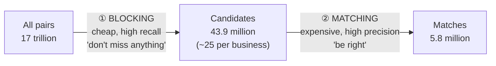
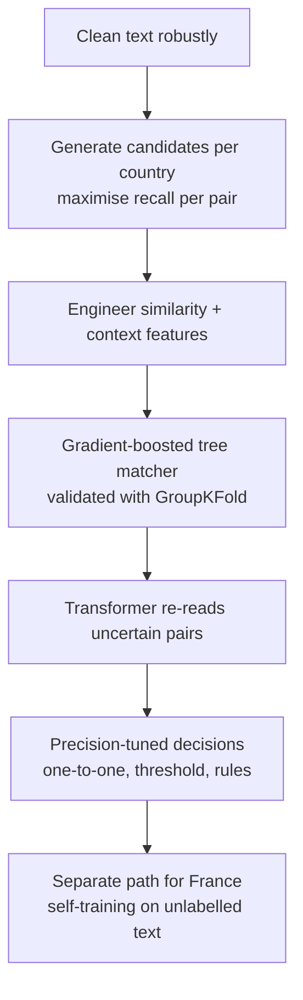

# 03 · How to think about it (before writing any code)

This chapter is about the *thinking*, not the code. If you were handed this problem tomorrow, this is the order of
questions an experienced person would ask.

## Question 1: What kind of ML problem is this?

It looks like "find groups", which suggests *clustering*. But Source 1 is already clean, so we only need to attach
Source 2/3 records to Source 1 businesses. That turns it into a much easier, better-studied shape:

> **Pairwise classification + constrained assignment.**
> For a pair (Source 1 business, candidate record), predict the probability they are the same business. Then accept the
> pairs above a threshold, with the constraint that each candidate record goes to at most one business.

Why this framing is good:
- Training data is plentiful. Every labelled business gives several positive pairs and many negative pairs.
- Any classifier works: trees, neural networks, or both stacked.
- The constraint ("at most one owner") comes straight from the problem, since Source 1 is deduplicated.

## Question 2: Can we just compare every pair?

1.73 M × 9.97 M ≈ **17 trillion** pairs. At a million comparisons per second, that is about 200 days. No.

So every entity-resolution system has two stages:

- **Blocking (candidate generation)** asks: which records *could possibly* be this business? It must be cheap and must
  not miss true matches.
- **Matching** asks: of these candidates, which really *are* this business? It can afford expensive comparisons because
  there are few candidates.

An analogy: a recruiter first filters 10,000 CVs down to 25 by keywords (blocking), then interviews those 25 carefully
(matching).

## The recall ceiling

This is the most important idea in the project:

> **If blocking misses a true match, no model can ever recover it.**
> The matcher only judges the candidates it is shown. Candidate recall is a hard ceiling on the final score.

Look at the team's history:

| Version | Candidate recall | CV F0.5 |
|---|:---:|:---:|
| v7 | 92.6 % | 0.9603 |
| v8 | **96.6 %** | **0.9804** |

v8 did not have a smarter model. It mostly had a bigger candidate pool and address-based keys. **+4 points of recall
gave +0.02 F0.5**, a bigger jump than any model change in the whole project. Once you see this, the strategy is clear:
first push recall as high as you can with a small candidate set, and only then polish the matcher.

But there is tension: the challenge also **rewarded smaller candidate sets**. So the question is not "how many candidates
can we add?" but "which candidate sources find the most true matches **per pair added**?" The team tested each source on
training data and kept only those that paid for themselves (chapter 04, stage 2).

## Question 3: What would a match-judge need to know?

Think like a careful human checking two records. You'd ask:

| Human question | Becomes feature(s) |
|---|---|
| Do the names look alike, even with typos? | fuzzy string ratios, Jaro-Winkler, consonant-skeleton similarity |
| Do they share the important words? | token Jaccard, TF-IDF cosine |
| Same house number? Same postcode? | `hn_jacc`, `post_match` |
| Is this name common? ("Sai Traders" is everywhere, "Zephyrion Analytics" is not) | **name rarity** `name_df_s1`, `name_df_cand` |
| Is the address missing, so I can't check it? | empty-address flags |
| Was this candidate a top pick from the shortlist? | blocking score and rank |
| Does it *mean* the same, across scripts? | multilingual embedding cosine, cross-encoder score |

Name rarity turned out to be the single biggest feature gain (+0.0038 CV). The intuition: "same name, no address" is
strong evidence for a rare name and almost no evidence for a common one.

## Question 4: How will I know if I'm improving?

Before writing a model, set up **validation that mirrors the leaderboard**:

1. **Use the exact competition metric**: macro F0.5, singletons included, after the one-to-one rule and the threshold.
   Not accuracy, not AUC.
2. **Split by business.** All candidates of one Source 1 business go in the same fold (GroupKFold).
3. **Count the misses.** Businesses whose true matches were never found by blocking still count in the score.
4. **Set a noise floor.** Only keep a change if CV improves by more than about +0.0005. Smaller "gains" are often noise.
5. **Check against the leaderboard** occasionally, but don't optimise *for* it.

The team also simulated "unseen country" by training on US and testing on India (and the reverse). An early model scored
0.822 / 0.946 in that setup, and the later model with the cross-encoder 0.937 / 0.969. This told them France would be
hard, and roughly how hard.

## Question 5: What is special about this dataset?

The EDA answers (chapter 02) that shaped the plan:
- **Country never crosses**, so do everything per country.
- **The generator is the same in every country**, so US/India knowledge transfers to France.
- **The generator plants look-alikes**, so precision needs explicit defences.
- **France is unlabelled**, so we need a domain-adaptation strategy.

## The plan that falls out

Each box is a section of chapter 04.

Next: [04 · The pipeline, step by step →](04-pipeline.md)
