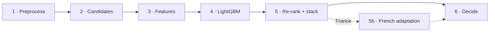
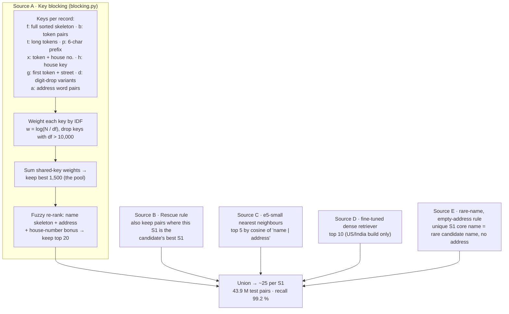
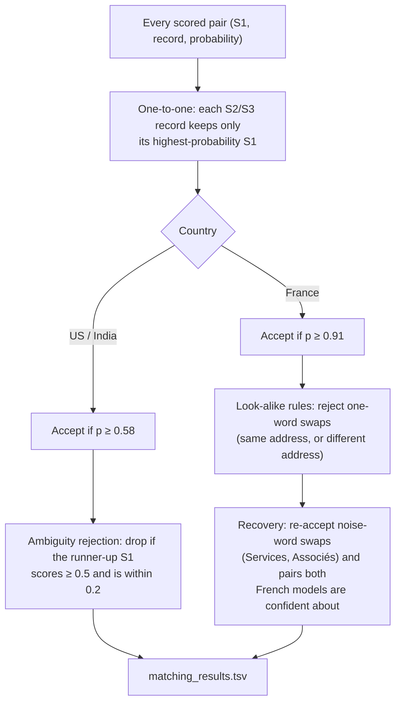

# 04 · The pipeline, step by step

Each stage below follows the same pattern:

- **In plain words:** what it does, in everyday language.
- **What we did:** the exact implementation, with links to the code.
- **Why:** the reasoning.
- **What it changed:** the measured effect on the score.

Code links point to the final package at commit
[`95b58b6`](https://github.com/Martial-Gautam/Amazon-ML-Challenge-2026/tree/95b58b6f460fe362b6a4d2d362d3fb9845a1017c/code/business_entity_resolution).
Experiment evidence comes from the working repo's
[`SUBMISSIONS.md`](https://github.com/Martial-Gautam/Amizon/blob/main/SUBMISSIONS.md) and
[`WORKBOARD.md`](https://github.com/Martial-Gautam/Amizon/blob/main/WORKBOARD.md).

---

## Stage 1 · Preprocessing (text normalisation)

**In plain words.** Before comparing names, make them comparable. "M/s. Sharma Traders Pvt. Ltd." and "SHARMA TRADERS
PRIVATE LIMITED" should both become `sharma traders`. Think of it as translating every record into one house style.

**What we did** ([`prep.py`](https://github.com/Martial-Gautam/Amazon-ML-Challenge-2026/blob/95b58b6f460fe362b6a4d2d362d3fb9845a1017c/code/business_entity_resolution/src/prep.py)).
For every record we compute six derived fields:

| Field | Example input → output | Function |
|---|---|---|
| `name` (normalised) | `M/S Sharma Traders Pvt. Ltd.` → `sharma traders private limited` | `norm` |
| `core` (no legal words) | → `sharma traders` | `name_fields` |
| `sk` (consonant skeleton of core) | → `srm trdrs` | `skel` |
| `addr` (normalised address) | `12 Main St, Ste 100` → `12 main street suite 100` | `addr_fields` |
| `hn` (house-number keys) | `19 Rue de la Douve, Pornic` → `19 dv` | `addr_fields` |
| `bk` (blocking keys) | → `f:srm trdrs`, `b:srm trdrs`, `t:trdrs`, `p:srmtrd`, `x:srm 12`, `h:12` (with address "12, MG Road") | `block_keys` |

The main tricks:

1. **Indic transliteration with only the standard library.** `latin()` reads each character's Unicode name ("DEVANAGARI
   LETTER KA") to turn 9 Indian scripts into rough Latin. No external transliteration library was needed.
2. **Mined dictionary.** `translate()` first swaps whole native-script words for English ones using `native_dict.tsv`
   (chapter 02). This is better than letter-by-letter conversion, because the data translated English words *into* Indian
   scripts.
3. **Consonant skeleton.** `skel()` drops vowels, `y` and `h`, merges look-alike consonants (w/b→v, c/q→k, z→j, ph→f)
   and collapses repeats. `marketing` and `मार्केटिंग` both become `mrktng`, and `enterpires` and `enterprises` both become
   `ntrprs`. Typos mostly hit vowels and letter order, so this simple trick absorbs a lot of noise.
4. **Digit-for-letter repair.** Inside mostly-letter words: 0→o, 1→l, 3→e, 5→s, 6→g, 8→b (`Bui1ders` → `builders`).
   Ordinals like `1st` and `3rd` are kept.
5. **French rules.** `St-Nazaire` and `Ste-Foy` mean Saint/Sainte, but `Main St, Ste 100` means Street/Suite. Elisions
   (`L'Atelier`) are removed, `N° 6` is not "north 6", `59bis` is house 59, and Cedex/BP numbers are not house numbers.
6. **Legal-word removal with a safety catch.** Stripping legal words by skeleton broke real words: `smith` ~ `smt`,
   `israel` ~ `srl`, `place` ~ `plc`. This affected about 1 % of names. The fix applies skeleton matching **only to
   transliterated Indic text**. The self-test at the bottom of `prep.py` (`python prep.py` prints `ok`) has 40+
   assertions guarding exactly these cases.

**Why.** Every later stage compares strings. Noise that isn't removed here becomes noise in every feature. It is also
cheap: it runs once per record, in parallel (`multiprocessing.Pool`).

**What it changed.** It is hard to isolate, because v1 already had transliteration. The measurable pieces are the
dictionary (+0.0010 CV, and native-script word matches 0 % → 79 %) and the legal-word fix (about 1 % of names repaired).

---

## Stage 2 · Candidate generation (blocking)

**In plain words.** For each Source 1 business, quickly find around 25 records that *might* be the same business, out of
millions. Like a library index: you don't read every book, you look up keywords.

**What we did.** There are four candidate sources, combined. All are **scoped to one country**: the country is folded
into every key's hash, and the neighbour searches loop over countries. This way France works without any special code.

**Source A, key blocking** ([`blocking.py`](https://github.com/Martial-Gautam/Amazon-ML-Challenge-2026/blob/95b58b6f460fe362b6a4d2d362d3fb9845a1017c/code/business_entity_resolution/src/blocking.py)):
- Each record emits many short *keys* (`block_keys` in `prep.py` and `_keys` in `blocking.py`). Two records "meet" if
  they share a key.
- **IDF weighting** (inverse document frequency) means rare keys count more. Sharing the key `t:zphyrn` (a rare word)
  is strong evidence, while sharing `t:trdrs` ("traders") is weak. Keys used by more than 10,000 records are dropped
  entirely.
- For each S1, sum the weights of shared keys, keep the best **1,500** (`--pool 1500`), then re-score those with cheap
  fuzzy similarity (`_rescore`: skeleton token-set ratio + address token-set + partial ratio + a +40 bonus for a shared
  house number) and keep the **top 20** (`--k-use 20`).
- Everything streams through Parquet files in chunks of 5,000 S1 records, so memory stays bounded. The peak was about
  36 GB, on the biggest country.

**Source B, rescue** (`--rescue` in `run.py pairs`): look in reverse. If this S1 is the *candidate's* best-scoring S1
(reverse rank 1 among its top 30), keep the pair even if it fell outside this S1's top 20. **+0.0010 CV** for only
+0.53 % more pairs.

**Source C, off-the-shelf embedding neighbours** (`candidates.py search`, model `intfloat/multilingual-e5-small`): turn
each record's `"name | address"` into a 384-number vector, then find the 5 closest records in the same country by
cosine similarity. This catches matches that share no keyword, such as native-script names or domain-style names. It
recovered 17.5 % of the previous version's misses for +4.5 % pairs.

**Source D, fine-tuned dense retriever** (`candidates.py train-retriever`): the same e5-small model, *trained* to put a
business and its copies close together (contrastive learning, chapter 05). Its top 10 found **65.4 %** of v9's remaining
misses for +24.4 % pairs, which lifted recall from 97.8 % to **99.2 %**. The team chose top 10 over top 5 (34.7 %) and
top 20 (78.1 % but +69 % pairs). Used for US/India only, because it hurt France (chapter 06).

**Source E, rare-name empty-address rule** (`rare_empty_pairs` in `run.py`): when a candidate has **no address**, key
blocking can only use the name. If the S1's core name is unique in its country and at most 10 candidates share it, pair
them directly. These pairs were **97.6 % true** on training data and recovered 4.9 % of the misses.

**Why each source had to earn its place.** The organisers ranked smaller candidate sets higher. So the test was always
"true matches recovered per pair added", measured on training data:

| Decision | Measurement | Verdict |
|---|---|---|
| Keep top 20, not 30 | CV 0.9487 vs 0.9489, with 33 % fewer pairs | **top 20** |
| Keep top 10? | CV 0.9468 | too costly |
| Higher key caps (30k / 50k) | no recall gain | rejected |
| Learned LambdaRank re-ranker in blocking | recall 94.5 % but CV 0.944 | rejected: the extra candidates were hard look-alikes |
| Empty-address same-name block (broad) | 13–16 % of misses at 1.6–2.6 % precision | rejected: floods candidates |

**What it changed.** This stage drove the score more than any other:

| Version | Blocking change | Recall | CV |
|---|---|:---:|:---:|
| v1 | composite keys | 81 % | 0.882 |
| v2 | pool 300 + fuzzy re-rank | 90 % | 0.937 |
| v3 | address keys, pool 600 | 93.0 % | 0.9487 |
| v8 | pool 1,500, partial-address re-rank, address word-pair keys | 96.6 % | 0.9804 |
| v9 | dictionary, rescue, e5 top 5, rare-empty | 97.8 % | 0.98693 |
| v10 | + fine-tuned retriever top 10 | **99.2 %** | **0.98921** |

> **Where the remaining misses are.** In v8, 52 % of missed true pairs had an **empty candidate address** (66 % in the
> US), and 27 % of India's misses were native-script names. "Same name, no address" for a common name is genuinely
> unresolvable: the information isn't in the data.

---

## Stage 3 · Feature engineering

**In plain words.** For each candidate pair, compute a row of numbers that describe how alike the two records are and
how much that likeness means. The model learns from these numbers, not from the raw text.

**What we did** ([`features.py`](https://github.com/Martial-Gautam/Amazon-ML-Challenge-2026/blob/95b58b6f460fe362b6a4d2d362d3fb9845a1017c/code/business_entity_resolution/src/features.py),
[`extra_features.py`](https://github.com/Martial-Gautam/Amazon-ML-Challenge-2026/blob/95b58b6f460fe362b6a4d2d362d3fb9845a1017c/code/business_entity_resolution/src/pipeline/extra_features.py),
[`embed.py`](https://github.com/Martial-Gautam/Amazon-ML-Challenge-2026/blob/95b58b6f460fe362b6a4d2d362d3fb9845a1017c/code/business_entity_resolution/src/embed.py)).
About 53 features, in families:

| Family | Features | What they capture |
|---|---|---|
| **Blocking context** (9) | `bscore`, `bshared`, `rscore`, `brank`, `b_rel_s1`, `r_rel_s1`, `b_n_s1`, `b_n_c`, `b_rel_c` | how strongly blocking linked the pair, relative to this S1's other candidates and to the candidate's other S1s |
| **Name strings** (14) | `name_ratio/partial/tsort/tset`, `core_ratio/tset/jw`, `compact_ratio/partial`, `sk_ratio/tset/tsort/jacc`, `sk_first_eq` | RapidFuzz similarities on full, core, compacted and skeleton names; Jaro-Winkler; shared-word Jaccard |
| **Address strings** (4) | `addr_ratio/tset/tsort/partial` | the same for addresses |
| **Structured address** (3) | `post_match`, `hn_jacc`, `hn_num_jacc` | postcode agreement (last 5–6 digit number), house-number overlap |
| **Shape** (7) | `sk_ntok_a/b`, `addr_len_a/b`, `name_len_a/b`, `src3` | lengths, token counts, whether the candidate came from Source 3 |
| **TF-IDF** (2) | `tfidf_core`, `tfidf_addr` | cosine of character-trigram TF-IDF vectors (fitted on train + test text) |
| **Neural** (3) | `emb_name`, `emb_addr`, `ce` | e5-small cosine of names and of addresses; small cross-encoder logit |
| **Neighbour search** (2–4) | `knn_rank`, `knn_cos` (+ `knn_r_rank`, `knn_r_cos` in v10) | where the pair sits in the embedding searches |
| **Rarity** (6 + 1) | `name_df_s1`, `name_df_cand`, `cand_addr_empty`, `name_df_s1_x_empty`, `name_df_s1_eq1`, `name_df_cand_le1`, `rare_empty` | how many S1s and candidates share this exact core name; empty-address interactions |

Missing values are kept as `NaN` or `-1` (for example, `post_match = -1` when either side has no postcode). LightGBM
handles missing values natively, so "unknown" stays different from "disagrees".

**Why these.** Each family answers a question a human checker would ask (chapter 03). Two design points are worth
stealing:
- **Rarity is context, not similarity.** Two records named "Sai Traders" are equally similar wherever they appear. What
  differs is how *surprising* the match is. That is why rarity was the single largest feature gain: **+0.0038 CV**.
- **Raw text for neural features.** `embed.py` and `ce.py` read the *original* text, not the normalised text. The
  multilingual model reads Indian scripts itself, which gives a signal independent of our own transliteration.

**What it changed.** TF-IDF + e5 cosines: +0.0014 together. Small cross-encoder feature: **+0.0077** (v6 0.9526 → v7
0.9603). Rarity: +0.0038. Native dictionary on name features: +0.0010. Word-level TF-IDF: +0.0012 on the A/B table but
−0.0017 on France on the leaderboard, so it was dropped from v10.

Six further feature families (per-country word IDF, cross-encoder rank/gap, decoration, typo shape, script flags,
address parts) each gained ≤ +0.001 and were all **rejected** under the noise bar.

---

## Stage 4 · The main matcher: LightGBM

**In plain words.** A model that looks at a pair's ~53 numbers and outputs the probability it's the same business.
LightGBM builds hundreds of small decision trees ("if name similarity > 92 and house numbers match, then…"). Each new
tree corrects the mistakes of the trees before it.

**What we did** ([`classifier.py`](https://github.com/Martial-Gautam/Amazon-ML-Challenge-2026/blob/95b58b6f460fe362b6a4d2d362d3fb9845a1017c/code/business_entity_resolution/src/pipeline/classifier.py),
[`run.py`](https://github.com/Martial-Gautam/Amazon-ML-Challenge-2026/blob/95b58b6f460fe362b6a4d2d362d3fb9845a1017c/code/business_entity_resolution/src/run.py),
[`tune.py`](https://github.com/Martial-Gautam/Amazon-ML-Challenge-2026/blob/95b58b6f460fe362b6a4d2d362d3fb9845a1017c/code/business_entity_resolution/src/tune.py)):

- **Training set:** all 2,206,821 training businesses **minus** the 99,948 used to train the small cross-encoder (to
  avoid leakage). That leaves 2,106,873 businesses and about 42–55 M candidate pairs.
- **Label:** 1 if the pair is in the ground truth, else 0.
- **Validation:** 5-fold **GroupKFold** grouped by Source 1 business. This gives an *out-of-fold* (OOF) probability for
  every training pair, predicted by a model that never saw that business.
- **Hyperparameters** (`best_params.json`, found by Optuna): learning rate 0.041, 286 leaves, min child samples 175,
  feature fraction 0.50, bagging 0.95, L1 0.096, L2 3.16, positive weight 1.21, **1,202 trees**.
- **Tuning objective:** the competition metric itself, macro F0.5 after the one-to-one rule at the best threshold
  (`tune.macro_f05`), with early stopping and median pruning.
- **Final model:** trained on all training pairs, averaged over **3 random seeds** (v10).

**Why LightGBM.** The data is tabular (rows of numbers), large (tens of millions of rows) and has missing values. Gradient-
boosted trees are the standard best choice for this: fast on CPU, no feature scaling needed, native missing-value
handling, strong out of the box. It was compared head-to-head with alternatives and won (chapter 05).

**What it changed, and what didn't:**

| Change | Result |
|---|---|
| Optuna-tuned vs default parameters (full 400k, 5-fold check) | **+0.0028** (0.95008 → 0.95287) |
| …but Optuna's own quick estimate (150k, 3-fold) | +0.0002. Too noisy to trust; the full re-check was needed |
| Second Optuna round on the newer feature set | +0.00003 to +0.00007 = noise, kept old params |
| 2× / 3× more trees, even at 2× data | flat (0.98581 / 0.98581 / 0.98579) |
| CatBoost; LightGBM + CatBoost blends | 0.95048; best blend 0.95268 < LightGBM alone 0.95287 |
| Training on all 2.2M vs 400k businesses | ~+0.002 |
| 3-seed averaging | part of v10's gain |

v8's LightGBM alone reached **CV 0.9804**. v10's reached 0.98802.

---

## Stage 5 · Cross-encoder re-ranking and stacking

**In plain words.** LightGBM sees only numbers *about* the text. For the pairs it is unsure about, we ask a model that
reads both records word by word, side by side, like a careful human proofreader. Then a small second model combines both
opinions.

**What we did** ([`rerank.py`](https://github.com/Martial-Gautam/Amazon-ML-Challenge-2026/blob/95b58b6f460fe362b6a4d2d362d3fb9845a1017c/code/business_entity_resolution/src/pipeline/rerank.py),
[`ce.py`](https://github.com/Martial-Gautam/Amazon-ML-Challenge-2026/blob/95b58b6f460fe362b6a4d2d362d3fb9845a1017c/code/business_entity_resolution/src/ce.py),
[`ce_data.py`](https://github.com/Martial-Gautam/Amazon-ML-Challenge-2026/blob/95b58b6f460fe362b6a4d2d362d3fb9845a1017c/code/business_entity_resolution/src/ce_data.py)):

1. **The uncertainty band.** Only pairs with LightGBM probability between **0.02 and 0.98** are re-read: ~1.5 M of the
   43.9 M test pairs. The rest are already clear.
2. **The re-ranker.** `multilingual-e5-base` (278 M parameters) fine-tuned as a binary classifier on input
   `"name | address" [SEP] "name | address"`, max 96 tokens, 1 epoch, learning rate 3e-5, batch 64, mixed precision.
3. **Two out-of-fold halves.** Training businesses are split into two halves by a fixed hash
   (`ce_half: (i × 2654435761 mod 2³²) mod 2`). Model h0 trains on 200k businesses from half 0 and scores half 1, and
   model h1 does the reverse. Every training pair therefore gets a score from a model that never saw it. `rerank.py`
   **asserts** this, and stops if any half scored its own training data. Test scores are the average of both models.
4. **Stacking.** A small LightGBM meta-model (200 trees, 15 leaves) takes `[logit(LightGBM probability), cross-encoder
   logit]` and outputs a new probability for band pairs. It is cross-validated by business and compared against a
   *control* meta-model that sees only the LightGBM probability. Output is written only if the cross-encoder version beats
   the control.

**Why.** Character-level fuzzy features can't tell "Chti Parents" from "Chti Centre" at the same address. A transformer
that has read the whole internet knows that "Parents" and "Centre" are different kinds of organisation. On uncertain
pairs, the small cross-encoder had AUC **0.887** vs LightGBM's **0.771**.

**What it changed.** v10 stage-1 CV 0.98802 → stacked **0.98876** (+0.00074). An earlier test on v7 gave only +0.0005,
and the team initially *didn't* adopt it, because scoring all test pairs with two e5-base models was expensive. Limiting
it to the uncertainty band made it cheap enough. On the leaderboard, ~40 % of its changes were French, and it helped
France more than CV could show.

---

## Stage 5b · France (domain adaptation)

France has its own chapter: [06 · France: learning a country with no labels](06-france.md). In short: two copies of the
e5-base re-ranker were fine-tuned on 885,573 French pairs **built from the unlabelled French test records**. Positives
were pairs the model was ≥ 99.5 % sure of. Negatives were synthetic look-alikes that imitate how the data generator
plants decoys. Their averaged score replaces the re-ranker score for French pairs. Result: about **+0.011 on France**.

---

## Stage 6 · The decision layer

**In plain words.** Probabilities aren't answers. This stage turns them into the final lists, cautiously, because wrong
merges are expensive.

**What we did** ([`decide.py`](https://github.com/Martial-Gautam/Amazon-ML-Challenge-2026/blob/95b58b6f460fe362b6a4d2d362d3fb9845a1017c/code/business_entity_resolution/src/pipeline/decide.py),
[`france.py`](https://github.com/Martial-Gautam/Amazon-ML-Challenge-2026/blob/95b58b6f460fe362b6a4d2d362d3fb9845a1017c/code/business_entity_resolution/src/pipeline/france.py)):

1. **One-to-one assignment** (`run.decide`, `exclusive=True`). Source 1 is deduplicated, so a record can belong to at
   most one S1. Keep each record only with its best-scoring S1. The threshold search tries it both on and off, and it
   always won.
2. **Threshold.** Chosen on out-of-fold predictions over a grid from 0.20 to 0.94 in steps of 0.02. For US/India the
   optimum (with step 3 below) is **0.58**, and it is flat between 0.56 and 0.62, which is a sign of a robust choice.
3. **Ambiguity rejection** (US/India only). If a record's second-best S1 also scores ≥ 0.5 and is within 0.2 of the
   best, the record sits between two look-alike businesses, so it is dropped. **+0.00018 CV**.
4. **France threshold 0.91.** There are no labels, so it could not be chosen on CV. It was found by sweeping on the
   public leaderboard (0.76 → 0.80 → 0.88 → 0.91 → 0.92 → 0.93 → 0.96) and fitting a calibration curve to those
   results. See chapter 06 and the risks in chapter 07.
5. **French look-alike rules and recovery.** See chapter 06.

**What else was tried here and rejected.** 70 variants of per-business decision rules, including choosing each
business's set to maximise its expected F0.5. None beat "one global threshold + one-to-one". Count-based conflict
resolution scored −0.0008. Per-row-size thresholds gained +0.000015, which isn't worth it. A learned "unseen-country
corrector" was negative in both test directions.

---

## Stage 7 · Assembly: two builds, merged by country

The final file is a **hybrid** of two complete pipeline builds:

| Rows | Build | Why |
|---|---|---|
| US + India | **v10** (with the fine-tuned retriever, 3 seeds) | best on US/India: CV 0.98921 |
| France | **v9** (no retriever) + French cross-encoders | v10's extra French candidates were mostly look-alikes: −0.004 on France |

`decide.py merge` takes France's rows from one build and the rest from the other, and **asserts** that no other row
changed. `reproduce.py` runs all of it with one command: stages `base → neighbours → v9 → rerank → france → v10 →
final`. Every step is skipped if its output already exists, so a crashed run resumes where it stopped.

**Final leaderboard steps** (from the final package README; each changes only the rows named):

| Step | Public LB | Δ |
|---|:---:|:---:|
| US/India from v10, France from v9 | 0.985926 | — |
| + second domain-adapted cross-encoder for France | 0.986050 | +0.000124 |
| France threshold 0.91 | 0.986371 | +0.000321 |
| + French noise-word copies recovered (*Services*, *Associés*) | 0.986525 | +0.000154 |
| + look-alike rule lifted where both French models were confident | 0.986673 | +0.000148 |
| **+ remaining confident cases (final)** | **0.986691** | +0.000018 |

Next: [05 · The models →](05-models.md)
