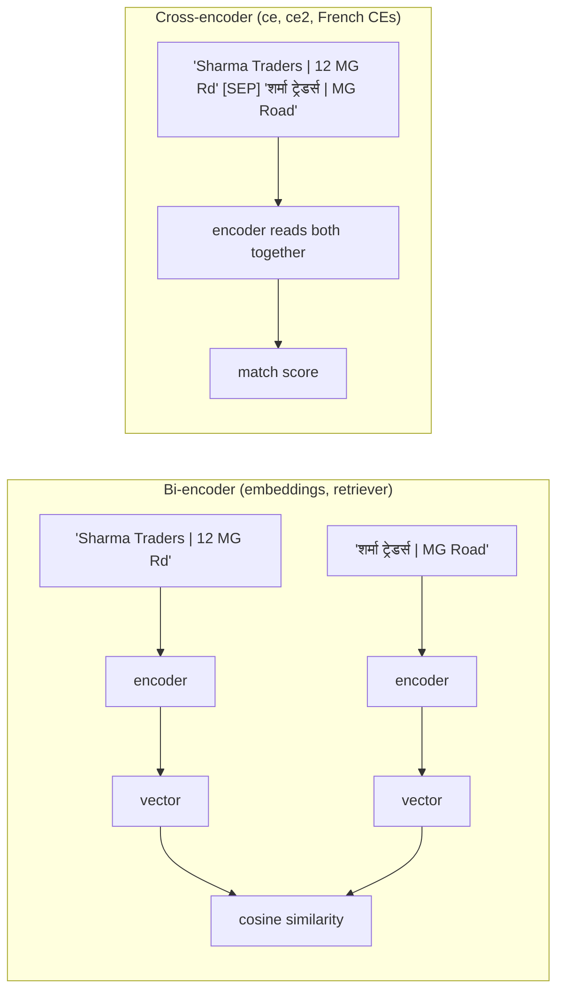

# 05 · The models

Six learned components, plus a few that were tried and dropped. For each one: what it is in simple words, why we chose
it, how it did, and its strengths and weaknesses.

| # | Model | Size | Role | Trained on |
|---|---|---|---|---|
| 1 | LightGBM matcher | 1,202 trees × 3 seeds | main pair classifier over ~53 features | 2.1 M training businesses (5-fold OOF) |
| 2 | e5-small embeddings (off the shelf) | 118 M | candidate search (top 5) + cosine features | not trained by us |
| 3 | e5-small dense retriever (fine-tuned) | 118 M | candidate search (top 10) | 99,948 held-out businesses |
| 4 | e5-small cross-encoder (`ce`) | 118 M | a feature for every pair | 2.94 M pairs of the same 99,948 held-out businesses |
| 5 | e5-base re-ranker (`ce2`), 2 halves | 278 M each | re-reads the uncertainty band | 200k businesses per half, out-of-fold |
| 6 | e5-base French cross-encoders (P5, P5b) | 278 M each | replaces `ce2` for French pairs | 885,573 French pairs built from unlabelled test text |
| 7 | LightGBM stacking meta-model | 200 trees, 15 leaves | combines 1 with 5 (or 6) | band pairs, 5-fold |

All neural models are `intfloat/multilingual-e5-*` (MIT licence). They are well within the 8 B parameter limit.

---

## Two families of model, in one picture

- A **bi-encoder** turns each record into a vector *separately*. You can pre-compute vectors for 10 million records once,
  then find nearest neighbours fast. That makes it good for **search** (blocking).
- A **cross-encoder** reads both records *together*, so every word can attend to every word on the other side. It is far
  more accurate, but must be run once per pair, so it is too slow for 17 trillion pairs. That makes it good for **judging**
  a shortlist.

This search-then-judge split is the same pattern as blocking-then-matching, applied to neural models.

---

## 1 · LightGBM (gradient-boosted decision trees)

**What it is.** A decision tree asks yes/no questions about the features ("`hn_jacc` > 0.5?") and ends in a prediction.
One tree is weak. *Boosting* builds trees one after another, each trained to fix the errors the previous ones still
make, and adds their outputs up. LightGBM is a fast implementation of this that grows trees leaf by leaf.

*Analogy:* a panel of 1,202 junior analysts. Each one specialises in the cases the panel still gets wrong.

**Why.** Tabular features, tens of millions of rows, missing values everywhere, CPU-only training, and a 72-hour clock.
LightGBM is the default winner on this kind of data.

**How it did.** v8 CV 0.9804 on its own. With features from the other models (v10) it reached 0.98802 before stacking.

**Strengths.** Fast. It handles `NaN` natively, needs no feature scaling, and gives feature importances, which is how
the team found that `b_rel_s1` (relative blocking score) carried 55 % of the gain in one diagnostic.
**Weaknesses.** It only sees what the features describe. It can't read the words, which is why the cross-encoders
helped. It also learned some country-specific quirks: in leave-one-country-out tests it was strong in-country and weaker
out-of-country (0.82–0.95).

**Compared against:** CatBoost (0.95048 vs 0.95287) and blends (best 0.95268). Both were rejected.

---

## 2 · e5-small embeddings (off the shelf)

**What it is.** `multilingual-e5-small` is a pre-trained transformer that maps text in ~100 languages to a 384-number
vector. Similar meanings get nearby vectors. We use mean pooling over tokens, normalised, with the `"query: "` prefix the
model expects.

**Where it's used.**
- `embed.py`: cosine similarity of names and of addresses for every pair (features `emb_name`, `emb_addr`).
- `candidates.py search`: top 5 same-country neighbours of each S1 as extra candidates (`knn_rank`, `knn_cos`).

**How it did.** With TF-IDF, about +0.0014 CV. As a candidate source, it recovered 17.5 % of v8's misses (+4.5 % pairs).

**Strengths.** It reads native scripts and domain-style names directly, and it is cheap at inference.
**Weaknesses.** It is generic: it was not trained to know that "Centre" vs "Parents" matters more than "St" vs "Street".

---

## 3 · Dense retriever (e5-small, fine-tuned with contrastive learning)

**What it is.** The same model as #2, *trained* on our task. For each S1 "query", it is shown one true copy (positive) and
one hard negative (a candidate that blocking liked but was wrong). Training pulls the query's vector toward the positive
and pushes it away from the negatives. This uses the **InfoNCE** loss (a softmax over the batch with temperature 0.05).
Every other record in the batch also serves as a negative ("in-batch negatives").

*Analogy:* teaching a librarian, by example, which books really belong together.

**Details** (`candidates.py train-retriever`): 4 epochs, learning rate 3e-5, 256 queries per batch, OneCycle schedule,
fp16. One subtle fix: if another query's positive in the same batch is *also* a true match for this query, it is masked
out instead of being wrongly treated as a negative. Trained only on the 99,948 held-out businesses.

**How it did.** Top 10 found **65.4 %** of the remaining misses, lifting recall 97.8 % → **99.2 %**. A retrained v2 was
identical (65.4 %).
**Strengths.** It was the biggest single recall lever late in the challenge.
**Weaknesses.** On France it pulled in look-alike businesses, which cost −0.004, so France uses the build without it.

---

## 4 · Small cross-encoder (e5-small, `ce`)

**What it is.** e5-small with a one-number classification head, fine-tuned to say "match / no match" for
`"name | address" [SEP] "name | address"`. Loss: binary cross-entropy. 1 epoch on 2.94 M pairs, learning rate 5e-5,
max 96 tokens.

**The leakage trick.** It is trained on 99,948 businesses that the LightGBM matcher **never** trains or validates on
(`--exclude-s1`). Otherwise its scores on training pairs would be over-optimistic, and LightGBM would learn to over-trust it.

**How it did.** **+0.0077 CV** as a feature (v6 0.9526 → v7 0.9603), the largest model-side jump. On uncertain pairs: AUC
0.887 vs LightGBM's 0.771. It also transferred well: a cross-encoder trained only on US data added **+0.053** F0.5 on
India in a simulation.
**Speed tricks** (in `ce.py`): length-sorted batches (less padding), tokenising the next batch on a CPU thread while the
GPU works, multi-GPU `DataParallel`, fp16 autocast.

---

## 5 · Re-ranker (e5-base, `ce2`, two out-of-fold halves)

**What it is.** The same idea as #4 but with the bigger `multilingual-e5-base` (278 M, 768-number vectors). It was trained
twice, once on each half of the businesses, so every training pair is scored by the model that didn't see it.

**Why only the uncertain band.** Scoring all 43.9 M pairs with two e5-base models would have taken many GPU-hours. As a
full feature it gained only +0.0005, below the team's +0.002 bar for that cost. On the ~1.5 M band pairs it was
affordable and worth +0.00074 CV, plus more on France.

**Bigger was not better.** `e5-large` ("ce3"), trained as 4 full-epoch shards, gained +0.00011 CV (bar +0.0003) and
**−0.000419 on the leaderboard**, because it diluted the French models' effect. It was rejected.

---

## 6 · French cross-encoders (P5 and P5b)

Copies of the two `ce2` halves, each fine-tuned for 1 epoch (learning rate 2e-5, batch 64) on 885,573 French pairs built
only from **unlabelled French test text**: confident pseudo-positives plus synthetic look-alike negatives. Their averaged
output replaces `ce2` for French pairs (with LightGBM probability ≥ 0.02). P5 alone: **+0.0017 LB** (France ≈ +0.011).
Adding P5b: +0.000124 LB. Full story in [chapter 06](06-france.md).

---

## 7 · Stacking meta-model

**What it is.** A tiny LightGBM (200 trees, 15 leaves, learning rate 0.05, min child samples 100) with just two inputs:
`logit(stage-1 probability)` and the cross-encoder logit. It learns *when to trust which opinion*.

**Guard rail.** It is always compared to a control that sees only the stage-1 probability. If the cross-encoder doesn't
beat the control, `rerank.py stack` writes nothing.

---

## Models tried and rejected

| Model | Result | Why it lost |
|---|---|---|
| LambdaRank (learning-to-rank) re-ranker in blocking | recall 94.5 % but CV 0.944 vs 0.9487 | it pulled in harder look-alike negatives the matcher couldn't separate |
| CatBoost, LightGBM + CatBoost blends | 0.95048 / ≤ 0.95268 vs 0.95287 | no gain over tuned LightGBM |
| e5-large cross-encoder (ce3) | +0.00011 CV, −0.000419 LB | no gain, and it hurt France |
| LightGBM with pseudo-labels (US→India simulation) | 0.821 → 0.820–0.821 | pseudo-labels are the easy pairs; nothing new to learn |
| Cross-encoder with plain pseudo-labels (simulation) | **−0.036 / −0.038** | the CE drifted toward LightGBM's own mistakes |
| 2nd-stage list-context model (rank / gap / counts) | 0.95960 vs 0.96005 | no gain |
| Learned unseen-country corrector | −0.003 to −0.006 | learned the training country's quirks, not general rules |
| Second round of French self-training | −0.000184 LB | round-2 labels repeat the model's confident mistakes |

Plain pseudo-labelling failed in simulation, yet the French self-training (#6) worked. The difference was **synthetic
hard negatives that imitate the generator**, plus filtering positives away from known look-alike groups. Chapter 06
explains why that matters.

Next: [06 · France: learning a country with no labels →](06-france.md)
