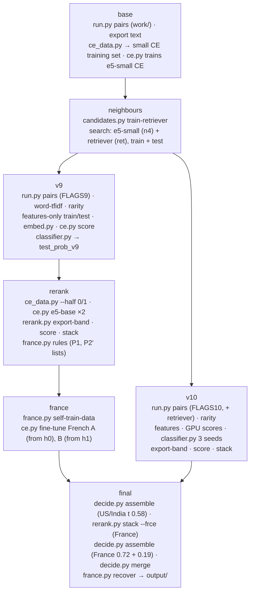

# Code walkthrough

A map of the code: what each file does, its key functions, and how the pieces connect. Links point to commit
[`95b58b6`](https://github.com/Martial-Gautam/Amazon-ML-Challenge-2026/tree/95b58b6f460fe362b6a4d2d362d3fb9845a1017c)
of the final package (the `code/` submodule) and to the working repo (the `research/` submodule).

## How the package is organised

```text
code/business_entity_resolution/
├── reproduce.py           orchestrates 7 stages; skips any step whose output exists
├── best_params.json       Optuna-tuned LightGBM parameters
├── native_dict.tsv        5,484 native-script/noisy token → English word (mined from training pairs)
├── requirements.txt       CPU deps: lightgbm, polars, rapidfuzz, scikit-learn, …
├── requirements-gpu.txt   torch 2.11 (CUDA 12.8) + transformers==4.57.6 (pinned: 5.x changes scores)
└── src/
    ├── prep.py            text normalisation + blocking keys                    (CPU)
    ├── blocking.py        TSV → Parquet cache; key blocking + fuzzy re-rank     (CPU, ~36 GB peak)
    ├── features.py        ~40 pair features                                     (CPU)
    ├── embed.py           e5-small name/address cosines                          (GPU)
    ├── ce.py              cross-encoder train + score (e5-small or e5-base)      (GPU)
    ├── ce_data.py         builds cross-encoder training sets (held-out / halves)
    ├── run.py             core driver: pairs → features → LightGBM → decide → write
    ├── tune.py            Optuna search on a saved feature table
    ├── native_dict.py     mines native_dict.tsv from training pairs
    └── pipeline/
        ├── candidates.py      train-retriever · search (GPU nearest neighbours)
        ├── extra_features.py  rarity · word-tfidf
        ├── classifier.py      LightGBM with extra columns, 5-fold OOF, N seeds
        ├── rerank.py          export-band · stack (cross-encoder re-ranking + meta-model)
        ├── france.py          self-train-data · rules · apply · recover
        └── decide.py          thresholds · assemble · merge
```

## The 7 stages of `reproduce.py`



Run one stage: `python code/business_entity_resolution/reproduce.py --stage v9`. All stages except `final` need a CUDA GPU.

## File by file

### `prep.py`: normalisation ([source](https://github.com/Martial-Gautam/Amazon-ML-Challenge-2026/blob/95b58b6f460fe362b6a4d2d362d3fb9845a1017c/code/business_entity_resolution/src/prep.py))

| Function | Line | Does |
|---|---|---|
| `_char`, `latin` | [37](https://github.com/Martial-Gautam/Amazon-ML-Challenge-2026/blob/95b58b6f460fe362b6a4d2d362d3fb9845a1017c/code/business_entity_resolution/src/prep.py#L37), [69](https://github.com/Martial-Gautam/Amazon-ML-Challenge-2026/blob/95b58b6f460fe362b6a4d2d362d3fb9845a1017c/code/business_entity_resolution/src/prep.py#L69) | Indic script → Latin using Unicode character names; strips accents |
| `_tok` | [91](https://github.com/Martial-Gautam/Amazon-ML-Challenge-2026/blob/95b58b6f460fe362b6a4d2d362d3fb9845a1017c/code/business_entity_resolution/src/prep.py#L91) | abbreviation expansion, digit-for-letter repair |
| `norm` | [120](https://github.com/Martial-Gautam/Amazon-ML-Challenge-2026/blob/95b58b6f460fe362b6a4d2d362d3fb9845a1017c/code/business_entity_resolution/src/prep.py#L120) | the main normaliser (M/s, dotted legal forms, N°, St/Ste, elisions, Cedex, `.com`) |
| `skel` | [141](https://github.com/Martial-Gautam/Amazon-ML-Challenge-2026/blob/95b58b6f460fe362b6a4d2d362d3fb9845a1017c/code/business_entity_resolution/src/prep.py#L141) | consonant skeleton |
| `translate` | [157](https://github.com/Martial-Gautam/Amazon-ML-Challenge-2026/blob/95b58b6f460fe362b6a4d2d362d3fb9845a1017c/code/business_entity_resolution/src/prep.py#L157) | native-script word → English word via `native_dict.tsv` |
| `name_fields` | [164](https://github.com/Martial-Gautam/Amazon-ML-Challenge-2026/blob/95b58b6f460fe362b6a4d2d362d3fb9845a1017c/code/business_entity_resolution/src/prep.py#L164) | → (name, core, skeleton); legal-word removal with the collision guard |
| `addr_fields` | [184](https://github.com/Martial-Gautam/Amazon-ML-Challenge-2026/blob/95b58b6f460fe362b6a4d2d362d3fb9845a1017c/code/business_entity_resolution/src/prep.py#L184) | → (address, house-number keys like `19 dv`) |
| `block_keys` | [200](https://github.com/Martial-Gautam/Amazon-ML-Challenge-2026/blob/95b58b6f460fe362b6a4d2d362d3fb9845a1017c/code/business_entity_resolution/src/prep.py#L200) | name keys `f: b: t: p: x: h:` |
| `prep` | [225](https://github.com/Martial-Gautam/Amazon-ML-Challenge-2026/blob/95b58b6f460fe362b6a4d2d362d3fb9845a1017c/code/business_entity_resolution/src/prep.py#L225) | applies all of the above in parallel to a DataFrame |

`python prep.py` runs 40+ assertions. **Read them**: they are the best documentation of the edge cases.

### `blocking.py`: candidate generation ([source](https://github.com/Martial-Gautam/Amazon-ML-Challenge-2026/blob/95b58b6f460fe362b6a4d2d362d3fb9845a1017c/code/business_entity_resolution/src/blocking.py))

- `ensure` streams each TSV in 400k-row batches through `prep` into Parquet parts with a global row index `idx`.
- `_keys` / `keys` add address keys (`g:`, `d:`, `a:`) and hash `(country, key)` to 64-bit integers.
- `block` per country: IDF weights (keys with df > 10,000 dropped) → sum over shared keys → pool of 1,500 → `_rescore` → top k.
- `cand_context` gives, per candidate, its best blocking score and how many S1s picked it (features `b_n_c`, `b_rel_c`).

### `run.py`: the core driver ([source](https://github.com/Martial-Gautam/Amazon-ML-Challenge-2026/blob/95b58b6f460fe362b6a4d2d362d3fb9845a1017c/code/business_entity_resolution/src/run.py))

| Function | Does |
|---|---|
| `pairs` | builds or reuses candidates, applies `--k-use`, `--rescue`, `--knn`, `--knn2`, `--rare-empty`; writes an `.args.json` sidecar so caches are never silently mixed |
| `rare_empty_pairs` | Source E candidates |
| `tfidf` | char-trigram TF-IDF vectorisers (train or train + test text) |
| `train_sample` | the fixed-seed set of training S1, minus `--exclude-s1` |
| `decide` | **one-to-one + threshold** (5 lines, the heart of the decision layer) |
| `f05` | the competition metric in Polars |
| `train` / `predict` | features → GroupKFold OOF → threshold search → final fit → submission files |

### `features.py`, `embed.py`, `ce.py`, `ce_data.py`

See [TECHNICAL §2](../TECHNICAL.md#2-the-pipeline-stage-by-stage) (stage 3) and [TECHNICAL §3](../TECHNICAL.md#3-the-models). Note `ce.py`'s throughput tricks and `ce_data.ce_half`, the fixed hash that
defines the two out-of-fold halves for every machine.

### `pipeline/` modules

| Module | Subcommands | Key detail |
|---|---|---|
| `candidates.py` | `train-retriever`, `search` | InfoNCE with false-negative masking; exact GPU top-k per country |
| `extra_features.py` | `rarity`, `word-tfidf` | rarity counted within each split's own records |
| `classifier.py` | — | `with_extra` asserts no duplicate or missing rows; 3-seed average |
| `rerank.py` | `export-band`, `stack` | asserts each half scored only the other half; control-vs-new comparison; `--frce` swaps in French scores |
| `france.py` | `self-train-data`, `rules`, `apply`, `recover` | generator imitation; `apply` asserts only French rows changed |
| `decide.py` | `thresholds`, `assemble`, `merge` | ambiguity rejection; `merge` asserts rows outside the country are unchanged; runs the official validator |

## The working repo (`research/`): experiments worth reading

Each script is one hypothesis with a measured answer (results in `SUBMISSIONS.md`).

| Script | Question it answered |
|---|---|
| [`ab.py`](https://github.com/Martial-Gautam/Amizon/blob/main/experiments/ab.py) | the shared A/B harness: same table, folds and metric for every matcher experiment |
| [`recall.py`](https://github.com/Martial-Gautam/Amizon/blob/main/experiments/recall.py) | where are true matches lost in blocking? |
| [`err_decomp.py`](https://github.com/Martial-Gautam/Amizon/blob/main/experiments/err_decomp.py) | where does macro F0.5 go (never found / FP / FN)? |
| [`n1_n2.py`](https://github.com/Martial-Gautam/Amizon/blob/main/experiments/n1_n2.py) | error breakdown + a list-context second stage (rejected) |
| [`b_rescue_ab.py`](https://github.com/Martial-Gautam/Amizon/blob/main/experiments/b_rescue_ab.py) | does the reverse "rescue" rule pay? (+0.0010) |
| [`a_dict_ab.py`](https://github.com/Martial-Gautam/Amizon/blob/main/experiments/a_dict_ab.py), [`mine_dict.py`](https://github.com/Martial-Gautam/Amizon/blob/main/experiments/mine_dict.py) | does the mined native-script dictionary help? (+0.0010) |
| [`rarity_ab.py`](https://github.com/Martial-Gautam/Amizon/blob/main/experiments/rarity_ab.py) | name-rarity features (+0.0038) |
| [`pseudo_sim.py`](https://github.com/Martial-Gautam/Amizon/blob/main/experiments/pseudo_sim.py), [`ce_pseudo_prep.py`](https://github.com/Martial-Gautam/Amizon/blob/main/experiments/ce_pseudo_prep.py) | pseudo-labelling simulations (rejected) |
| [`weight_loco.py`](https://github.com/Martial-Gautam/Amizon/blob/main/experiments/weight_loco.py) | importance weighting toward an unseen country (rejected) |
| [`probe1_sim.py`](https://github.com/Martial-Gautam/Amizon/blob/main/experiments/probe1_sim.py), [`rule_sim.py`](https://github.com/Martial-Gautam/Amizon/blob/main/experiments/rule_sim.py) | simulate French rules on an unseen-country proxy before spending an upload |
| [`france_probe.py`](https://github.com/Martial-Gautam/Amizon/blob/main/experiments/france_probe.py), [`frce_probe.py`](https://github.com/Martial-Gautam/Amizon/blob/main/experiments/frce_probe.py) | France-only leaderboard probes |
| [`fr_synth.py`](https://github.com/Martial-Gautam/Amizon/blob/main/experiments/fr_synth.py) | the original French self-training data builder (P5) |
| [`france_thr_model.py`](https://github.com/Martial-Gautam/Amizon/blob/main/experiments/france_thr_model.py) | fit a calibration curve to leaderboard steps and predict the best French threshold |
| [`capacity_ab.py`](https://github.com/Martial-Gautam/Amizon/blob/main/experiments/capacity_ab.py) | does LightGBM need more trees at full scale? (no) |
| [`drop_bad_parquet.py`](https://github.com/Martial-Gautam/Amizon/blob/main/experiments/drop_bad_parquet.py) | power-cut recovery |

## Running it

Full reproduction needs the competition data (`student_resource/` with `dataset/` and `utils/`), Linux/macOS/WSL, a CUDA
GPU with 16 GB, ~40 GB RAM and Python 3.12:

```bash
git clone --recurse-submodules https://github.com/gitswagata1/amazon-ml-challenge-2026-clover.git
cd amazon-ml-challenge-2026-clover/code
pip install -r code/business_entity_resolution/requirements.txt -r code/business_entity_resolution/requirements-gpu.txt
python code/business_entity_resolution/reproduce.py --data /path/to/student_resource
python utils/validate_submission.py --matching output/matching_results.tsv \
    --candidate output/candidate_pairs.tsv --test-dir dataset/test --check-ids
```

Without the data or a GPU, you can still:
- run `python code/business_entity_resolution/src/prep.py` (the normalisation self-test, CPU only), and
- run everything in `examples/` at the repo root.
