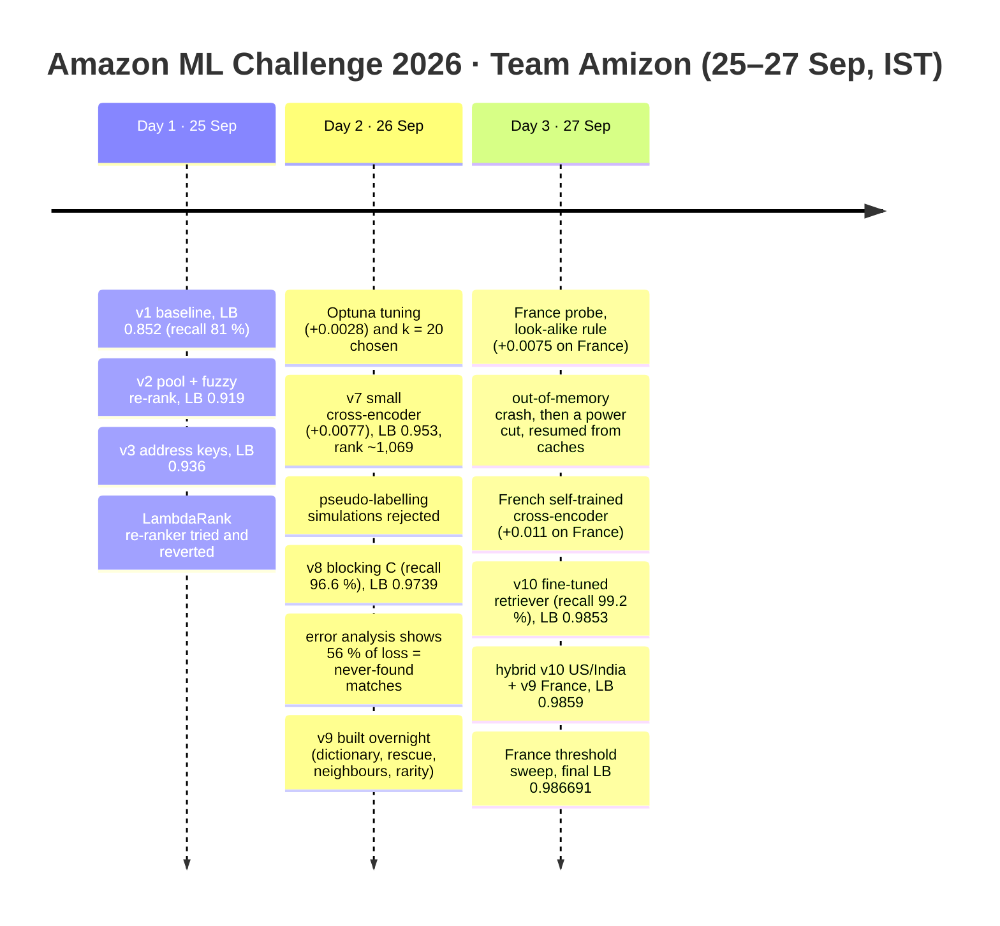

# The journey: ups, downs and what we learned

This is the honest part of the story: what went wrong, how the team found out, and what fixed it (or didn't). Sources: the
working repo's [`WORKBOARD.md`](https://github.com/Martial-Gautam/Amizon/blob/main/WORKBOARD.md),
[`SUBMISSIONS.md`](https://github.com/Martial-Gautam/Amizon/blob/main/SUBMISSIONS.md) and the commit history.

## The 72 hours at a glance

| Version | What we tried | What went right ✅ | What went wrong ❌ | Lesson |
|---|---|---|---|---|
| v1 → v3 | keys, pool + fuzzy re-rank, address keys | LB 0.852 → 0.936 from blocking alone | LambdaRank re-ranker raised recall but lowered F0.5 | more candidates can mean harder negatives |
| v4 – v7 | competition features, tuning, CatBoost, embeddings, small cross-encoder | cross-encoder +0.0077; Optuna +0.0028 | v4 features, CatBoost, blends: no gain | read the words, not just numbers about them |
| v8 | bigger pool, address word-pair keys, all training data | recall 96.6 %, LB +0.021 | France ≈ 0.942, far below US/India | recall is the ceiling; find your unseen subgroup |
| v8.1 | word TF-IDF | CV +0.0002 | −0.0017 on France (LB) | small CV gains can be real losses elsewhere |
| v9 | dictionary, rescue, neighbours, rarity, re-ranker, French rules | CV 0.98693, LB 0.9839 | a self-deadlocking build script lost 70 min | wait on PIDs or done-files |
| France probes | look-alike rules, French self-training | +0.0075 and +0.011 on France | plain pseudo-labelling had failed in simulation; e5-large hurt France | synthetic hard negatives beat pseudo-labels |
| v10 | fine-tuned retriever, 3 seeds, threshold 0.58 | recall 99.2 %, CV 0.98921 | hurt France (−0.004); OOM crash; power cut; stale Kaggle data; GPU quota | cache everything; verify inputs; budget compute |
| final | hybrid by country, French threshold 0.91, recovery rules | LB 0.986691; US/India 0.9897 | France 0.9673 remains the gap | plan for the unseen part from day 1 |

## 1. Where the error actually was (error decomposition)

Before deciding what to fix, the team measured *where* the score was being lost
([`experiments/err_decomp.py`](https://github.com/Martial-Gautam/Amizon/blob/main/experiments/err_decomp.py) on v8's
out-of-fold predictions). This is one of the most useful habits in the whole project:

| v8, CV | Score |
|---|:---:|
| Actual | 0.9804 |
| If decisions were perfect *on v8's candidates* (the ceiling) | 0.9890 |
| If there were no false positives | 0.9833 |
| If there were no missed matches among the candidates | 0.9862 |

Of the 0.0196 lost:
- **0.011 (56 %)** came from true matches that blocking **never found**.
- **0.0086** came from the matcher: missed matches (0.0058) cost twice as much as false merges (0.0029).
- By business type, 76 % of the loss was "partly right" businesses: some copies found, some not.

**What it led to.** Candidates first. That meant v9 (dictionary, rescue, neighbours, rare-empty) and v10 (fine-tuned
retriever), which took recall from 96.6 % to 99.2 %. Around then the team learned that the **top-10 leaderboard teams
were above 0.99**. That confirmed v8's candidate ceiling (0.989) was the binding limit and that the leaders had
near-complete recall.

## 2. France: a validation set that didn't exist

**Problem.** CV measures US/India only. France could only be measured on the public leaderboard, with a few uploads a day.

**How it showed up.** Leaderboard scores ran consistently below CV. Assuming US/India score their CV, the team backed
out France ≈ **0.942** at v8.

**What was tried.** Leave-one-country-out simulations as a stand-in for France; *probe uploads* that changed **only**
French rows, so any score change was France's alone; and a final diagnostic upload with French rows emptied to measure
both parts exactly (US/India 0.9897, France 0.9673).

**What worked.** French look-alike rules (+0.0075 on France), French self-training (+0.011), the France-specific
threshold, and France from the v9 build.

**Residual risk.** The French threshold and several French rules were *chosen* using the public leaderboard. The
private leaderboard uses different rows, so some of that gain could be overfit. The flat peak (0.88–0.93) suggests it is
small, but the private result is `[not in the files]`.

## 3. Simulations that disagreed with reality

| Simulation said | Reality said | Lesson |
|---|---|---|
| Word TF-IDF: +0.0012 (A/B table) | −0.0017 on France (LB) | features fitted on vocabulary can hurt an unseen language. A user rule followed: drop it from any rebuild |
| Cross-encoder pseudo-labels: −0.036 (India sim) | French self-training with synthetic negatives: +0.011 on France | a *different recipe* can rescue an idea a simulation killed |
| Optuna quick estimate: +0.0002 | full 400k / 5-fold check: **+0.0028** | small, noisy evaluations can hide real gains |
| `--block-sample` CV 0.9669 | full-data CV 0.9804 | sampled blocking weakens context features, so use it for *relative* A/B only |
| Row-aware France rule: predicted 0.98646 | 0.986298 (worse) | the US/India assumption "a lone match usually means a singleton" was wrong for France |

## 4. Compute, memory and infrastructure

The pipeline processes ~20 M records and ~45–55 M pairs, with several transformer passes. Resources were the binding
constraint for most of the 72 hours.

| Bottleneck | What happened | Fix |
|---|---|---|
| **RAM** | Blocking peaks at ~36 GB. A 40 GB analysis script running alongside v10's feature build **ran WSL out of memory**, which killed every job (27 Sep, 08:51 IST) | Streamed Parquet everywhere (`pl.scan_parquet`, chunks of 5,000 S1 records); every stage caches its output, so v10 resumed from disk |
| **GPU time** | Kaggle gives ~30 GPU-hours/week per account. The main account hit its quota mid-final-day | Work spread across teammates' Kaggle accounts, a local RTX 3050 laptop and CPU scoring. Only pairs not already scored were sent to the GPU |
| **Weak local GPU** | A T1000 under WSL ran at 2 % utilisation and its GPU bridge crashed | Moved all transformer work to Kaggle T4/P100 |
| **Cloud** | AWS credentials became invalid on day 1 | Dropped AWS, used Kaggle |
| **Disk** | The original laptop had ~4 GB free | Became the "coordinator" (Kaggle jobs, small A/Bs, docs); heavy jobs moved to a 64 GB workstation |
| **Power cut** (no UPS) | The workstation went off at 10:38 IST on the final day | A written recovery procedure: a script deletes truncated Parquet files, cached stages are reused, and a status file auto-pushes to GitHub every 20 min |
| **Inference speed** | Millions of pairs per cross-encoder pass | Length-sorted batches, background tokenisation, fp16, multi-GPU, and scoring only the uncertainty band |

## 5. Pipeline bugs and near-misses

These are worth studying, because they are the kind every ML project hits.

| Bug | Symptom / risk | Fix |
|---|---|---|
| **Legal-word collisions** | Skeleton matching treated `smith`→`smt`, `israel`→`srl`, `place`→`plc` as legal words and deleted them from ~1 % of names | Skeleton matching applied only to transliterated Indic text; regression tests in `prep.py`'s self-test |
| **`St` ambiguity** | French "St Denis" = Saint, US "Main St" = Street | Only hyphenated `St-`/`Ste-` and French street-type contexts become Saint. The space-separated rule would have damaged 13× more US addresses |
| **Stale Kaggle dataset** | GPU kernels pushed 8 seconds after a dataset update mounted the **old** version and scored 0 of v10's 12.2 M new pairs | Re-scored. New rule: after a dataset update, check the row count before trusting outputs |
| **Silent truncation** | A truncated Kaggle output would have left band pairs silently un-rescored | `rerank.py` now **asserts** every test band pair has a score |
| **Cache reuse** | A rebuilt candidate file could silently reuse pairs built with other settings | Settings are encoded in cache file names, plus an `.args.json` sidecar that is checked on reuse; files are written atomically |
| **Self-deadlock** | A shell waited on `pgrep -f retrain_extra.py`, which matched its *own* command line. The chain stalled for 70 minutes | Wait on a PID or a "done" file, never on `pgrep -f` |
| **Library version drift** | `transformers` 5.x gives different cross-encoder scores on borderline pairs | Pinned `transformers==4.57.6`; checked CPU vs Kaggle scores (Pearson correlation 1.0, max difference 0.04) |
| **Leakage via neural features** | A cross-encoder trained on businesses the matcher also trains on inflates CV | `--exclude-s1`, out-of-fold halves, and assertions in `rerank.py` |
| **Version/packaging mismatch** | v8's test caches were built with an older `prep.py` | A packaging rule: ship the exact `prep.py` that built each tagged version |

## 6. Ideas that cost time and didn't pay

From the team's rejected list, each with its evidence: v4 competition/cluster features (0.9485 vs 0.9487); LambdaRank
re-ranker (−0.0047); **pair chaining**, i.e. transitive S2–S3 links (chains spread false merges, which F0.5 punishes);
70 per-business decision-rule variants; CatBoost and blends; higher blocking key caps; full embedding-search blocking
(ceiling only +0.002); importance weighting; anchor features (+0.00047); six feature families F1–F6 (each ≤ +0.001);
e5-large (ce3); richer stacking (+0.00006); more trees; count-based conflict resolution (−0.0008); a second
self-training round (−0.000184).

None of these were wasted: each was measured, logged and not retried. **The written "rejected" list is a tool.** It stops
a tired team, or a new AI-assistant session, from re-running dead ends at 3 a.m.

## 7. How the team worked

- **Tracks with owners** (candidate budget, GPU features, model blends, full-data training, submissions/docs), each on a
  named machine, written on a shared workboard.
- **AI coding assistants.** The handoff notes show two Claude Code sessions working in parallel under the team's
  direction, coordinated through `WORKBOARD.md` and `CLAUDE.md`. Decisions such as "drop word TF-IDF from any rebuild",
  "use top 10 retriever neighbours" and "re-run the tree-count curve" were the user's calls.
- **A strict acceptance bar.** Change kept only if CV gained > ~+0.0005 (or +0.001 for features, +0.002–0.003 for
  unseen-country work). Every result logged, every upload tagged in Git.
- **A manual runbook** for when no assistant session was available, including what to upload and what to fall back to.

## The leaderboard log

All 29 public-leaderboard uploads (from `SUBMISSIONS.md`), condensed:

| # | What changed | Public LB |
|---|---|---|
| 1 | v1: transliteration, composite-key blocking (81 % recall), LightGBM | 0.852 |
| 2 | v2: pool 300 + fuzzy re-rank (90 %) | 0.919 |
| 3 | v3: address keys, pool 600 (93 %) | 0.936 |
| 4 | v7: + TF-IDF, e5, tuned LightGBM, small cross-encoder | 0.953 |
| 5 | v8: blocking C (96.6 %), French normalisation, all training data | 0.973867 |
| 6, 7b | v8 threshold probes 0.76 / 0.68 | 0.973972 / 0.973633 |
| 7 | v8.1: + word TF-IDF | 0.973785 |
| 8 | v8.1 + e5-base re-ranker (ce2) | 0.974716 |
| 9 | French look-alike rule P1 (probe) | 0.975834 |
| 10 | French self-trained cross-encoder P5 (probe) | 0.977522 |
| 11 | v9 + ce2 + P5 + P1 + P2′ + ambiguity rule | 0.983893 |
| 12 | same + e5-large ce3 | 0.983474 (rejected) |
| 13 | v10 + ce2 + P5, US/India threshold 0.58 | 0.985330 |
| 14 | v10 with v10-built French rule lists | 0.985084 |
| 15 | **hybrid**: v10 US/India + v9 France | 0.985926 |
| 16 | + P5b | 0.986050 |
| 17–21 | France threshold sweep 0.76 → 0.96 | 0.985981 … 0.986368 |
| 22 | round-2 self-training | 0.986184 (rejected) |
| 23 | v10 France at 0.92 | 0.986343 (v9 France kept) |
| 24 | row-aware France rule | 0.986298 (rejected) |
| 25 | remove saturated French pairs | 0.986055 (rejected) |
| 26 | diagnostic: French rows emptied | 0.849872 → US/India 0.9897, France 0.9673 |
| 27–29 | France threshold 0.93 / 0.88 / **0.91** | 0.986345 / 0.986335 / **0.986371** |
| final | + noise-word recovery and confident-case reversals (final package README) | **0.986691** |

---

← [Learning track](learning-track.md) · [Home](../README.md) · [Lessons](lessons.md) →
