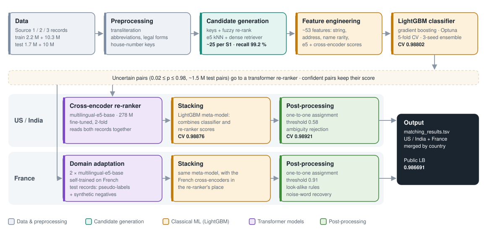

# ML Challenge 2026: Business Entity Resolution Solution

**Team Name:** Amizon  
**Team:** Team Amizon (GitHub: [Martial-Gautam](https://github.com/Martial-Gautam), [gitswagata1](https://github.com/gitswagata1))  
**Submission Date:** 27 September 2026

---

## 1. Executive Summary

We find each business's copies in three steps: gather a small set of likely candidates, score every candidate pair
with a LightGBM model, and have a multilingual transformer cross-encoder take a second look at the pairs the model is
unsure about. France never appears in training, so we taught the cross-encoder French by fine-tuning it on pairs built
from the unlabelled French test records. The final submission scores **0.986691** on the public leaderboard (macro
F0.5), with a cross-validated **0.98921** on US and India, using no external data.

---

## 2. Methodology

### 2.1 Problem Analysis

The training data has 2.2 million Source 1 businesses and 10.3 million Source 2/3 records from the US and India. The
test set adds France (15 % of the 1.7 million test businesses), with no French examples to learn from.

**Exploratory data analysis (EDA)** showed:

- **The data follows the same recipe in every country.** US and India both have 3.46 true copies per business, 5.6 %
  of businesses with no copy at all, and 74 % of Source 2/3 records matched. So what the model learns on US and India
  should carry over to France.
- **Copies never cross countries,** so candidates are searched within one country at a time.
- **Names are noisy in predictable ways:** typos, digits for letters (`Freed0m`), website-style names
  (`rajsoftware.com`), legal forms (Pvt Ltd, LLC, SARL), and Indian names written in native scripts. The native-script
  words come from a small vocabulary (2,000 words cover 98.6 %), so a dictionary learned from training pairs translates
  them.
- **Some copies change one word on purpose.** A copy often swaps its last word for *center*, *services* or *partners*;
  decoy records add a word such as *groupe* or *holding* and sit at a nearby house number.
- **France is harder:** it has 10–40 times more businesses with near-identical names at the same address, so a wrong
  match is easier to make there.
- **Addresses are often partial or empty,** and many small businesses share generic names.

### 2.2 Solution Strategy

**Approach Type:** Blocking + classifier + cross-encoder re-ranking (hybrid).  
**Formulation:** pairwise classification followed by constrained assignment: generate a few candidates per business,
score each pair with the probability that both records are the same business, and accept pairs above a threshold with
every Source 2/3 record assigned to at most one business. Because France has no labels, France is also an
**unsupervised domain adaptation** problem; country is treated as an open set and never one-hot encoded.  
**Core Innovation:** A transformer cross-encoder re-reads the uncertain pairs. For France, a country the model never
saw, the same cross-encoder is adapted by self-training on the unlabelled French test records, with synthetic
look-alikes that mimic how the data was generated.

<picture>
  <source media="(prefers-color-scheme: dark)" srcset="../code/business_entity_resolution/docs/pipeline-dark.svg">
  
</picture>

The models doing the heavy lifting:

| Model | Size | What it does |
|---|---|---|
| `intfloat/multilingual-e5-base` cross-encoder | 278 M parameters | reads both records of an uncertain pair together and judges whether they are the same business; two French-adapted copies handle France |
| `intfloat/multilingual-e5-small` dense retriever | 118 M parameters | fine-tuned to find a business's copies by meaning, for candidates that share no keyword |
| `intfloat/multilingual-e5-small` cross-encoder and embeddings | 118 M parameters | quick neural similarity signals for every candidate pair |
| LightGBM | gradient-boosted trees | the main matcher over all features, and the model that combines its score with the cross-encoder's |

All models are MIT-licensed and far below the 8 billion parameter limit.

**Data preprocessing:** before anything else, every record is cleaned and normalised: native scripts are transliterated
to Latin letters, abbreviations expanded, legal forms removed, and house numbers extracted.

### 2.3 Validation Setup

- **5-fold GroupKFold grouped by business:** all candidates of one Source 1 business stay in the same fold, so the model
  is never validated on a business it trained on. A plain split over pairs would leak between pairs of the same business.
- **The CV score is the competition metric itself:** macro F0.5 over all sampled businesses, including singletons and
  businesses whose true copies were not found. Thresholds are chosen on out-of-fold predictions over a grid from 0.20 to
  0.94 in steps of 0.02.
- **No leakage from the neural features:** the small cross-encoder and the dense retriever are trained only on 99,948
  businesses that the LightGBM matcher never trains or validates on; the e5-base re-ranker is trained twice, once per half
  of the businesses, and each model scores only the half it did not see.
- **Unseen-country checks:** training on one country and scoring the other (US → India, India → US) simulates France. An
  early matcher scored 0.822 / 0.946 this way; the later matcher with the cross-encoder feature scored 0.937 / 0.969.
- **Acceptance rule:** a change was kept only for a CV gain above noise (about +0.0005), then checked on the leaderboard.

---

## 3. Candidate Generation (Blocking)

Comparing every Source 1 business with every Source 2/3 record would mean trillions of pairs, so we first pick about 25
likely candidates per business, always within the same country.

- **Blocking keys used:** words of the normalised name, consonant "skeletons" of names (robust to typos), name + street
  + house number combinations, and address word pairs. Keys are weighted by rarity (IDF), the best 1,500 records are
  re-ranked by fuzzy string similarity, and the top 20 are kept. Extra sources add what keys miss:
  - the 5 nearest records by `multilingual-e5-small` embedding similarity;
  - the 10 nearest records by our dense retriever, fine-tuned with contrastive learning and hard negatives;
  - a rescue rule that keeps a pair when the Source 1 business is that record's best match (+0.0010 CV);
  - a rule for records with an empty address whose name is unique among the country's businesses (97.6 % of these
    pairs are true matches; it recovers 4.9 % of the matches the other sources missed).
- **Candidate pairs generated:** 43.9 million test pairs, about 25 per business.
- **How you ensured true matches were not lost:** each source was kept only if it found enough extra true matches for
  the pairs it added, measured on training data. The remaining misses are mostly records with an empty address and a
  common name, which the data itself cannot resolve.

| Version | Change | Candidate recall |
|---|---|:---:|
| v1 | composite-key blocking | 81 % |
| v2 | pool of 300 + fuzzy re-rank to top 20 | 90 % |
| v3 | street-name and digit-drop address keys, pool of 600 | 93.0 % |
| v8 | pool of 1,500, partial-address keys | 96.6 % |
| v9 | native-script dictionary, rescue rule, e5 neighbours, empty-address rule | 97.8 % |
| v10 | fine-tuned dense retriever | **99.2 %** |

**Candidate set size.** Since smaller candidate sets rank higher in the final evaluation, we keep the top 20 from the key
source, not 30: the same CV (0.9487 against 0.9489) with 33 % fewer pairs. Keeping only 10 cost too much (0.9468).

---

## 4. Matching Model

**Features used (feature engineering):**
- Name features: fuzzy string ratios (RapidFuzz) on the full name, the name without legal words, and its consonant
  skeleton; Jaro-Winkler; character 3-gram TF-IDF cosine; **name rarity**, meaning how many businesses and records share
  the exact name (our largest single feature gain, +0.0038 CV).
- Address features: fuzzy address ratios, postcode agreement, house-number overlap, empty-address flags.
- Other: how the candidate was found (key score, rank, neighbour similarity); `multilingual-e5-small` similarity of
  names and of addresses; the score of a small `multilingual-e5-small` cross-encoder trained on 99,948 businesses that
  the matcher never trains on, so the feature is never over-optimistic.

**Model type:** gradient-boosted trees and fine-tuned transformers, combined by stacking.
1. **LightGBM matcher (gradient boosting):** hyperparameters tuned with Optuna, trained on 2.1 million businesses with
   5-fold GroupKFold cross-validation, final model an ensemble of 3 seeds. It scores all 43.9 million pairs: CV 0.98802.
2. **Cross-encoder re-ranker and stacking:** the 1.5 million pairs with a probability between 0.02 and 0.98 go to a
   `multilingual-e5-base` cross-encoder, fine-tuned (transfer learning) to read both records at once. It is trained twice, on each half of the
   businesses, so no training pair is scored by a model that saw it. A LightGBM meta-model
   stacks the matcher's and the cross-encoder's scores: CV 0.98876.
3. **Domain adaptation for France (self-training):** we built 885,573 French training pairs from the test records alone.
   Pseudo-labelled positives are 300,000 French pairs the model is at least 99.5 % sure of; synthetic hard negatives
   (data augmentation) are look-alikes made the way the data
   was generated (one generic word swapped, decoy words at a nearby house number). Both cross-encoders were fine-tuned
   on them for one epoch, and their ensemble average replaces the re-ranker for French pairs (about +0.011 on France on the
   leaderboard).

**Training details:**

| Model | Key settings |
|---|---|
| LightGBM matcher | Optuna-tuned: learning rate 0.041, 286 leaves, min child samples 175, feature fraction 0.50, bagging 0.95, L1 0.096, L2 3.16, positive-class weight 1.21, 1,202 trees; average of 3 seeds |
| Dense retriever (e5-small) | contrastive InfoNCE loss, temperature 0.05, 4 epochs, learning rate 3e-5, 256 queries per batch, one hard negative per query |
| Small cross-encoder (e5-small) | 2.94 M pairs, 1 epoch, learning rate 5e-5, max length 96 tokens |
| Re-ranker cross-encoder (e5-base) | one model per half of the businesses, 1 epoch, learning rate 3e-5, batch 64 |
| French cross-encoders (e5-base) | 885,573 French pairs, 1 epoch, learning rate 2e-5, batch 64 |
| Stacking meta-model | LightGBM, 200 trees, 15 leaves, learning rate 0.05 |

**Threshold selection method (post-processing):** each Source 2/3 record goes to at most one business, its most probable
one (one-to-one assignment). The US/India threshold (0.58) maximises macro F0.5 on out-of-fold predictions; a match is also dropped when a second
business scores almost as high (at least 0.5 and within 0.2), which brings CV to **0.98921**. France has no labels, so
its threshold (0.91) was chosen with a probability-calibration model fitted to leaderboard results. For France we also reject
a match whose name differs from the business's name by one common word (a typical look-alike), unless that word is a
known noise word such as *Services* or *Associés* and both French models are confident.

France uses the model version without the dense retriever: the retriever's extra French candidates were mostly
look-alikes and cost France 0.004.

---

## 5. Results & Error Analysis

- **F_0.5 Score (macro):** **0.98921** cross-validated on US and India; **0.986691** on the public leaderboard.

| Version | Main change | Recall | CV F0.5 | Public LB |
|---|---|:---:|:---:|:---:|
| v3 | composite keys, fuzzy re-rank | 93.0 % | 0.9487 | 0.936 |
| v7 | TF-IDF, embeddings, tuned LightGBM, small cross-encoder | 92.6 % | 0.9603 | 0.953 |
| v8 | larger candidate pool, address keys, all training businesses | 96.6 % | 0.9804 | 0.9739 |
| v9 | dictionary, neighbours, rarity features, e5-base re-ranker, French cross-encoder and rules | 97.8 % | 0.98693 | 0.9839 |
| v10 | dense retriever, 3 seeds, tuned US/India threshold | 99.2 % | 0.98921 | 0.9853 |
| final | France from v9 with two French cross-encoders, threshold 0.91, noise-word recovery | 99.2 % | 0.98921 | **0.986691** |

A diagnostic upload with the French rows left empty measured the two parts separately: **US/India 0.9897** on the
leaderboard (slightly above CV) and **France 0.9673**.

- **Common false positives (wrong merges):** look-alike businesses at the same address whose names differ by one
  generic word (for example *Club* vs *Comité*), especially in France; and records with an empty address and a generic
  name that several businesses share.
- **Common false negatives (missed matches):** in France, copies whose noise the model never saw in training (French
  noise words, accents, reordered words), roughly 10 % of French copies; elsewhere, empty-address copies of businesses
  with common names, where two candidates are equally likely.

Tried and not kept, each measured: CatBoost blends, a LambdaRank re-ranker, an e5-large cross-encoder (−0.0004 on the
leaderboard), word TF-IDF features (−0.0017 on France), a second round of French self-training (−0.0002), and a learned
corrector for unseen countries.

---

## 6. Conclusion

Recall set the ceiling, so we added candidate sources one at a time and kept only those that paid for themselves. Name
rarity taught the matcher when "same name" really means "same business", and the multilingual-e5 cross-encoders gave
the biggest neural gains. France was the hardest part: with no labels, self-training the cross-encoder on French test
records brought the largest improvement, and better French recall is where the remaining gap lies.

---

## Appendix

### A. Code Artefacts

`code/business_entity_resolution/` holds the runnable pipeline. One command rebuilds both output files:

```bash
pip install -r code/business_entity_resolution/requirements.txt -r code/business_entity_resolution/requirements-gpu.txt
python code/business_entity_resolution/reproduce.py --data /path/to/student_resource
```

`src/` has normalisation, blocking, features, the cross-encoders and the core driver; `src/pipeline/` has one module
per later step (candidates, extra features, classifier, re-ranking, France, decisions). The `README.md` there lists the
requirements and steps. GPU steps need a CUDA GPU; `transformers` is pinned to 4.57.6 because later versions change the
cross-encoder scores.

### B. Additional Results: data use and fair play

Only the provided data is used. Everything learned from labels (matcher, cross-encoders, dictionary, thresholds) is
fitted on training data only. Label-free statistics use each split's own text: the character TF-IDF is fitted on
training and test names, and rarity counts and neighbour searches run within each split. The French cross-encoders are
fine-tuned on pairs built from the French test records, using their text only, never labels; the organisers confirmed
this self-training is allowed. The French decisions were checked with public-leaderboard uploads and with simulations on
training data.

### C. Scale and Robustness

- **Large-scale processing:** each TSV is streamed into Parquet files, and later steps use Polars lazy scans, so the
  20 million records never have to sit in memory at once. Nearest-neighbour search is an exact cosine search on the GPU,
  one country at a time, so no approximate index (such as FAISS) is needed. Transformer inference runs in half precision
  with length-sorted batches to avoid padding. Peak memory was about 36 GB on a 32-core, 54 GB machine.
- **Resumable runs:** every stage caches its output, and `reproduce.py` skips any step whose output already exists.
- **Unseen countries:** no country one-hot encoding or hard-coded country lists, candidate search per country, a
  multilingual encoder, and French adaptation built only from French test text.
- **Missing and noisy fields:** empty-address flags, the empty-address candidate rule and name-rarity features for
  missing addresses; transliteration, accent removal, the native-script dictionary, digit-for-letter repair,
  abbreviation expansion, consonant skeletons and character n-gram features for noisy names.
